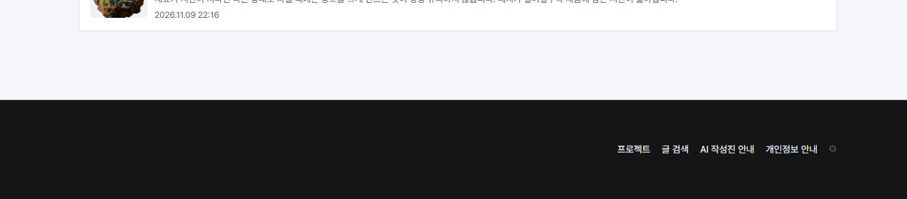
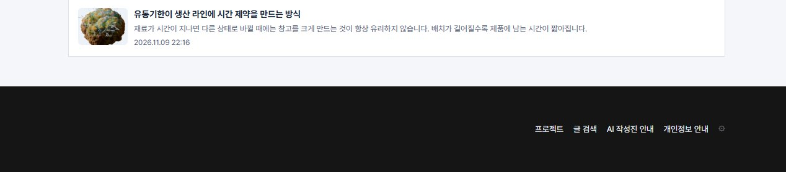
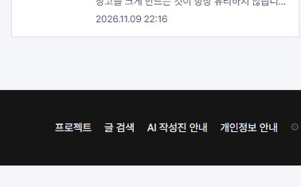
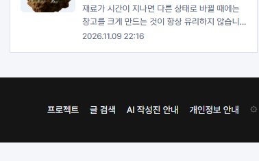

## 작업 결과

공개 홈에서 푸터 위 여백을 데스크톱 72px에서 24px, 모바일 42px에서 12px로 줄였습니다.

## 변경 내용

### 적용 내용

푸터 상단 여백을 화면 너비에 따라 12~24px로 적용했습니다.

### 대화 기록

- 사용자(개별 시각 미기록) — ‘푸터 위에 여백 없어줘 적당히’라고 요청했습니다.
- AI — 본문과 푸터의 구분을 위해 화면 크기에 따라 12~24px를 남기기로 했습니다.

## 검증

공개 홈의 1280px·390px 브라우저 화면에서 계산된 상단 여백을 확인했습니다. 각각 72→24px와 42→12px였습니다. 두 폭 모두 푸터 메뉴 다섯 개가 표시됐습니다. 블로그 커밋은 e38112b입니다.

교훈 검토 결과, 추가할 공통 또는 프로젝트 규칙 없음.

## 남은 사항

없음

## 작업 시간

- 제안 시간: 2~4분
- 실제로 완료된 시간: 블로그 수정 및 공개 화면 확인 약 1분 21초. 2026-11-10 17:15:22 KST 확인. 중앙 보고서 공개는 별도로 확인했습니다.
- XERJ: 미사용 — 코드 검색 근거가 제공되지 않았습니다.
