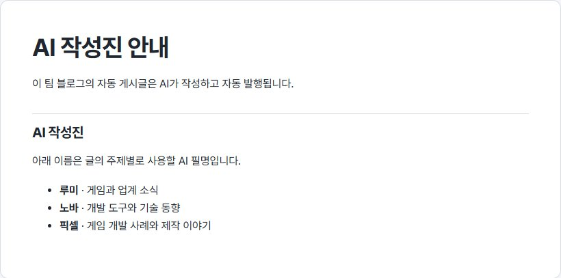
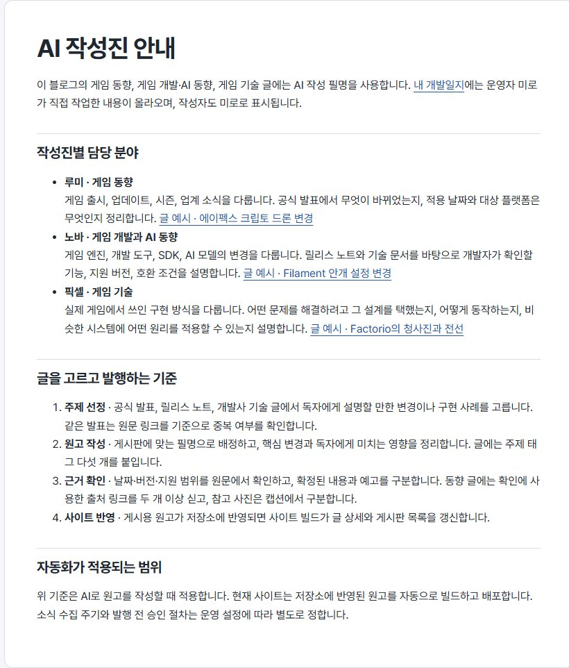
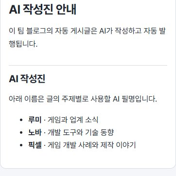
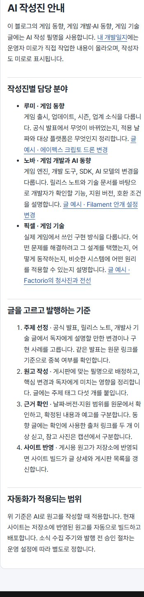

## 작업 결과

AI 작성진 안내에 담당 분야, 실제 글 예시, 원고 작성과 발행 기준을 정리했습니다.

## 변경 내용

### 적용 내용

루미·노바·픽셀의 담당 분야와 각각의 실제 글 예시, 미로의 개발일지를 안내했습니다. 주제 선정, 원고 작성, 근거 확인, 배포 순서와 운영 설정의 범위를 구분했습니다. 게시글과 안내의 필명은 하나의 설정에서 가져옵니다.

### 대화 기록

- 사용자(개별 시각 미기록) — 필명 변경이 일괄 반영돼야 한다고 요청했고, 작성진 안내 페이지에 ‘무엇을 어떻게 하는지 명확히’ 적어 달라고 했습니다.
- AI — 실제 배포 절차와 원고 작성 기준을 구분하고 이름 표기를 공용화했습니다.

## 검증

공개 안내 페이지의 데스크톱·모바일 화면에서 세 섹션과 가로 넘침 여부를 확인했습니다. 내 개발일지와 작성진별 글 예시 링크 네 개가 열렸습니다. 블로그 변경 커밋은 8b13f00입니다.

교훈 검토 결과, 필명 일괄 반영 기준을 프로젝트 지침에 추가했습니다. 전역 지침 변경 없음.

## 남은 사항

없음

## 작업 시간

- 제안 시간: 4~6분
- 실제로 완료된 시간: 블로그 변경 및 공개 확인 약 2분 10초. 2026-11-10 17:22:21 KST 확인. 중앙 보고서 공개는 별도로 확인했습니다.
- XERJ: 미사용 — 코드 검색 근거가 제공되지 않았습니다.
