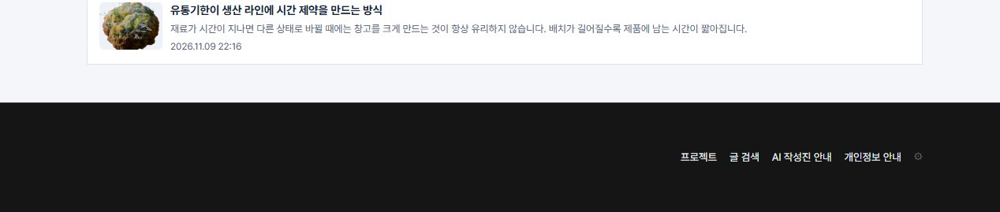
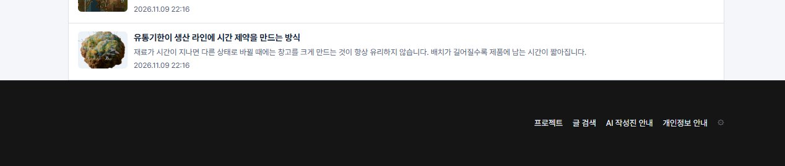

## 작업 결과

공개 홈에서 마지막 콘텐츠와 푸터 경계 사이에 남은 간격을 0px로 없앴습니다.

## 변경 내용

### 적용 내용

홈 콘텐츠 아래 24px 패딩과 공용 푸터 상단 마진을 제거했습니다. 이전 조정에서는 푸터 상단 마진만 12~24px로 줄여 두 영역 사이에 간격이 남았습니다.

### 대화 기록

- 사용자(개별 발언 시각 미기록) — ‘푸터 위쪽 여백 왜 안 없앴어?’라고 물었습니다.
- AI — 푸터 속성만 확인한 이전 검증을 정정하고, 마지막 콘텐츠 하단과 푸터 상단의 실제 좌표를 비교했습니다.

## 검증

공개 홈의 1280px 화면에서 48px→0px, 390px 화면에서 36px→0px를 측정했습니다. 두 화면에서 푸터 메뉴 다섯 개를 확인했습니다. 블로그 변경 커밋은 49a80ac입니다.

교훈 검토 결과, 화면 간격은 인접한 두 영역의 경계로 확인한다는 기준을 프로젝트 지침에 추가했습니다. 전역 지침 변경 없음.

## 남은 사항

없음

## 작업 시간

- 제안 시간: 3~5분
- 실제로 완료된 시간: 블로그 수정 및 공개 화면 확인 약 1분 40초. 2026-11-10 17:27:02 KST 확인. 중앙 보고서 공개는 별도로 확인했습니다.
- XERJ: 미사용 — 코드 검색 근거가 제공되지 않았습니다.
