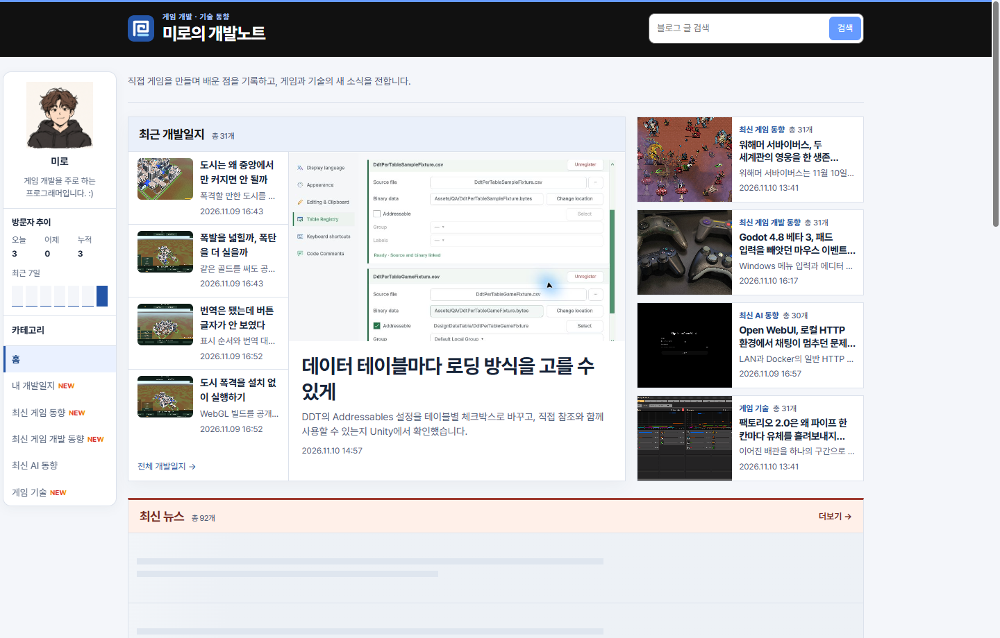
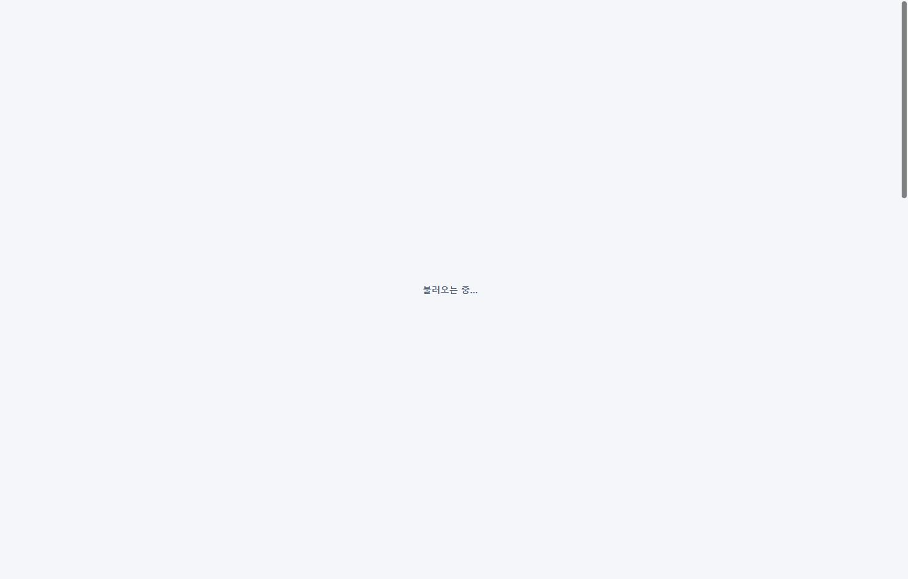
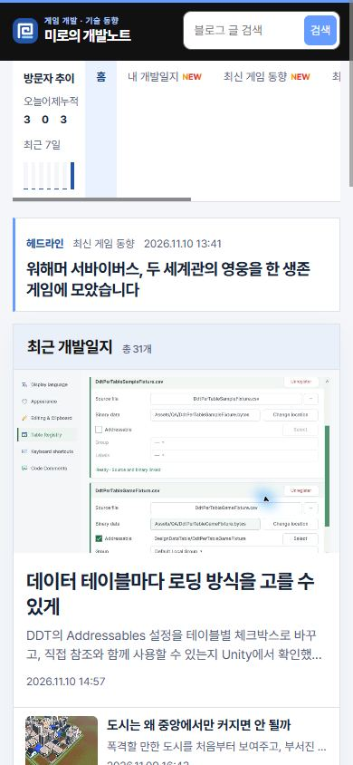

## 작업 결과

PC와 모바일의 공개 홈에서 헤드라인이 표시되고 해당 기사로 이동합니다.

## 변경 내용

### 적용 내용

홈 상단의 고정 소개 문구를 기사 제목, 분류, 발행 시각이 표시되는 링크로 변경했습니다. build.mjs의 홈 생성부는 최신 뉴스 목록과 같은 정렬을 사용하고, style.css는 하늘색 세로선과 작은 화면에서 줄바꿈되는 제목을 적용합니다.

```js
const allNews=posts.filter(post=>post.section.endsWith('-news'));
const homeHeadline=allNews[0];
```

### 대화 기록

- 사용자 — 기존 소개 문구를 “뉴스 사이트 처럼 헤드라인 하는 곳으로 변경”해 달라고 요청했습니다.
- AI — 뉴스 목록 첫 기사의 제목과 발행 정보를 보여 주고 기사 본문에 연결했습니다.

## 검증

커밋 2de75e6을 푸시했습니다. 공개 홈에서 PC 1440px와 모바일 390px의 헤드라인 배치를 확인했습니다. 모바일 화면에서 제목을 눌러 같은 제목의 기사 본문이 열리는 것을 확인했습니다.







## 남은 사항

모바일 수정 전 화면은 별도로 확보하지 못했습니다. 전역·프로젝트 지침에 추가할 교훈은 없습니다.

## 작업 시간

- 제안 시간: 수정과 로컬 확인 약 1~2분
- 실제로 완료된 시간: 블로그 공개 확인까지 약 2분 18초. 2026-11-10 17:34:49 KST
- XERJ: 미사용 — 코드 검색 근거가 제공되지 않았습니다.
