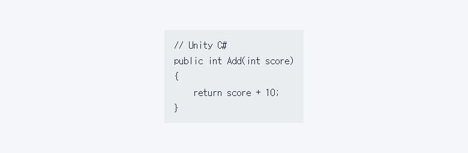
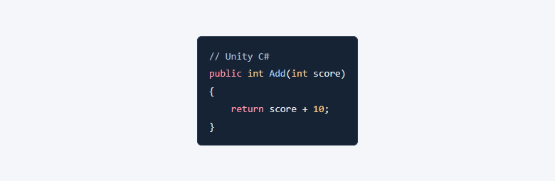

## 작업 결과

빌드와 사이트 검증을 마치고 블로그 main에 24ae625를 푸시했습니다.

## 변경 내용

### 적용 내용

사용자 요청 원문(시각 미기록) — ‘게시물에 코드 하이라이터 넣어줘 앞으로 쓸 거임’

AI 조치 — build.mjs의 MarkdownIt 설정에 Highlight.js를 연결했습니다. 이전에는 언어가 지정돼도 일반 코드로 렌더링됐습니다. 이제 지원 언어의 코드 블록은 빌드할 때 색상 토큰으로 바뀌고, 그 외 코드는 마크다운 렌더러가 일반 텍스트로 표시합니다.

```javascript
highlight(code, language) {
  return language && hljs.getLanguage(language)
    ? hljs.highlight(code, { language, ignoreIllegals: true }).value
    : '';
}
```

## 검증

175페이지, 154개 게시물과 이미지 참조 214개를 검사했고 끊어진 링크는 0개입니다. C# 토큰과 미지원 언어 이스케이프를 확인했습니다.





## 남은 사항

캡처는 공개 글에 예제를 추가하지 않고, 기존과 새 렌더러를 사용한 브라우저 검증 화면입니다. 보고서 작성 시점에는 운영 확인 중입니다. 전역 및 프로젝트 지침은 변경하지 않았습니다.

## 작업 시간

- 제안 시간: 수정 및 배포 확인 3~5분
- 실제로 완료된 시간: 첫 확인 17:34:24 KST, 수정·푸시 17:36:11 KST, 약 1분 47초, 2026-11-10.
- XERJ: 미사용 — 코드 검색 근거가 제공되지 않았습니다.
