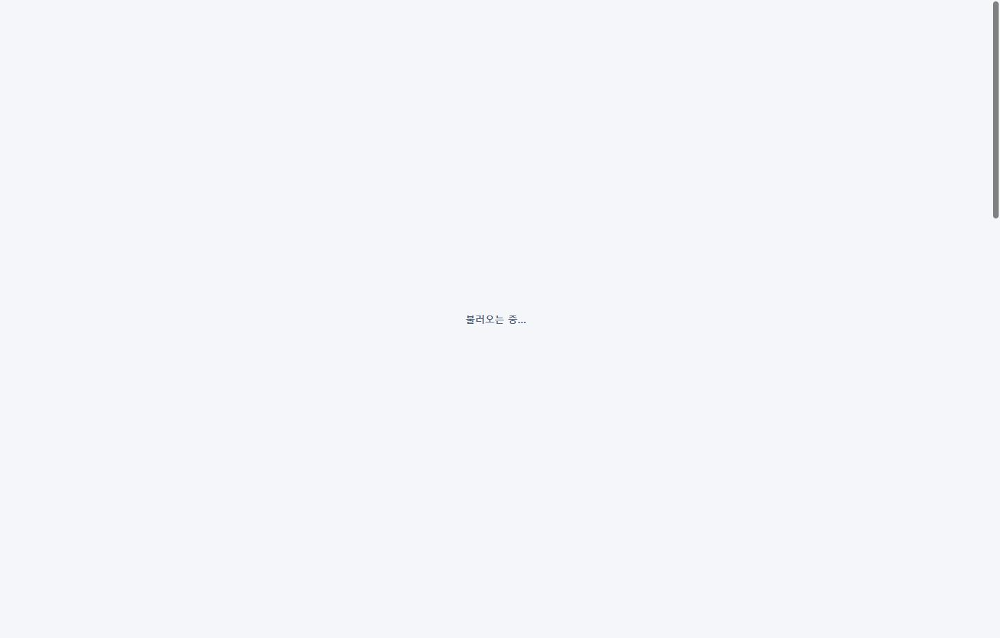
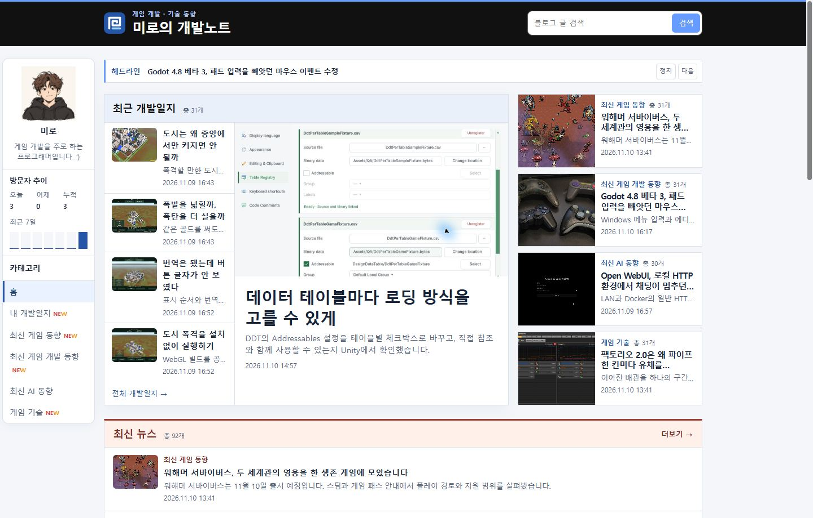
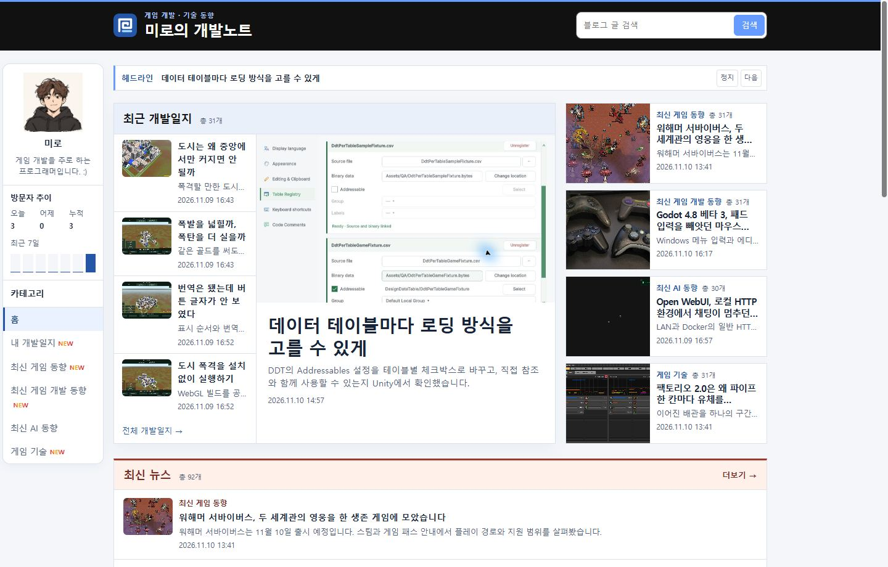
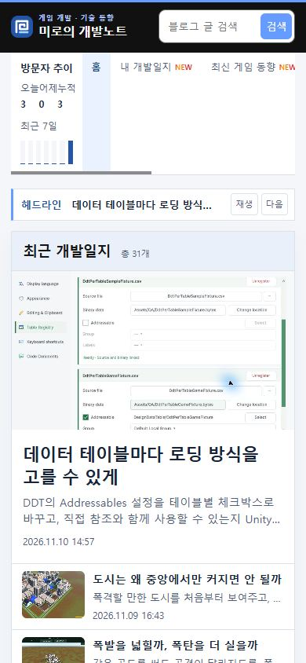

## 작업 결과

공개 홈에서 자동 전환, 정지, 다음 버튼과 기사 이동을 확인했습니다.

## 변경 내용

### 적용 내용

build.mjs의 홈 생성부가 발행 시각을 기준으로 게시물 다섯 개를 고릅니다. headline-ticker.js의 advance는 현재 제목을 숨긴 뒤 다음 제목 한 개만 보여 줍니다. 기본 간격은 4초이며, 정지 또는 제목에 포인터나 키보드 포커스가 있는 동안 자동 전환을 멈춥니다. 모션 줄이기 환경에서는 정지 상태로 시작합니다.

```js
const homeHeadlines=posts.toSorted((a,b)=>publishedTime(b)-publishedTime(a)).slice(0,5);

function advance() {
  headlines[current].hidden = true;
  current = (current + 1) % headlines.length;
  headlines[current].hidden = false;
}
```

### 대화 기록

- 사용자 — “최신 게시물 여러개를 헤드라인 하나씩 지나가게 작은 글씨로 디자인해줘”
- AI — 최신 다섯 글을 한 줄 티커에 배치하고 정지와 다음 기능을 추가했습니다.

## 검증

커밋 de0359d를 푸시했습니다. 공개 Chrome에서 Godot 기사 다음에 개발일지가 표시됐고, 정지 상태에서 제목이 유지됐습니다. 모바일 모션 줄이기 환경에서는 다음 버튼으로 글을 넘기고 해당 기사로 이동했습니다. 검증 브라우저에서 외부 광고와 폰트 요청을 제외했습니다.










## 남은 사항

전역·프로젝트 지침에 추가할 교훈은 없습니다.

## 작업 시간

- 제안 시간: 수정과 로컬 확인 약 2분
- 실제로 완료된 시간: 블로그 공개 확인까지 약 4분 11초. 2026-11-10 17:41:53 KST
- XERJ: 미사용 — 코드 검색 근거가 제공되지 않았습니다.
