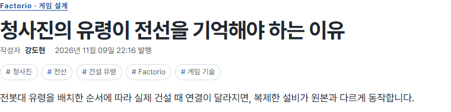
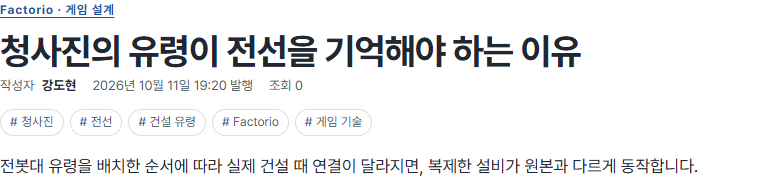
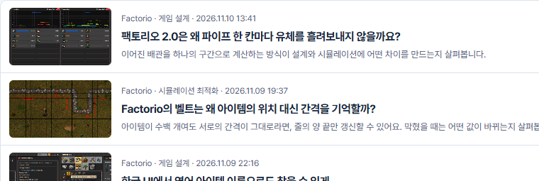
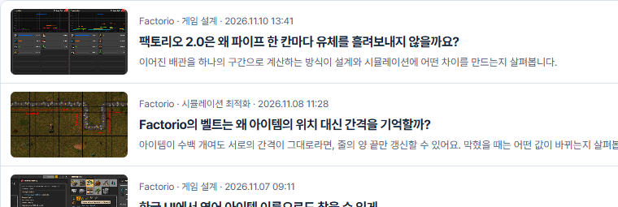

## 작업 결과

운영 Chrome에서 게시물 조회수와 게시판 발행 시각을 확인했습니다.

## 변경 내용

### 적용 내용

사용자 요청 원문(시각 미기록) — ‘게시물에 조회수 보이게 해줘’, ‘적당히 분포해놔 사람들 활동하는 시간에’.

AI 조치 — 상세 화면의 발행 정보 옆에 조회수를 표시했습니다. visitor-summary/worker.mjs에서 게시물별로 카운터를 분리했습니다. build.mjs는 기존 150개 글의 실제 등록 정보를 보존하면서 편집 날짜 기반의 공개 표시 시각을 우선합니다.

```javascript
const displayDate = post.displayPublished || post.published;
const counter = env.POST_VIEWS.getByName(slug);
const views = record ? await counter.increment() : await counter.count();
```

## 검증

게시물 154개, 페이지 175개, 이미지 참조 214개, 끊어진 링크 0개. 30일간 표시 시각 150개가 모두 다릅니다. 공개 조회수 읽기와 기존 방문자 API 응답을 확인했습니다.









## 남은 사항

공개 조회수는 기능 적용 이후부터 집계합니다. 과거 GA4 수치는 이관하지 않았습니다. 전역 및 프로젝트 지침 변경은 없습니다.

## 작업 시간

- 제안 시간: 구현과 배포 확인 6~9분
- 실제로 완료된 시간: 첫 확인 17:39:01 KST, 운영 Chrome 확인 17:44:43 KST, 약 5분 42초, 2026-11-10.
- XERJ: 미사용 — 코드 검색 근거가 제공되지 않았습니다.
