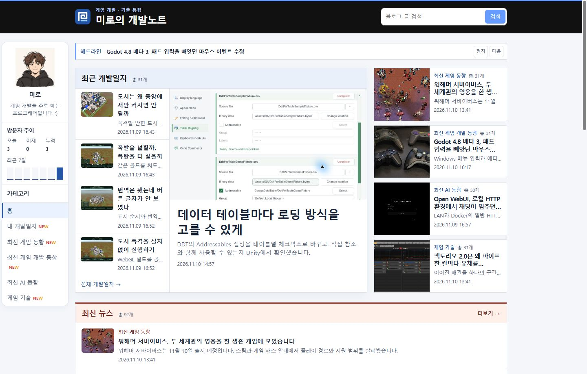
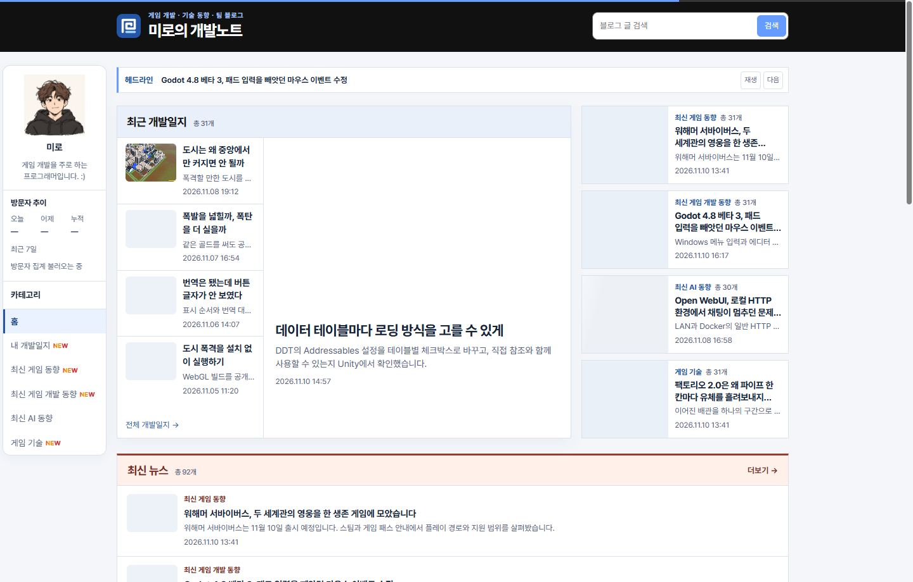
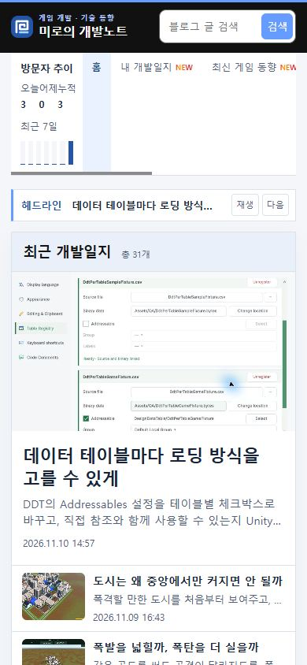
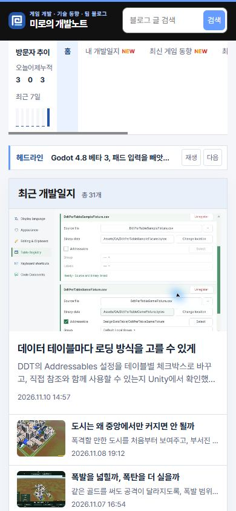

## 작업 결과

공개 홈에서 PC와 모바일 제목 크기를 확인했습니다.

## 변경 내용

### 적용 내용

style.css의 .press-lead h3 글자 크기 범위를 줄였습니다. 큰 화면에서는 22px까지, 작은 화면에서는 18px로 표시됩니다.

```css
.press-lead h3 {
  margin-top: 16px;
  font-size: clamp(1.125rem, 1rem + .45vw, 1.375rem);
}
```

### 대화 기록

- 사용자 — “가운데 이 게시물 제목이 너무 커 적당히 조절 좀”
- AI — 홈 가운데 대표 카드 제목만 작게 조정했습니다.

## 검증

커밋 2445cb6을 푸시했습니다. 공개 Chrome에서 1440px 화면의 제목이 22px, 390px 화면의 제목이 18px로 표시되는 것을 확인했습니다.









## 남은 사항

전역·프로젝트 지침 변경은 없습니다.

## 작업 시간

- 제안 시간: 수정과 로컬 확인 약 30초
- 실제로 완료된 시간: 블로그 공개 확인까지 약 1분 5초. 2026-11-10 17:45:38 KST
- XERJ: 미사용 — 코드 검색 근거가 제공되지 않았습니다.
