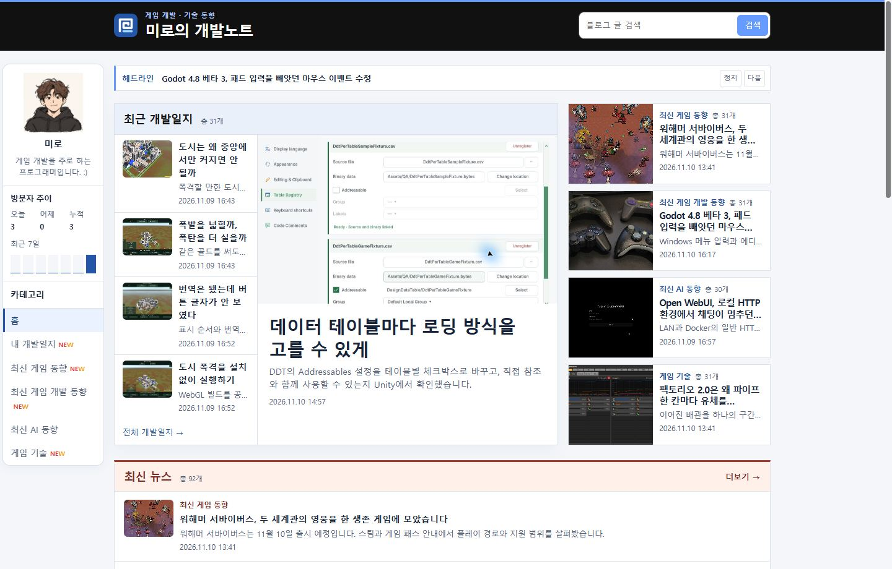
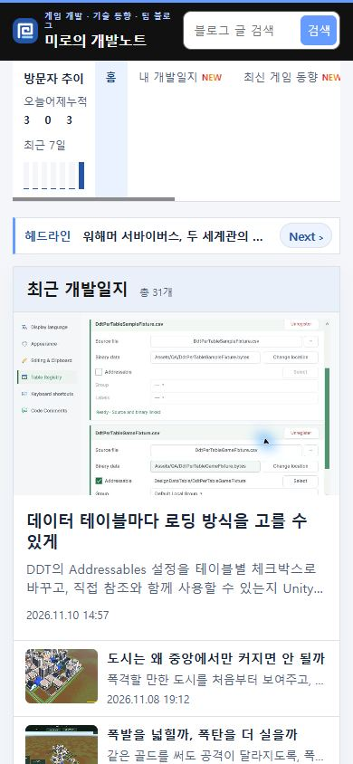

## 작업 결과

공개 PC·모바일에서 자동 전환과 Next 동작을 확인했습니다.

## 변경 내용

### 적용 내용

headline-ticker.js는 페이지를 열면 4초 타이머를 시작합니다. Next를 누르면 즉시 다음 제목을 열고 타이머를 다시 시작합니다. 키보드 포커스가 제목 위에 있거나 탭이 숨겨진 동안 전환을 건너뜁니다. build.mjs에서 재생 버튼을 제거했습니다. style.css는 제목이 오른쪽에서 들어오도록 조정했고, 모션 줄이기 설정에서는 자동 전환을 유지하며 이동 효과만 생략합니다.

```js
function rotate() {
  if (!document.hidden && !list.matches(':focus-within')) advance();
}

next.hidden = false;
let timer = setInterval(rotate, 4000);
next.addEventListener('click', () => {
  advance();
  clearInterval(timer);
  timer = setInterval(rotate, 4000);
});
```

```css
@keyframes headline-enter { from { transform: translateX(20%); opacity: 0; } }
```

### 대화 기록

- 사용자 — “헤드라인은 항상 자동 재생해줘”, “넘어갈때 옆으로 넘어가는 애니”, “다음은 Next”
- AI — 기존 4초 간격을 유지하고 재생 버튼을 제거했습니다.

## 검증

티커 커밋 1d4abfc를 푸시했습니다. 로컬에서 Mermaid 스크립트 허용 목록 누락을 재현했고, 후속 원격 커밋 2963eaf의 검증 변경으로 배포 검사 175페이지가 통과했습니다. 공개 Chrome에서 PC 약 4.03초, 모바일 약 3.95초에 다음 제목을 확인했습니다. 두 화면에서 Next만 표시됐고, PC에서 translateX(20%)로 들어왔습니다. 검증 브라우저에서는 외부 광고와 폰트 요청을 제외했습니다.






## 남은 사항

전역·프로젝트 지침 변경은 없습니다.

## 작업 시간

- 제안 시간: 수정과 로컬 확인 약 1분
- 실제로 완료된 시간: 블로그 공개 확인까지 약 4분 59초. 2026-11-10 17:54:34 KST
- XERJ: 미사용 — 코드 검색 근거가 제공되지 않았습니다.
