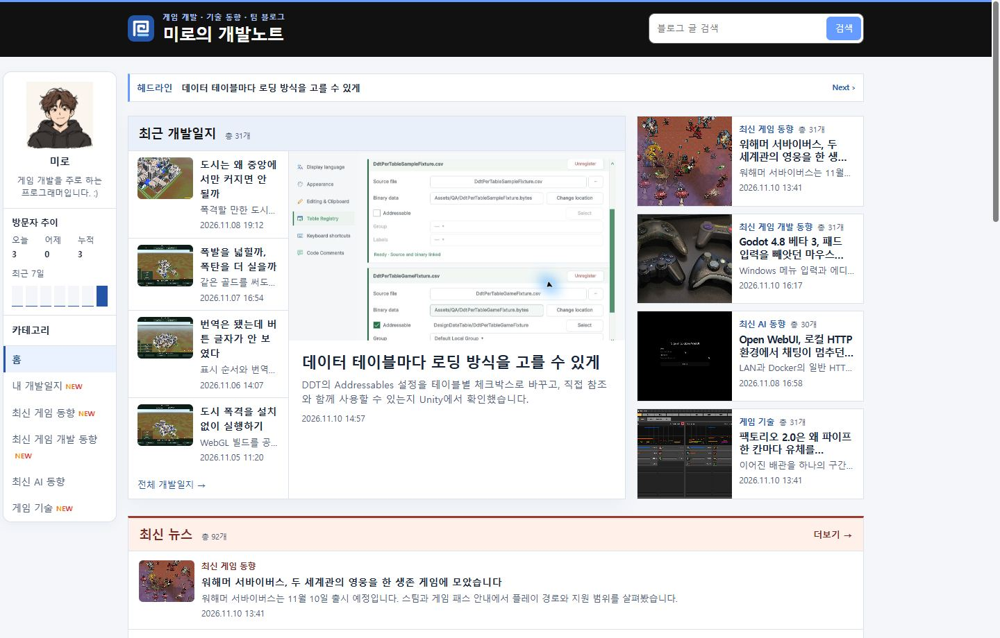
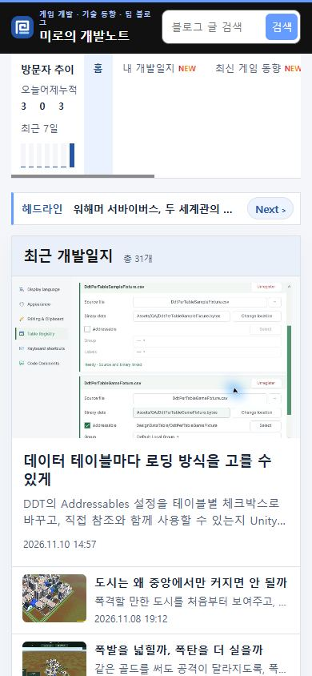

## 작업 결과

공개 PC·모바일에서 Next 모양과 자동·수동 가로 전환을 확인했습니다.

## 변경 내용

### 적용 내용

style.css의 Next 버튼을 11px 텍스트로 바꾸고 배경과 테두리를 제거했습니다. 이전 공개 CSS는 모션 줄이기 설정에서 티커 애니메이션을 적용하지 않았습니다. 이제 일반 설정에서는 420ms 동안 오른쪽에서 들어오고, 모션 줄이기에서는 12px만 220ms 동안 이동합니다. 자동 재생 간격은 4초입니다.

```css
.press-masthead li:not([hidden]) {
  --headline-slide-distance: 24%;
  animation: headline-enter 420ms ease-out;
}
@media (prefers-reduced-motion: reduce) {
  .press-masthead li:not([hidden]) {
    --headline-slide-distance: 12px;
    animation-duration: 220ms;
  }
}
@keyframes headline-enter {
  from { transform: translateX(var(--headline-slide-distance)); opacity: 0; }
}
```

### 대화 기록

- 사용자 — “next는 작게해줘”, “배경이랑 테두리도 지우고”, “애니메이션 안됨”
- AI — 버튼을 텍스트로 정리하고, 두 모션 설정에서 가로 이동을 확인했습니다.

## 검증

커밋 7fab0b5와 8c512d4를 푸시했습니다. 공개 Chrome에서 PC와 모바일 모두 Next가 11px, 투명 배경, 0px 테두리임을 확인했습니다. Next 클릭과 자동 전환에서 PC translateX(24%) 420ms 및 모바일 모션 줄이기 translateX(12px) 220ms의 animationstart를 관찰했습니다. 검증 브라우저에서 외부 광고와 폰트 요청을 제외했습니다. 사용자의 브라우저 설정은 미확인입니다.







## 남은 사항

전역·프로젝트 지침 변경은 없습니다.

## 작업 시간

- 제안 시간: 버튼 수정과 로컬 확인 약 30초, 애니메이션은 후속 요청
- 실제로 완료된 시간: 블로그 공개 확인까지 약 3분 20초. 2026-11-10 18:04:49 KST
- XERJ: 미사용 — 코드 검색 근거가 제공되지 않았습니다.
