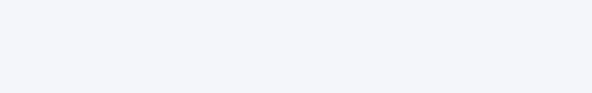

## 작업 결과

운영 홈에서 푸터 안쪽 위 0px, 아래 58px, 본문 사이 24px를 확인했습니다.

## 변경 내용

### 적용 내용

사용자 요청 요약(시각 미기록) — 푸터의 여백을 제거해 달라고 했고, 후속 캡처의 빨간 표시로 링크 위 검은 공간을 지목했습니다.

AI 조치 — 첫 수정은 푸터 안쪽 양쪽 여백을 제거했습니다. 후속 요청에 맞춰 style.css에서 본문 사이 간격과 링크 아래쪽 패딩을 복원하고 위쪽 패딩만 제거했습니다.

```css
.footer { margin-top: clamp(12px, 2vw, 24px); }
.foot { padding-block-end: clamp(34px, 5vw, 58px); }
```

## 검증

운영 Chrome 1440px 화면에서 푸터 내부 위 58px → 0px, 아래 58px 유지, 바깥 0px → 24px를 확인했습니다. 사이트 빌드·검사 통과.




## 남은 사항

전역·프로젝트 지침 변경은 없습니다.

## 작업 시간

- 제안 시간: 수정 및 배포 확인 2~4분
- 실제로 완료된 시간: 첫 확인 18:02:51 KST, 운영 Chrome 확인 18:06:14 KST, 약 3분 23초, 2026-11-10.
- XERJ: 미사용 — 코드 검색 근거가 제공되지 않았습니다.
