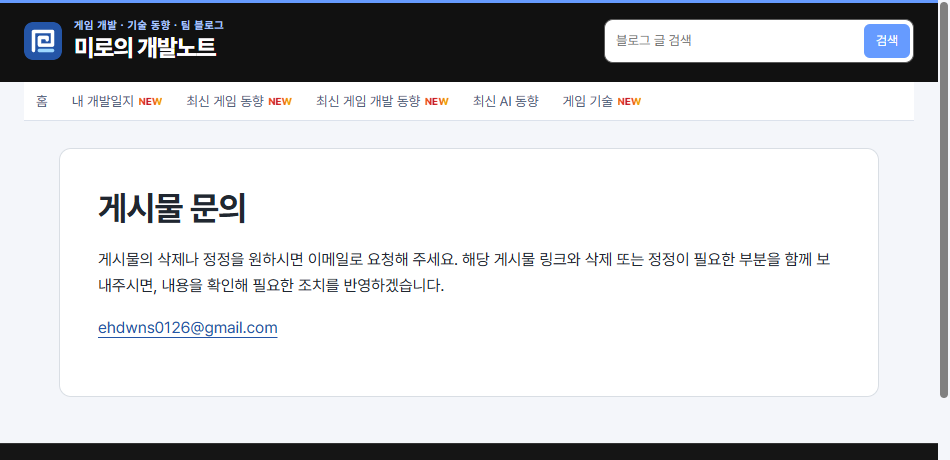

## 작업 결과

운영 문의 페이지와 푸터 링크를 확인했습니다.

## 변경 내용

### 적용 내용

사용자 요청 요약(시각 미기록) — 연락용 이메일을 설정 변수로 두고 삭제 요청을 확인해 반영한다는 안내와 링크를 추가해 달라고 요청했습니다.

AI 조치 — site.json의 contactEmail을 build.mjs에서 읽어 새 문의 페이지의 이메일 링크를 렌더링하고, 푸터에서 연결했습니다.

```javascript
const contactEmail = escape(settings.contactEmail);
```

## 검증

176페이지 빌드·링크 검사 통과. 운영 홈의 문의 링크, 안내 문구, 이메일 링크를 확인했습니다.



## 남은 사항

새 안내 페이지이므로 이전 버전에는 해당 페이지가 없었습니다. 푸터 변경 전 캡처는 미확보입니다. 전역·프로젝트 지침 변경은 없습니다.

## 작업 시간

- 제안 시간: 수정 및 배포 확인 2~4분
- 실제로 완료된 시간: 첫 확인 18:10:27 KST, 운영 확인 18:11:56 KST, 약 1분 29초, 2026-11-10.
- XERJ: 미사용 — 코드 검색 근거가 제공되지 않았습니다.
