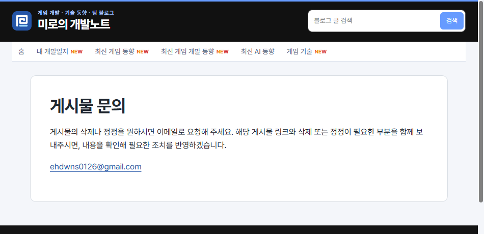
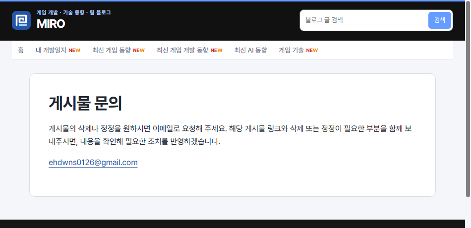

## 작업 결과

운영 문의 페이지의 제목이 MIRO로 표시되는 것을 확인했습니다.

## 변경 내용

### 적용 내용

사용자 요청 원문(시각 미기록) — ‘블로그 이름 그냥 MIRO로 해줘’.

AI 조치 — build.mjs의 공통 상단, 홈 제목, 페이지 제목 접미사와 문의 이메일 제목에 새 이름을 적용했습니다.

```javascript
publish('/', 'MIRO', '개발일지와 게임, 게임 개발, AI 동향', front, true);
```

## 검증

176페이지 빌드 및 링크 검사 통과. 같은 문의 페이지의 상단 이름 전후를 Chrome으로 확인했습니다.





## 남은 사항

전역·프로젝트 지침 변경은 없습니다.

## 작업 시간

- 제안 시간: 수정과 배포 확인 2~4분
- 실제로 완료된 시간: 첫 확인 18:14:26 KST, 운영 문의 페이지 캡처 18:15:49 KST, 약 1분 23초, 2026-11-10.
- XERJ: 미사용 — 코드 검색 근거가 제공되지 않았습니다.
