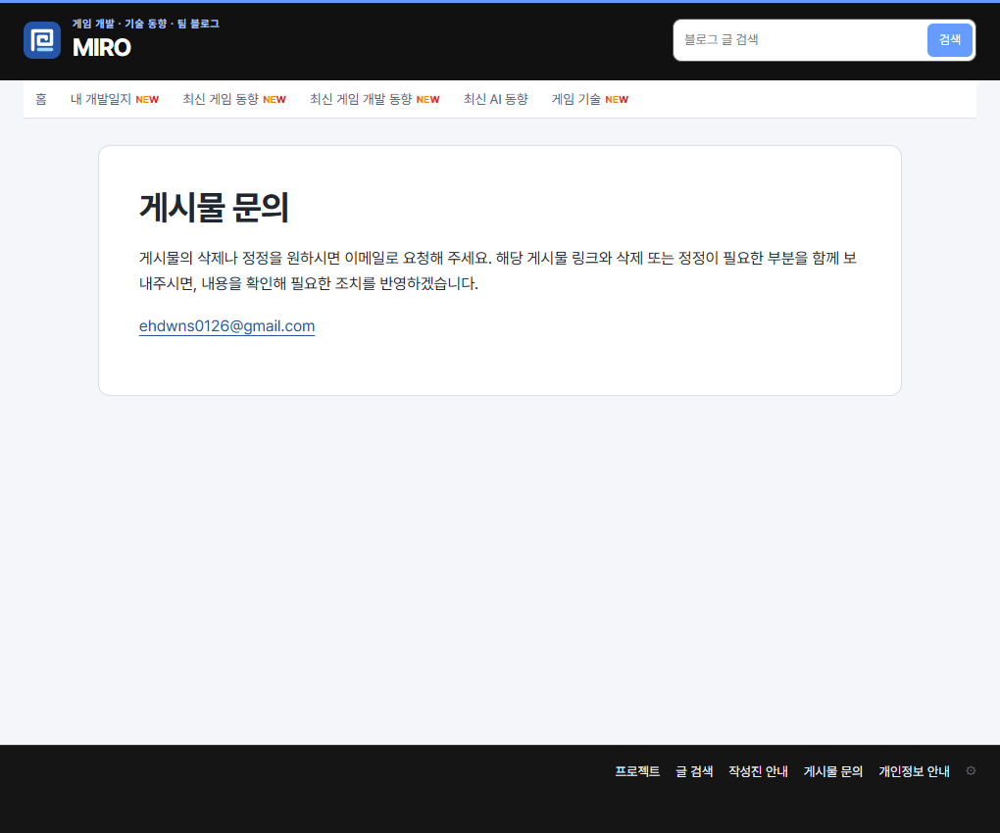
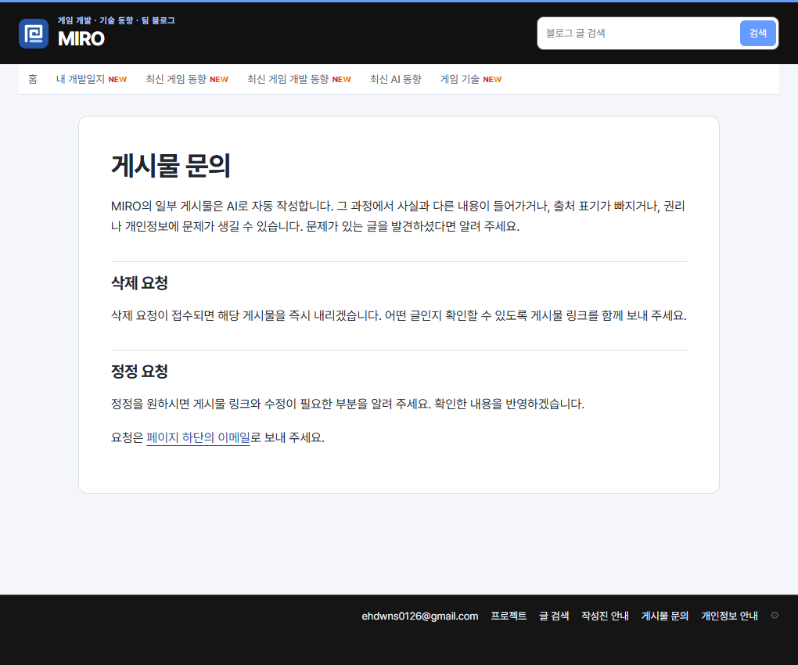

## 작업 결과

운영 홈 푸터의 이메일 링크와 문의 페이지의 즉시 삭제 문구를 확인했습니다.

## 변경 내용

### 적용 내용

사용자 정정 요약(시각 미기록) — 이메일은 블로그 하단에 표시하고, AI 자동 작성 게시물에 문제가 있으면 요청 접수 즉시 삭제한다고 안내해 달라고 했습니다.

AI 조치 — build.mjs 공통 푸터가 설정 변수에서 가져온 이메일 링크를 렌더링합니다. 문의 본문은 푸터로 이동하는 링크와 삭제·정정 절차를 제공합니다. 첫 빌드의 변수 초기화 오류를 수정했습니다.

```html
<a href="#footer-contact">페이지 하단의 이메일</a>
```

## 검증

176페이지 빌드·링크 검사 통과. 운영 HTML과 Chrome 화면에서 문구 및 위치를 확인했습니다.





## 남은 사항

전역·프로젝트 지침은 변경하지 않았습니다.

## 작업 시간

- 제안 시간: 수정과 배포 확인 2~4분
- 실제로 완료된 시간: 첫 확인 18:17:25 KST, 운영 확인 18:20:22 KST, 약 2분 57초, 2026-11-10.
- XERJ: 미사용 — 코드 검색 근거가 제공되지 않았습니다.
