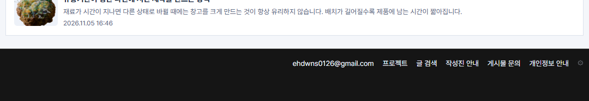
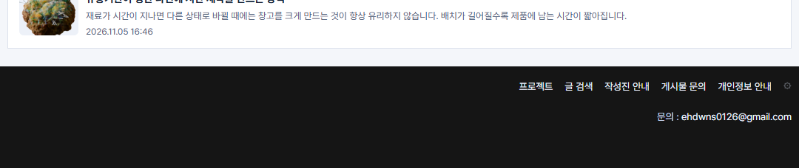

## 작업 결과

운영 홈에서 별도 문의 줄을 확인했습니다.

## 변경 내용

### 적용 내용

사용자 요청 요약(시각 미기록) — 이메일을 푸터 링크들 아래에서 ‘문의 : 이메일 주소’로 표시하도록 요청했습니다.

AI 조치 — build.mjs에서 공통 푸터 메뉴 뒤로 이메일을 옮겼습니다. 기존 이메일 설정 변수와 연결 주소를 사용합니다.

```css
.foot .footer-contact { flex-basis: 100%; text-align: right; }
```

## 검증

운영 Chrome에서 메뉴 다음 줄에 이메일이 보이는 것을 확인했습니다.





## 남은 사항

전역 및 프로젝트 지침은 변경하지 않았습니다.

## 작업 시간

- 제안 시간: 수정·배포 확인 2~3분
- 실제로 완료된 시간: 첫 확인 18:25:52 KST, 운영 Chrome 확인 18:26:36 KST, 약 44초, 2026-11-10.
- XERJ: 미사용 — 코드 검색 근거가 제공되지 않았습니다.
