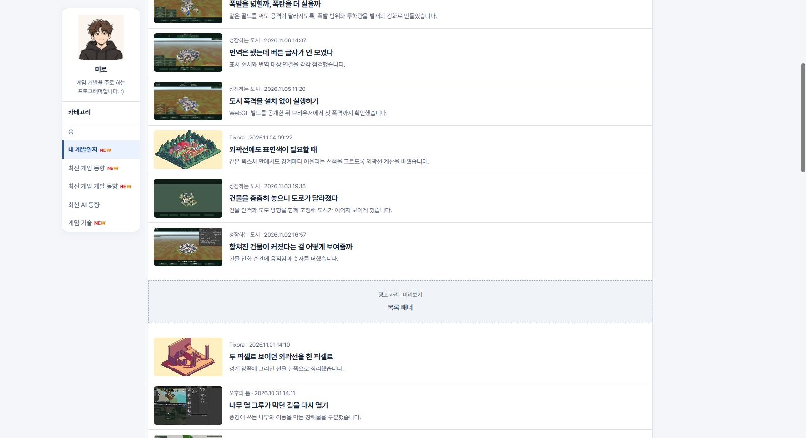
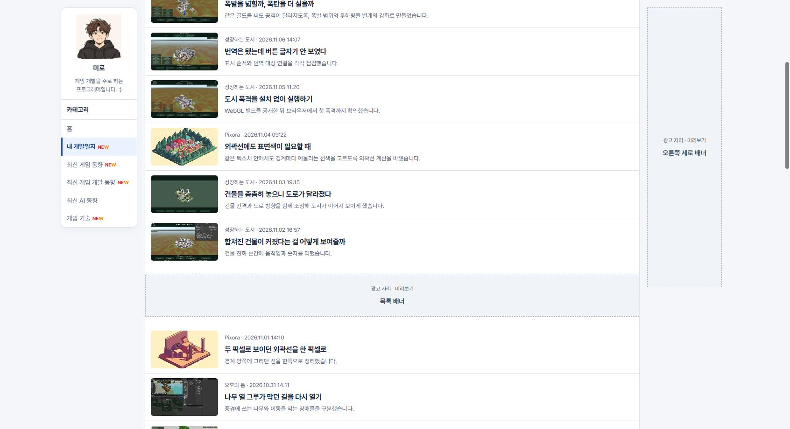

## 작업 결과

공개 게시판에서 우측 고정 표시와 모바일 숨김을 확인했습니다.

## 변경 내용

### 적용 내용

build.mjs의 page()에서 홈과 게시물에 사용하던 우측 광고 미리보기 슬롯을 카테고리 게시판과 최신 뉴스 통합 목록에도 사용합니다. 배치 설정, 미리보기 전환, 넓은 화면에서의 고정 표시 방식은 기존 슬롯을 따릅니다.

```js
const isBoard=canonical==='/news/'||sections.some(section=>sectionPath(section.id)===canonical);
const rightAd=(canonical==='/'||isBoard||canonical.startsWith('/posts/'))?adMock('오른쪽 세로 배너','rail'):'';
```

### 대화 기록

- 사용자 — “이런 게시판에서도 우측 광고 나오게해”
- AI — 기존 우측 미리보기 슬롯을 게시판 경로에도 연결했습니다.

## 검증

커밋 afbfb4b를 푸시했습니다. 공개 최신 뉴스 통합과 카테고리 게시판 6곳의 슬롯을 확인했습니다. 1692px 공개 내 개발일지에서 미리보기를 켜고 스크롤했을 때 우측 슬롯은 160×600px, 상단 16px 고정, 본문과 간격 16px였습니다. 390px에서는 숨겨졌습니다. 검증은 광고 배치 미리보기로 수행했습니다.





## 남은 사항

전역·프로젝트 지침 변경은 없습니다.

## 작업 시간

- 제안 시간: 약 1분 안에 수정 후 공개 검증
- 실제로 완료된 시간: 블로그 공개 확인까지 약 1분 53초. 2026-11-10 18:30:33 KST
- XERJ: 미사용 — 코드 검색 근거가 제공되지 않았습니다.
