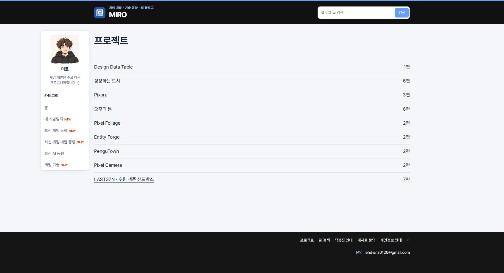
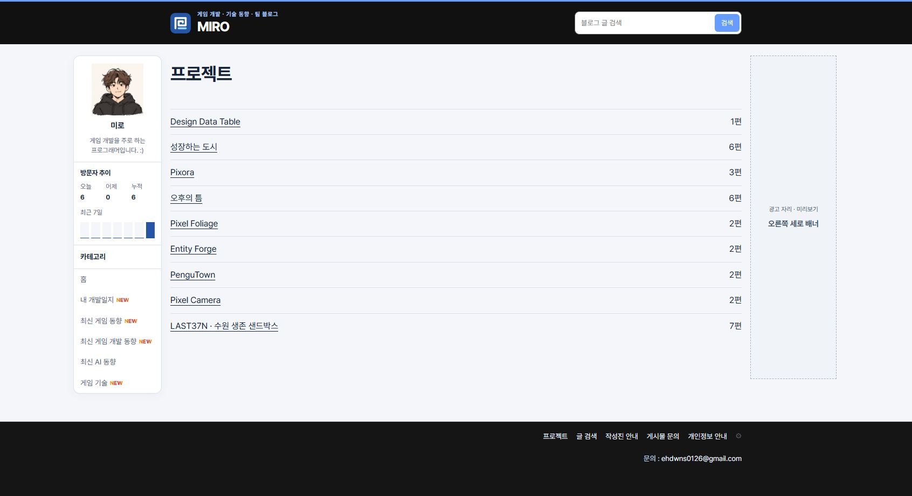
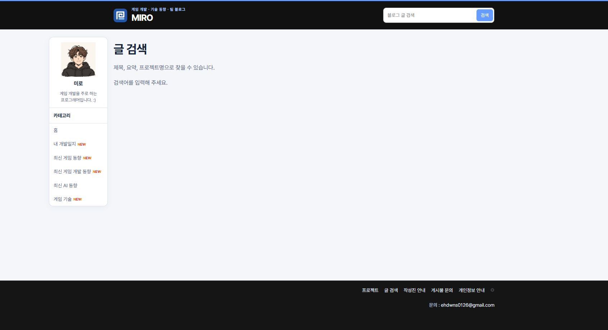
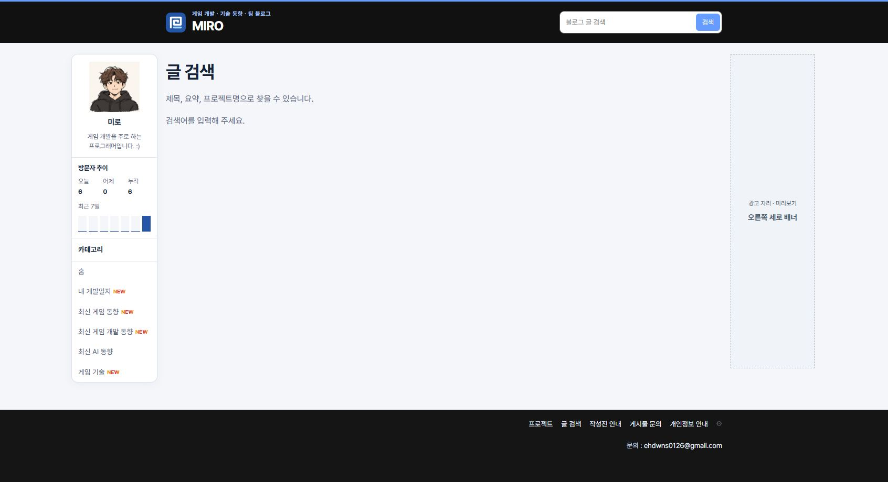
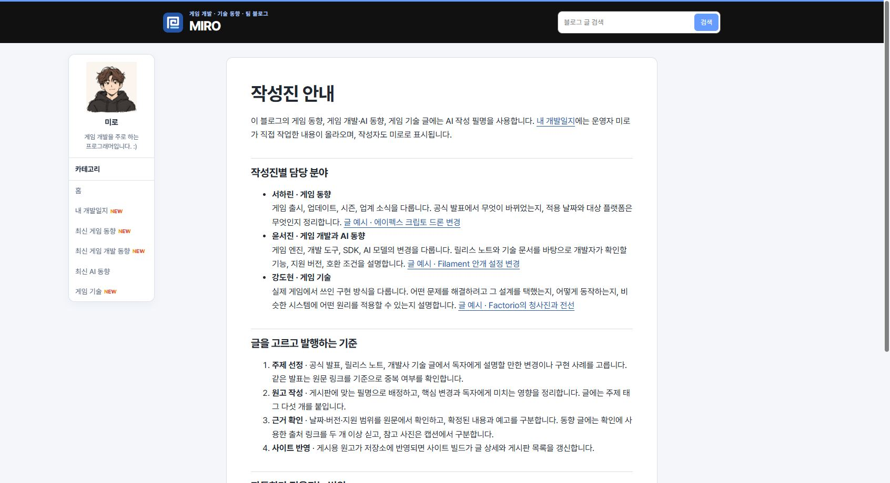
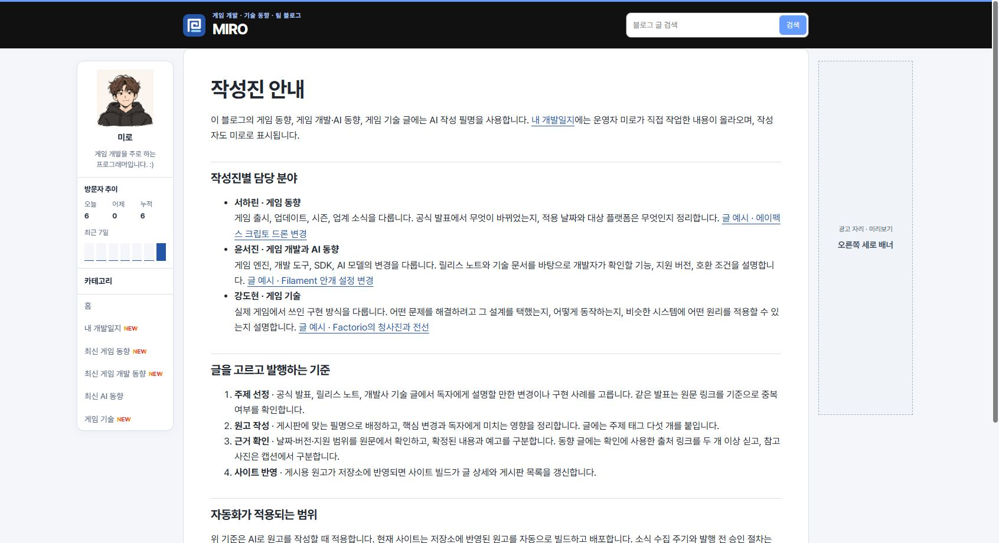
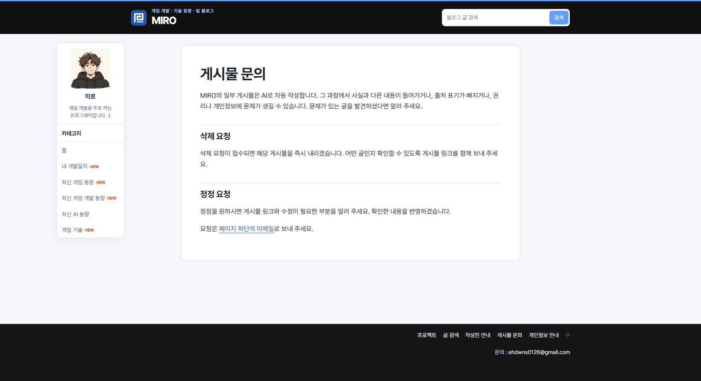
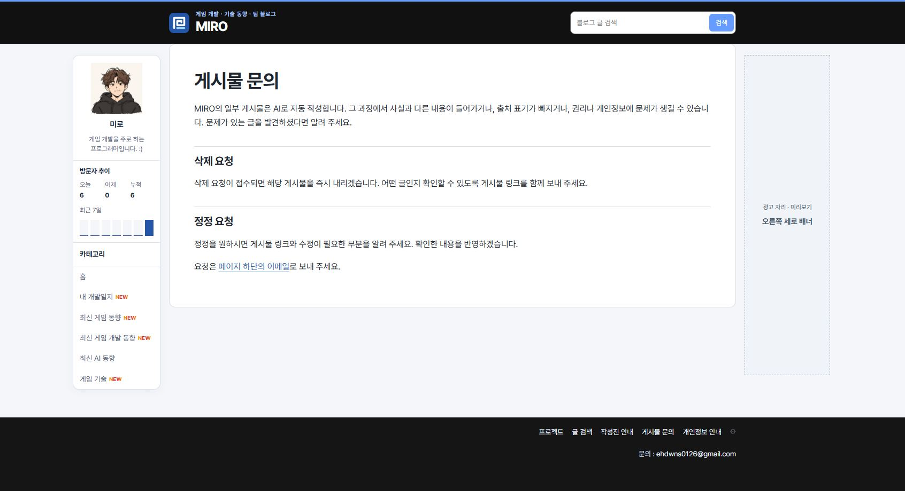
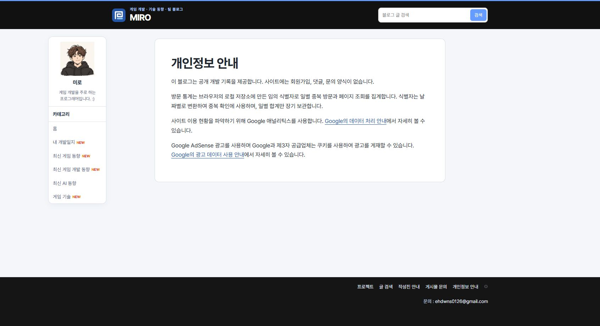
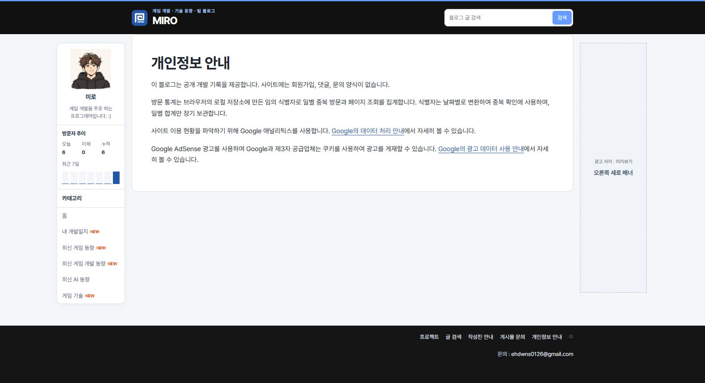

## 작업 결과

공개 페이지 다섯 곳에서 공용 폭, 방문자 그래프, 우측 광고 미리보기를 확인했습니다.

## 변경 내용

### 적용 내용

build.mjs의 page()에서 푸터 공개 경로를 공용 사이드 패널에 연결했습니다. style.css에서는 안내 문서의 820px 제한을 제거해 일반 게시물과 같은 본문 열을 사용합니다. 오른쪽은 기존 미리보기 설정과 화면 폭 조건을 따릅니다.

```js
const isFooterPage=canonical.startsWith('/projects/')||['/search/','/ai-authors/','/contact/','/privacy/'].includes(canonical);
const hasSidePanels=canonical==='/'||isBoard||isFooterPage||canonical.startsWith('/posts/');
const rightAd=hasSidePanels?adMock('오른쪽 세로 배너','rail'):'';
```

### 대화 기록

- 사용자 — “게시물 사이즈도 가로가 다르고, 좌측 네비게이터 방문자 안 나오는거보니 따로 쓰는 것 같고, 우측 패널 광고 없네”
- AI — 푸터 공개 페이지 다섯 곳을 일반 게시물과 같은 레이아웃에 연결했습니다.

## 검증

커밋 d6f6613을 푸시했습니다. 공개 Chrome 1692px에서 다섯 페이지의 본문 폭 1060px, 방문자 그래프 렌더링, 오른쪽 광고 미리보기 표시를 확인했습니다. 작성진 안내·문의·개인정보 안내의 수정 전 본문 폭은 820px였습니다.

### 프로젝트





### 글 검색





### 작성진 안내





### 게시물 문의





### 개인정보 안내





## 남은 사항

공용 레이아웃 적용 범위를 프로젝트 지침에 반영했습니다. 전역 지침 변경은 없습니다.

## 작업 시간

- 제안 시간: 수정과 로컬 확인 약 1~2분
- 실제로 완료된 시간: 블로그 공개 확인까지 약 2분 18초. 2026-11-10 18:36:23 KST
- XERJ: 미사용 — 코드 검색 근거가 제공되지 않았습니다.
