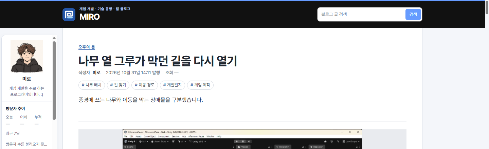
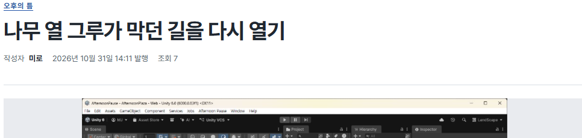

## 작업 결과

운영 게시물에서 세 변경점을 Chrome으로 확인했습니다.

## 변경 내용

### 적용 내용

사용자 요청 요약(시각 미기록) — 게시물 상세의 요약을 숨기고 태그는 글 아래에 두며, 제목과 작성 정보 사이에 여백을 요청했습니다.

AI 조치 — build.mjs의 게시물 템플릿에서 상단 요약을 제거하고 태그 목록을 본문 뒤로 옮겼습니다. style.css에서 작성 정보에 위쪽 12px를 적용했습니다.

```css
.post-byline { margin-block-start: 12px; }
```

## 검증

176개 페이지 빌드·검사 통과. Chrome에서 상단 요약 없음, 본문 직후 태그, 작성 정보 위쪽 12px를 확인했습니다.






## 남은 사항

전역 및 프로젝트 지침은 변경하지 않았습니다.

## 작업 시간

- 제안 시간: 수정과 배포 확인 2~4분
- 실제로 완료된 시간: 첫 확인 18:36:41 KST, 운영 Chrome 확인 18:38:34 KST, 약 1분 53초, 2026-11-10.
- XERJ: 미사용 — 코드 검색 근거가 제공되지 않았습니다.
