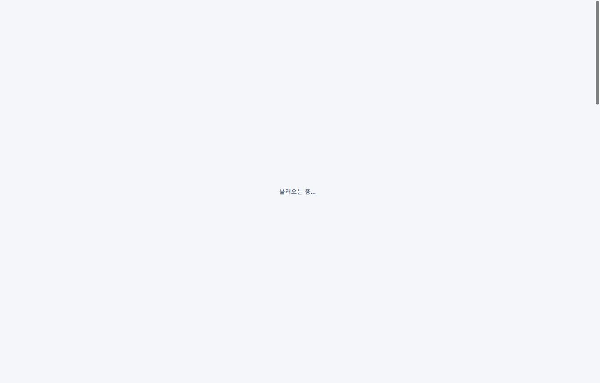

## 작업 결과

공개 사이트에서 탑바 표시와 두 모션 설정을 확인했습니다.

## 변경 내용

### 적용 내용

build.mjs의 폰트 대기용 전체 화면 가림을 제거했습니다. 탑바 로딩 상태는 첫 화면에서 초기화하고, style.css는 본문만 약하게 180ms 동안 페이드합니다.

```css
@media (prefers-reduced-motion: no-preference) {
  #main { animation: page-enter 180ms ease-out; }
}
@keyframes page-enter {
  from { opacity: .88; }
  to { opacity: 1; }
}
```

### 대화 기록

- 사용자 — “페이지 전환 때 너무 깜박임 탑바는 안 없어져도 될 것 같아”
- AI — 전체 화면 가림을 제거하고 페이드 범위와 강도를 줄였습니다.

## 검증

커밋 e4f1400을 푸시했습니다. 공개 Chrome에서 폰트 준비가 늦는 조건을 재현해 홈에서 개발일지로 이동했습니다. 수정 전에는 탑바가 숨겨지고 전체 화면의 로딩 문구가 나타났습니다. 수정 후 첫 프레임부터 탑바가 보였으며 본문은 0.88에서 시작해 180ms 페이드했습니다. 모션 줄이기에서는 불투명도 1, 애니메이션 없음으로 관찰했습니다.




## 남은 사항

전환 기준을 프로젝트 지침에 반영했습니다. 전역 지침 변경은 없습니다.

## 작업 시간

- 제안 시간: 수정과 로컬 확인 약 2분
- 실제로 완료된 시간: 블로그 공개 확인까지 약 2분 18초. 2026-11-10 18:42:21 KST
- XERJ: 미사용 — 코드 검색 근거가 제공되지 않았습니다.
