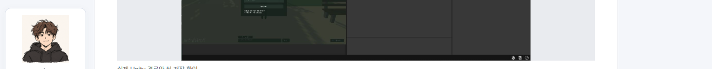
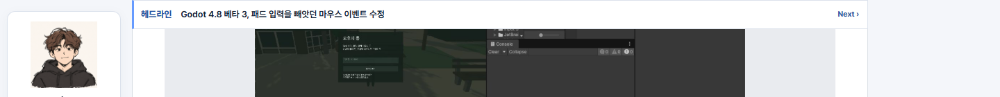
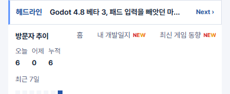

## 작업 결과

홈과 글 상세, 모바일 게시판에서 고정 동작을 확인했습니다.

## 변경 내용

### 적용 내용

사용자 요청 요약(시각 미기록) — 헤드라인을 다른 페이지에서도 기존 위치에 표시하고 스크롤 중에도 보이게 해 달라고 요청했습니다.

AI 조치 — build.mjs에서 헤드라인을 공통 페이지의 상단 헤더 뒤에 배치했습니다. style.css에서 화면 상단 고정과 모바일 카테고리의 42px 오프셋을 적용했습니다.

```css
.site-headlines { position: sticky; inset-block-start: 0; }
```

## 검증

176페이지 빌드·링크 검사 통과. Chrome에서 홈, 글 상세, 390px 게시판에 헤드라인이 한 번씩 표시되고 650px 스크롤 후 상단 0px에 고정됨을 확인했습니다. 모바일 메뉴는 42px 아래에 표시됐습니다.







## 남은 사항

전역 및 프로젝트 지침은 변경하지 않았습니다.

## 작업 시간

- 제안 시간: 수정과 배포 확인 약 3분
- 실제로 완료된 시간: 첫 확인 18:42:15 KST, 운영 Chrome 확인 18:44:45 KST, 약 2분 30초, 2026-11-10.
- XERJ: 미사용 — 코드 검색 근거가 제공되지 않았습니다.
