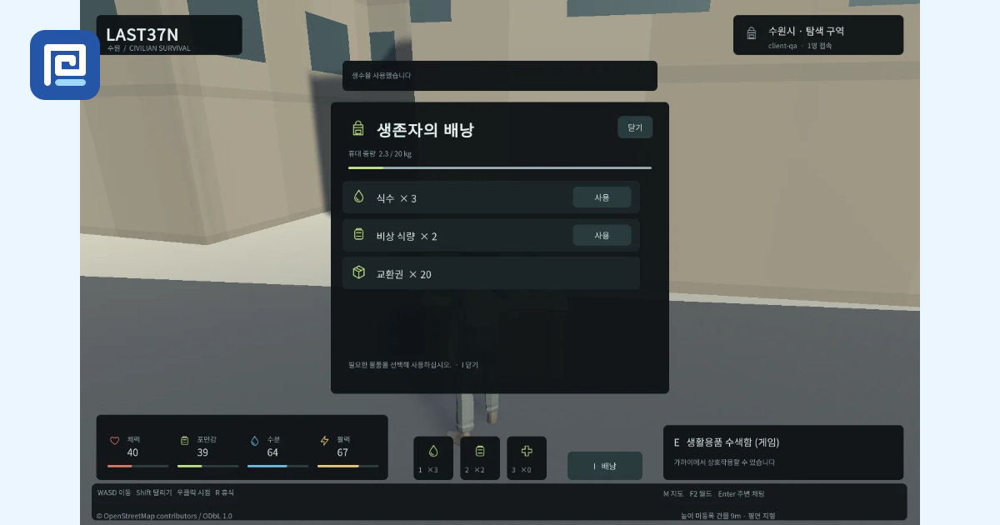
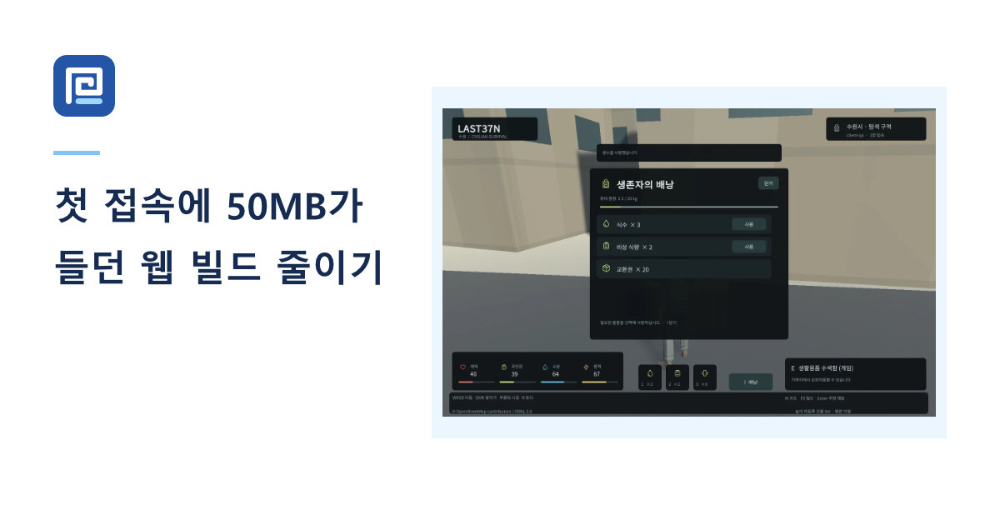
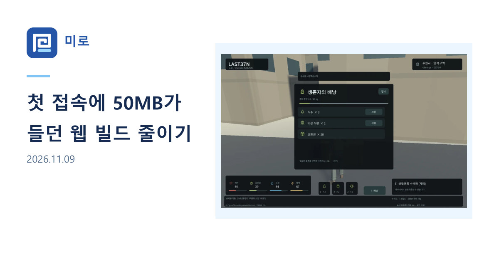

## 작업 결과

홈은 중앙 로고, 작아진 MIRO, 소개 문구로 구성했습니다. 게시글은 로고 옆에 미로, 제목 아래에 발행일을 두고 썸네일의 종횡비를 유지합니다.

## 변경 내용

### 적용 내용

홈 간격 조정 전과 후


게시글의 썸네일 중심 카드와 최종 카드




`build.mjs`의 `socialMetadata`는 홈과 각 게시글의 Affinity JPEG를 찾아 `og:image`를 설정합니다. 전용 카드가 없는 글은 기존 썸네일을 사용하며, 썸네일까지 없으면 제목·설명 위주의 카드로 표시합니다.
```js
const image = fs.existsSync(custom) ? '/social/'+file : cover && !cover.icon ? cover.src : '';
if(image.startsWith('/social/')) write(image.slice(1),fs.readFileSync(custom));
```

공개용 대화 요약

- 사용자: 사이트의 하늘색·라이트 테마와 첨부의 파란 로고를 기준으로 홈과 게시글 OG를 재구성해 달라고 요청했습니다.
- 사용자 원문: “MIRO가 위에는 너무 붙었고, 아래랑은 너무 떨어졌꼬, 그리고 폰트가 너무 큰 듯”
- 사용자 원문: “음 게시물 og 카드가 좀 거슬리는데 게시물 제목이랑 이미지 적당히 화면 안에 들어가게 구성 가능?”
- 사용자 원문: “로고 옆에 미로 적어주면 좋을 듯 제목 아래는 작게 날짜 적으면 좋을 것 같고”
- AI: 홈은 MIRO를 105px에서 78px로 줄였습니다. 게시글 제목은 단어 단위로 줄바꿈하고, 발행일은 시각을 제외한 YYYY.MM.DD로 표시했습니다.

## 검증

Affinity 3.3.3에서 재출력한 실제 JPEG를 확인했습니다. 홈과 게시글 예시의 편집 원본을 다시 열었고 미저장 변경이 없었습니다. 1200×630 출력 154개와 로컬 빌드의 OG 참조 및 JPEG 바이트 일치를 대조했습니다.

## 남은 사항

공개 블로그의 배포는 이 작업에서 수행하지 않았습니다. 현재 게시글 153개는 모두 썸네일이 있어 썸네일 없는 운영 게시글 사례는 미확인입니다. 교훈은 이 블로그의 OG 디자인 기준에 추가했습니다.

## 작업 시간

- 제안 시간: 라이트 테마 2~4분, 홈 간격 조정 약 1분, 게시글 레이아웃 3~5분, 미로·날짜 적용 2~4분. 중앙 아카이브 배포 대기 별도.
- 실제로 완료된 시간: 게시글 제목·썸네일 레이아웃 작업 19:07:08 KST 시작. 미로와 발행일 추가를 포함한 로컬 검증 완료 19:13:04 KST(약 5분 56초). 중앙 아카이브 배포 대기 별도.
- XERJ: 미사용 — 코드 검색 근거가 제공되지 않았습니다.
