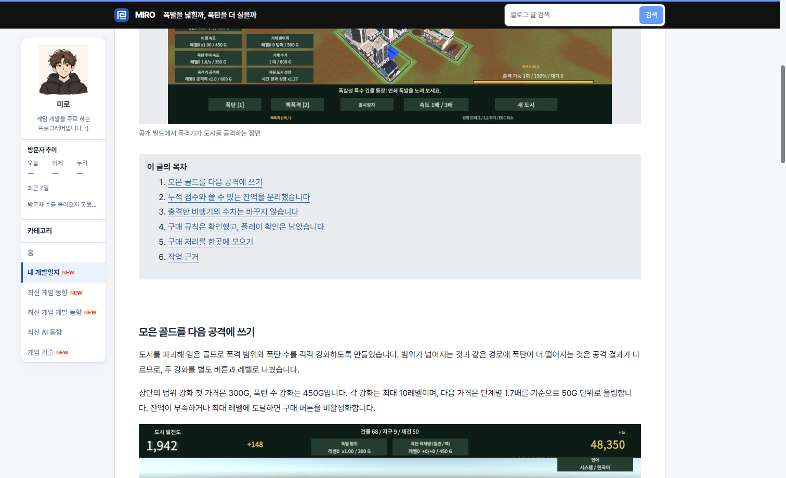
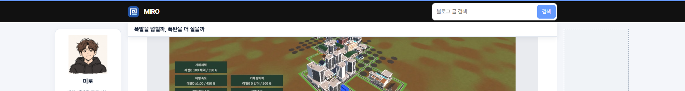

## 작업 결과

좌우 패널은 탑바 높이에 맞춰 따라옵니다. 글 제목과 헤드라인의 높이는 패널 위치에 더해지지 않습니다.

## 변경 내용

### 적용 내용

사용자는 “제목은 안 따라오는데?”라고 보고한 후 탑바와 제목이 합쳐졌는지 확인했습니다. 이어 좌우 패널이 헤드라인 높이만큼 내려가는 배치를 지적했습니다. 기존 제목은 탑바 내부에 들어갔고 원래 제목이 탑바 뒤로 지나간 뒤에만 나왔습니다. 제목을 별도의 요소로 분리하고 상단 헤드라인은 본문 열로 이동했습니다.

```js
titleBar.className = 'shell reading-title-bar';
titleBar.append(readingTitle);
utility.after(titleBar);
```

## 검증

게시물 154개, 이미지 참조 214개에 대한 기존 검증에서 끊어진 링크가 없었습니다. 폭 1690px의 헤드리스 Chrome에서 탑바 하단 55px, 제목 줄 55~91px, 좌우 패널 상단 71px을 확인했습니다. 제목 줄 좌우 경계는 본문과 동일했습니다. 페이지 맨 위로 돌아가면 작은 제목이 숨겨졌습니다.





## 남은 사항

전역·프로젝트 지침에 추가할 공통 규칙은 확인되지 않았습니다.

## 작업 시간

- 제안 시간: 3~5분
- 실제로 완료된 시간: 19:11:26 KST 시작. 19:16:23 KST에 검증 및 보고 기록.
- XERJ: 미사용 — 코드 검색 근거가 제공되지 않았습니다.
