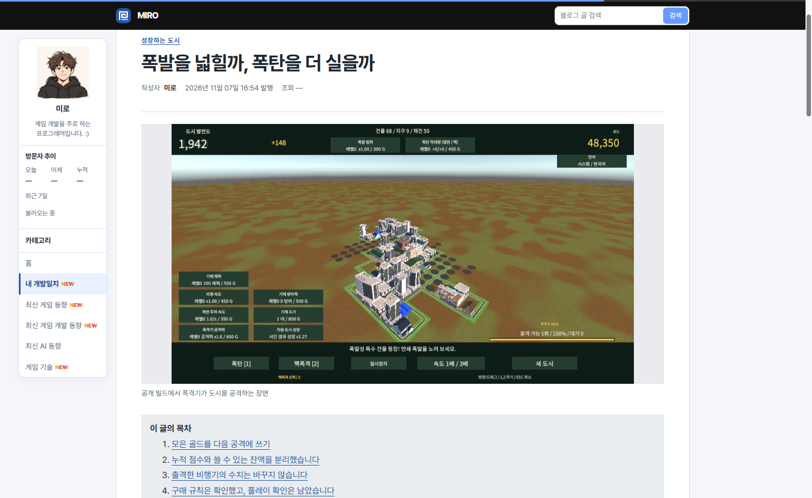
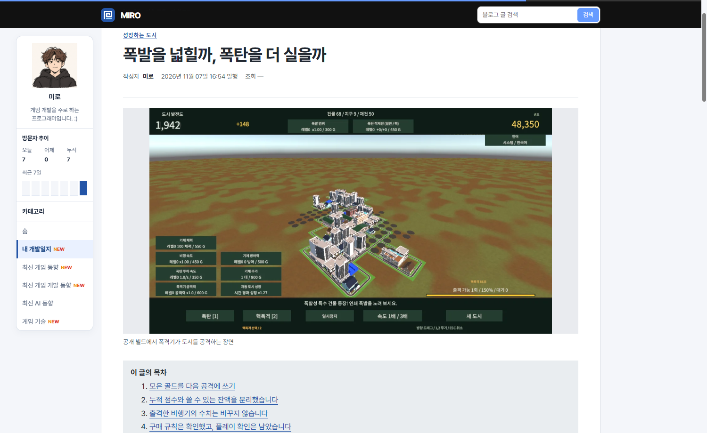
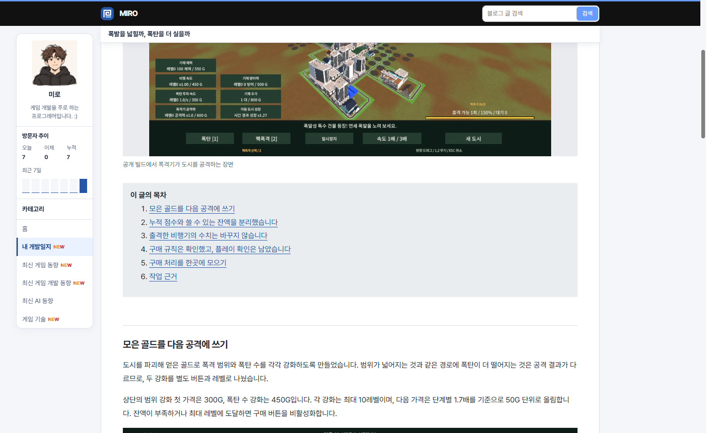
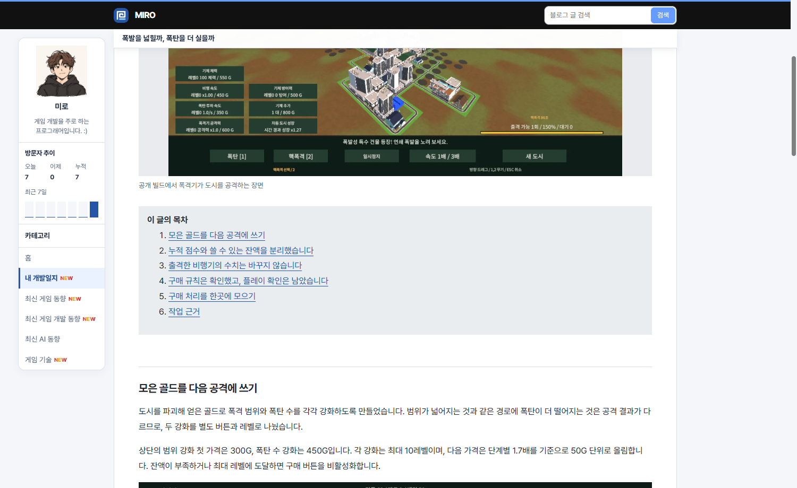

## 작업 결과

운영 커밋 782e0bd에서 크기 전환과 제목 페이드의 중간 프레임을 확인했습니다.

## 변경 내용

### 적용 내용

사용자는 “애니메이션 안 해”라고 보고했습니다. 이전 확인은 일반 모션 환경을 강제했습니다. 기본 Chrome에서 모션 감소가 켜진 것을 확인한 후 해당 분기를 바꿨습니다.

```css
@media (prefers-reduced-motion: reduce) {
  .reading-title-bar, .reading-title { transform: none; }
  .reading-title-bar { transition: opacity .18s ease, visibility .18s; }
}
```

## 검증

운영 주소에서 탑바 높이 82 → 70 → 55px, 검색창 너비 310 → 284 → 250px, 제목 불투명도 0 → 0.85 → 1을 관찰했습니다.









## 남은 사항

전역·프로젝트 지침 변경 없음.

## 작업 시간

- 제안 시간: 2~4분
- 실제로 완료된 시간: 19:24:29 KST 시작. 19:27:10 KST경 운영 동작 확인.
- XERJ: 미사용 — 코드 검색 근거가 제공되지 않았습니다.
