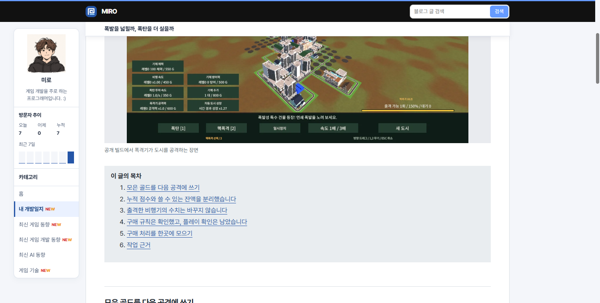

## 작업 결과

고정된 16px 대신 본문과 공유하는 반응형 여백을 사용합니다.

## 변경 내용

### 적용 내용

사용자가 “제목은 좌측 패딩 넣어야할 것 같은데”라고 요청했습니다. 본문 안쪽 여백에 게시물 테두리 1px을 더해 스크롤 제목의 시작 위치를 맞췄습니다.

```css
:root { --article-inset: clamp(17px, 4vw, 46px); }
.reading-title { margin: 0 16px 0 calc(var(--article-inset) + 1px); }
```

## 검증

운영 게시물의 제목 좌표를 비교했습니다. 수정 전 화면은 같은 브라우저와 스크롤 위치에서 기존 16px 여백을 재현했습니다.




## 남은 사항

전역·프로젝트 지침 변경 없음.

## 작업 시간

- 제안 시간: 1~2분
- 실제로 완료된 시간: 19:29:19 KST 시작. 19:30:54 KST에 화면 비교 기록.
- XERJ: 미사용 — 코드 검색 근거가 제공되지 않았습니다.
