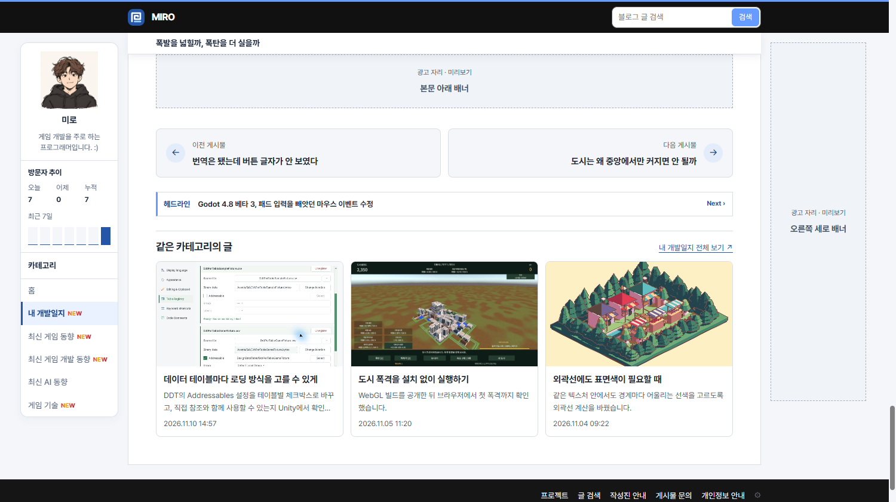
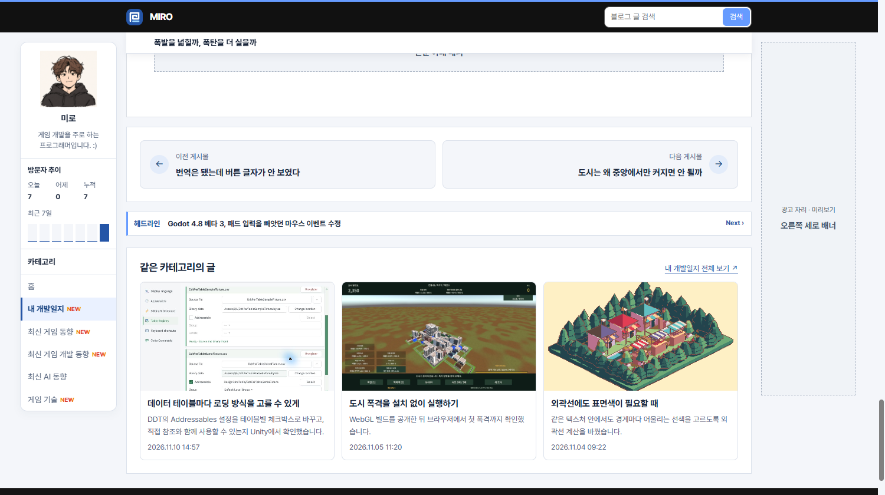

## 작업 결과

네 구역이 동일한 너비를 사용하며, 데스크톱 16–20px 및 모바일 16px의 간격을 확인했습니다.

## 변경 내용

### 적용 내용

사용자가 “게시물 빨간선 단위로 나눠줘”라고 요청했습니다. 본문 태그를 먼저 닫고 그 다음에 탐색, 헤드라인, 관련 글을 렌더링합니다.

```js
const body = articleMarkup + '</article>' + articleFooter(post) + mermaidScript;
```

## 검증

운영 커밋 49180aa에서 1500px 및 390px 화면을 확인했습니다. 수정 전은 이전 구조와 CSS를 같은 운영 게시물에서 재현했습니다.





## 남은 사항

전역·프로젝트 지침 변경 없음.

## 작업 시간

- 제안 시간: 2~4분
- 실제로 완료된 시간: 19:35:16 KST 시작, 19:37:42 KST 운영 확인. 2분 26초.
- XERJ: 미사용 — 코드 검색 근거가 제공되지 않았습니다.
