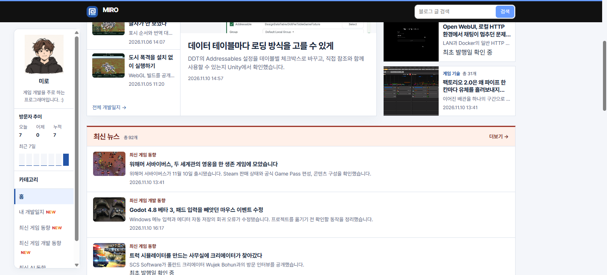

## 작업 결과

펼친 상태에는 기존처럼 MIRO 위에 두고 축소 상태에는 가로 배치를 적용했습니다.

## 변경 내용

### 적용 내용

사용자는 축소 애니메이션 중 “게임 개발 · 기술 동향 · 팀 블로그”가 사라진다고 지적하고 MIRO 옆으로 옮겨 달라고 요청했습니다.

```css
[data-compact-topbar] .brand-copy { display: flex; align-items: center; font-size: 1rem; gap: 8px; }
[data-compact-topbar] .brand-copy small { order: 1; word-break: keep-all; }
```

## 검증

운영 홈의 펼친 상태와 축소 상태를 비교했습니다. 이전 화면은 같은 운영 홈의 축소 상태에서 이전의 숨김 스타일을 재현했습니다.




## 남은 사항

전역·프로젝트 지침 변경 없음.

## 작업 시간

- 제안 시간: 2~3분
- 실제로 완료된 시간: 19:39:02 KST 시작. 19:40:35 KST에 화면 비교 기록.
- XERJ: 미사용 — 코드 검색 근거가 제공되지 않았습니다.
