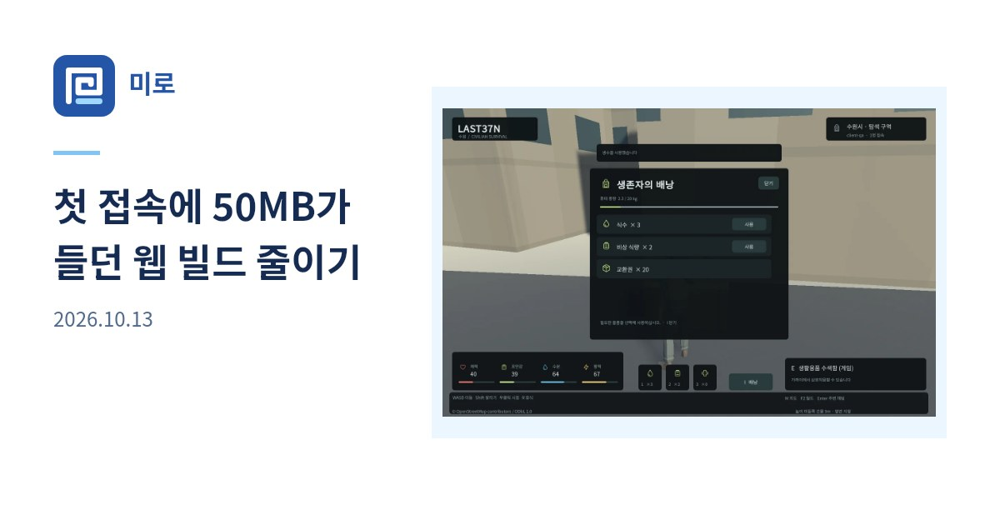

## 작업 결과

게시글만 발행·수정하면 CI가 공유 카드를 다시 만들고 배포합니다. 글별 이미지 파일을 별도로 생성하거나 올릴 필요가 없습니다.

## 변경 내용

### 적용 내용

공개 홈 OG


공개 게시글 OG


`build.mjs`가 현재 원고와 커버를 `social-card.mjs`로 전달합니다. JPEG 바이트의 해시를 이미지 URL에 포함하므로 카드 내용이 바뀌면 새 URL이 생성됩니다. 썸네일이 없는 원고는 제목 중심 카드로 표시하고, 발행일 미확인 원고에는 날짜를 넣지 않습니다.
```js
const image = await renderSocialCard({title:post.title,date,thumbnail});
saveSocialCard(post.href,post.href.split('/')[2],post.title,image);
```

공개용 대화 요약

- 사용자: 발행과 수정에 따라 OG가 자동으로 갱신되어야 한다고 정정했습니다.
- AI: Affinity 일괄 출력 방식에 새 글마다 재출력 단계가 생긴다는 점을 먼저 설명하지 못했다고 밝혔고, 정적 카드 배포를 중단했습니다.
- 사용자 원문: “자동 생성 방식으로 가야지”
- AI: 빌드 렌더러로 교체하고 실제 원고 추가·변경과 배포를 확인했습니다.

## 검증

정상 빌드에서 홈과 게시글의 OG 링크 155개를 대조했습니다. 임시 원고에 썸네일을 넣지 않아도 이미지가 생성됐으며, 기존 글 제목을 수정하면 이미지 URL이 바뀌는 것을 확인했습니다. 임시 원고를 제거한 다음 정상 빌드와 사이트 검사를 통과했습니다. 첫 GitHub Actions 배포는 Linux에서 글꼴을 자동으로 찾지 못해 실패했고, 공식 Noto Sans KR 파일을 해시로 고정하고 렌더러에 직접 등록한 수정본을 재배포했습니다. 수정 커밋 4533480의 Publish blog 실행 42801620127이 성공했습니다. 19:44:40 KST에 공개 홈페이지와 게시글의 실제 og:image URL에서 JPEG HTTP 200 응답을 확인했습니다.

## 남은 사항

블로그 발행 과정에 별도 작업은 없습니다. 프로젝트 지침을 빌드 자동 생성 기준으로 갱신했습니다.

## 작업 시간

- 제안 시간: 구현·검증 3~5분, 자동 배포 별도
- 실제로 완료된 시간: 19:36:58 KST 시작, 19:41:13 KST 최초 푸시, 19:43:57 KST 글꼴 수정 푸시, 19:44:40 KST 공개 검증 완료. 총 약 7분 43초.
- XERJ: 미사용 — 코드 검색 근거가 제공되지 않았습니다.
