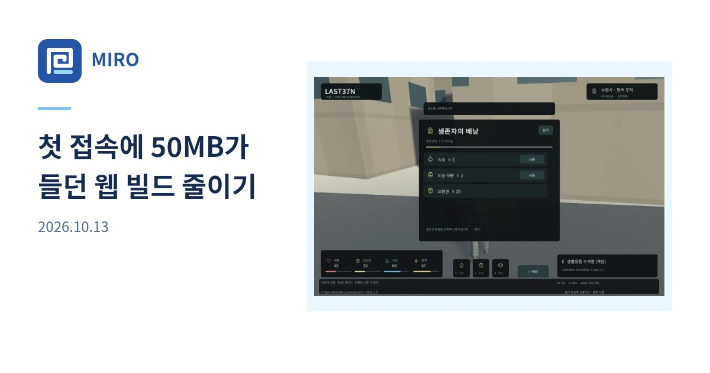

## 작업 결과

블로그 main 커밋 64c1641을 배포했고 공개 게시글 카드의 MIRO 표기를 확인했습니다.

## 변경 내용

### 적용 내용

수정 전


수정 후


`social-card.mjs`의 게시글 로고 옆 표기를 바꿨습니다.
```js
ctx.fillText('MIRO',154,85);
```

사용자 원문: “아 미로가 영어로 나와야해 왜 한글이니”

AI: 공용 렌더러의 게시글 표기만 변경해 배포했습니다.

## 검증

블로그 배포 실행 42802468159 성공. 공개 예시 글의 새 og:image가 HTTP 200 image/jpeg를 반환했고, 새 JPEG에서 로고 옆 MIRO를 확인했습니다.

## 남은 사항

프로젝트 지침의 영문 표기를 갱신했습니다. 전역 지침 변경 없음.

## 작업 시간

- 제안 시간: 코드 수정·푸시 30초~1분, 자동 배포 별도
- 실제로 완료된 시간: 19:50:00 KST 시작, 19:50:06 KST 푸시, 19:50:54 KST 공개 검증. 약 54초.
- XERJ: 미사용 — 코드 검색 근거가 제공되지 않았습니다.
