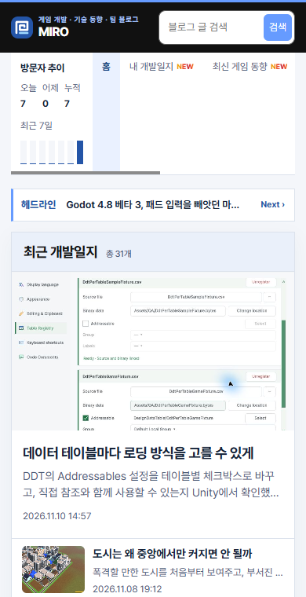
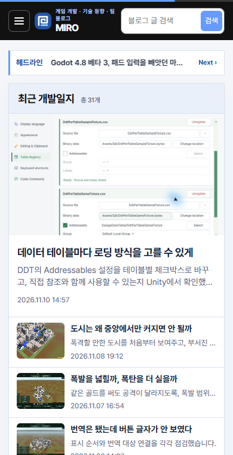
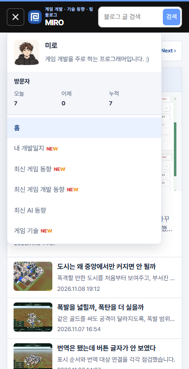

## 작업 결과

메뉴 안에 프로필 이미지, 소개, 오늘·어제·누적 방문자 수, 카테고리를 모았습니다.

## 변경 내용

### 적용 내용

사용자는 모바일 가로 목록과 방문자 그래프의 배치를 지적하고 “삼바”를 만들어 설명·썸네일·방문자를 보이게 해 달라고 했습니다. 이를 햄버거 메뉴로 해석했습니다. 데스크톱 사이드바와 그래프는 유지하며 방문자 조회는 한 번만 요청합니다.

```js
const summaries = document.querySelectorAll('[data-visitor-summary]');
```

```css
@media (max-width: 1429px) {
  .category-drawer { display: block; flex: none; }
}
```

## 검증

운영 모바일 홈에서 닫힌 상태와 메뉴가 열린 상태를 확인했습니다. 이전 화면은 기존 CSS로 재현했습니다. 사이트 빌드에서 게시물 154개 및 이미지 참조 214개를 확인했습니다.







## 남은 사항

전역·프로젝트 지침 변경 없음.

## 작업 시간

- 제안 시간: 3~5분
- 실제로 완료된 시간: 19:59:43 KST 시작. 20:03:42 KST에 화면 비교 기록.
- XERJ: 미사용 — 코드 검색 근거가 제공되지 않았습니다.
