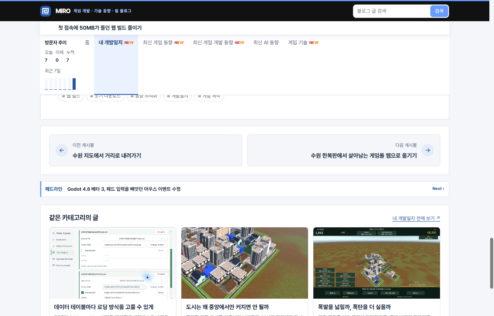
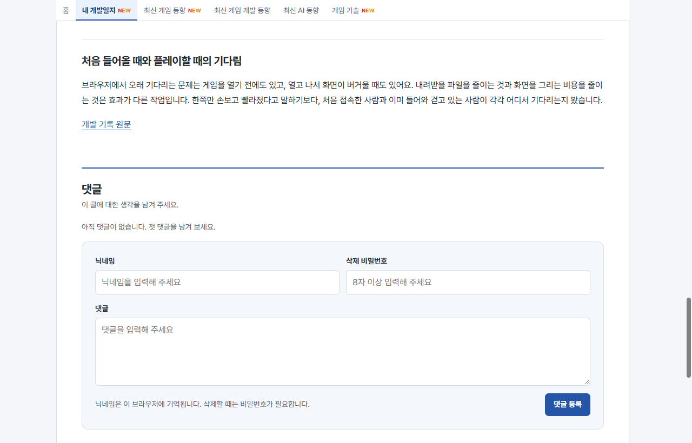
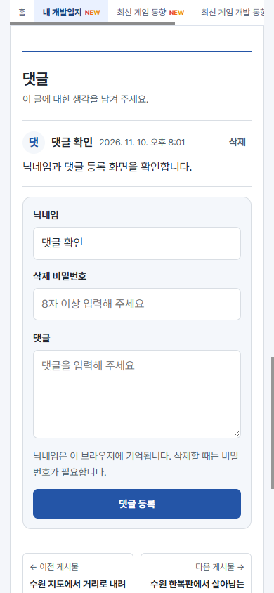
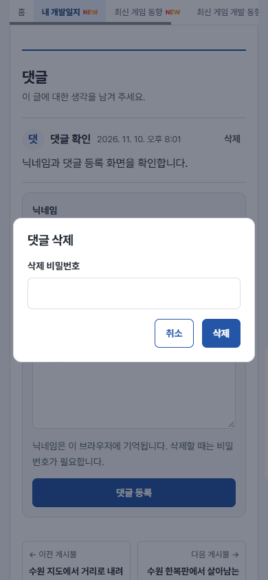

## 작업 결과

게시글에 닉네임으로 댓글을 작성하고 등록할 때 정한 비밀번호로 삭제할 수 있도록 구현했습니다. 로컬에서 등록, 닉네임 복원, 삭제를 확인했습니다. 댓글 변경은 [PR #1](https://github.com/MDJ0126/github-blog/pull/1)에 있습니다.

## 변경 내용

### 적용 내용

- `build.mjs`가 게시글 본문 하단에 댓글 영역을 생성합니다. 블로그의 파란색을 사용하고, 모바일에서는 입력을 한 열로 표시합니다.
- `comments/client.js`는 닉네임을 브라우저에 저장하고 삭제 비밀번호는 요청에만 사용합니다. `functions/api/comments.js`는 게시글별로 D1을 조회하고 댓글마다 솔트가 다른 검증값을 비교합니다.
- 삭제 비밀번호는 8자 이상입니다. 등록과 삭제 요청의 시간당 한도는 IP별로 각각 8회와 24회입니다.

```js
const valid = await crypto.subtle.verify(
  'HMAC', key, new Uint8Array(comment.password_mac),
  passwordMessage(post, comment.salt, password),
);
if (!valid) return reply({error: '삭제 비밀번호가 일치하지 않습니다.'}, 403);
await db.prepare('DELETE FROM comments WHERE post = ? AND id = ?').bind(post, input.id).run();
```

### 대화 기록

1. 사용자 (시각 미기록) · “댓글 기능 못 만드나?”
2. AI (19:42 KST) · 현재 블로그 구조를 확인하고 GitHub 로그인 또는 자체 저장 방식으로 만들 수 있다고 답했습니다.
3. 사용자 (시각 미기록) · “디비가 무료야?” AI가 Cloudflare D1 무료 플랜과 한도를 확인했습니다.
4. 사용자 (시각 미기록) · “Cloudflare D1 무료 플랜으로 로그인 없이 닉네임만 입력해서 댓글 달 수 있게 만들어줘.” 기기별 닉네임 기억, 본인 삭제 비밀번호, 디자인을 요청했습니다.
5. AI (20:02 KST) · 로컬에서 기능을 확인하고 댓글 변경만 별도 브랜치로 푸시했습니다.

## 검증

- 최신 운영 소스를 기준으로 배포용 정적 사이트 154개 게시글을 빌드했습니다. 운영 D1 스키마와 Pages 시크릿을 등록했습니다.
- 로컬 Pages와 D1에서 목록 조회 200, 작성 201, 잘못된 비밀번호 403, 정상 삭제 200을 확인했습니다. 브라우저 새로고침 후 닉네임이 복원됐습니다.


변경 전 운영 게시글 하단입니다.


변경 후 로컬 게시글의 데스크톱 댓글 작성 화면입니다.


390px 로컬 화면에서 등록된 댓글과 복원된 닉네임을 확인했습니다.


삭제 비밀번호를 입력하는 로컬 대화상자입니다.

## 남은 사항

- 자동 승인 검토가 기본 브랜치 직접 푸시를 거부했습니다. 운영 배포를 승인받은 뒤 PR을 병합하고 공개 주소에서 등록·조회·삭제를 확인해야 합니다.
- 교훈 검토 결과, 전역 및 프로젝트 전용 지침에 새로 반영할 규칙은 없었습니다.

## 작업 시간

- 제안 시간: 8~15분
- 실제로 완료된 시간: 2026-11-10 19:50:36 KST 시작. 20:02:57 KST에 구현·로컬 확인·PR 생성 완료, 약 12분 21초. 운영 완료 시각 미기록.
- XERJ: 미사용 — 지정 검색 도구를 사용하지 않았습니다.
