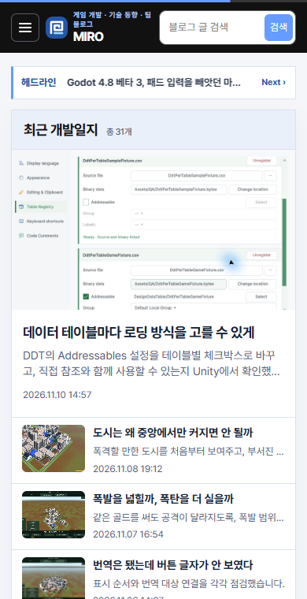
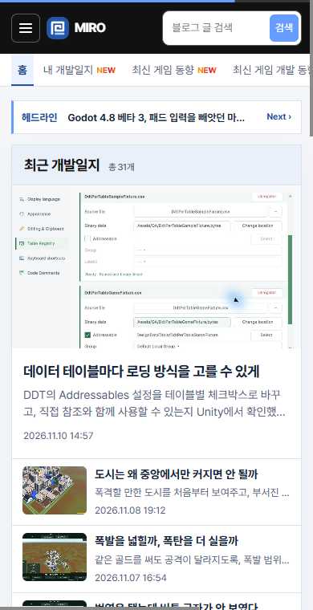
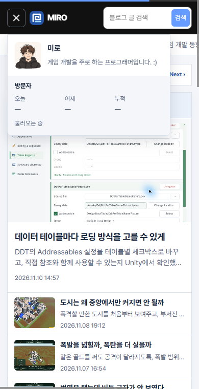

## 작업 결과

블로그 정보 메뉴에는 프로필 이미지와 소개, 방문자 수를 유지했습니다.

## 변경 내용

### 적용 내용

사용자는 소개 문구가 줄바꿈돼 답답하다고 지적하고, 모바일에 MIRO만 표시하며 카테고리는 탑바 아래에 유지해 달라고 정정했습니다.

```css
.mobile-categories { display: flex; overflow-x: auto; }
.mobile-categories a { flex: none; white-space: nowrap; }
```

## 검증

운영 홈의 320px, 390px 모바일 화면과 1500px 데스크톱 화면을 비교했습니다. 변경 전은 직전 운영 버전의 실제 캡처를 사용했습니다.







## 남은 사항

전역·프로젝트 지침 변경 없음.

## 작업 시간

- 제안 시간: 2~4분
- 실제로 완료된 시간: 20:05:50 KST 시작. 20:07:30 KST에 화면 비교 기록.
- XERJ: 미사용 — 코드 검색 근거가 제공되지 않았습니다.
