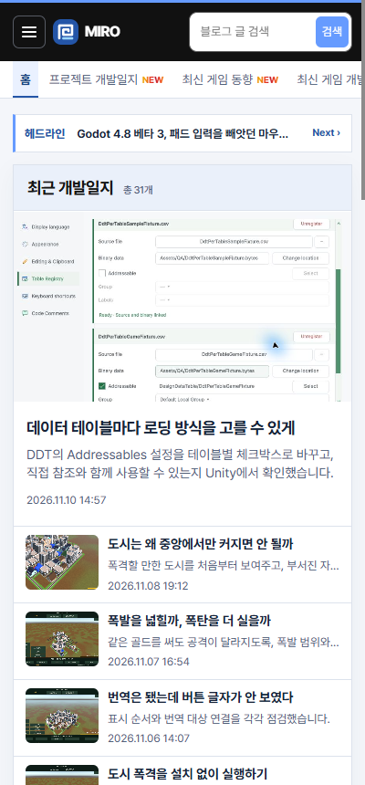
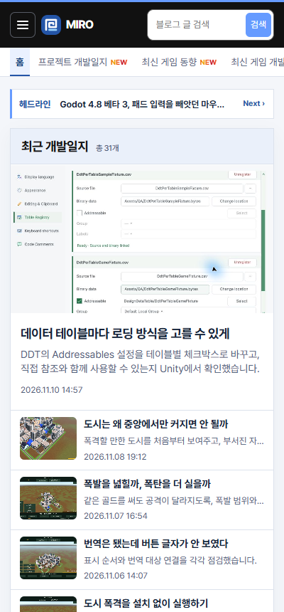

## 작업 결과

카테고리 행의 보조 텍스트를 행 안에 포함해 문서 가로 너비가 기기 폭과 일치합니다.

## 변경 내용

### 적용 내용

사용자는 오른쪽에 빈 영역이 생긴 모바일 화면을 첨부했습니다. 숨김 접근성 문구가 스크롤 컨테이너 밖의 요소를 위치 기준으로 사용하고 있었습니다. 카테고리 행을 해당 문구의 위치 기준으로 지정했습니다.

```css
.mobile-categories { position: relative; overflow-x: auto; }
```

## 검증

운영 주소에서 320px, 390px, 400px 기기 폭과 문서 너비를 대조했습니다. 수정 전은 같은 400px 화면에서 기존 위치 기준을 재현했습니다.





## 남은 사항

모바일 검증 기준을 프로젝트 지침에 추가했습니다. 전역 지침 변경 없음.

## 작업 시간

- 제안 시간: 2~4분
- 실제로 완료된 시간: 20:08:28 KST 시작. 20:10:52 KST에 화면 비교 기록.
- XERJ: 미사용 — 코드 검색 근거가 제공되지 않았습니다.
