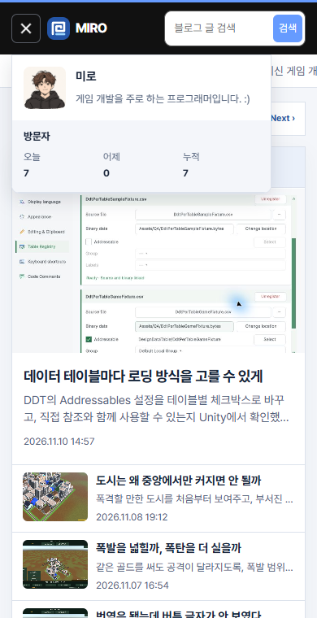
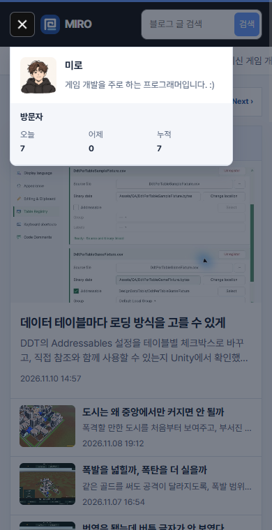

## 작업 결과

메뉴 내용과 기존 닫기 버튼을 어두운 레이어 위에 배치했습니다.

## 변경 내용

### 적용 내용

사용자는 “밖 영역 누르면 닫히게 해줘”라고 요청하고 메뉴가 열린 동안 바깥 영역을 불투명하게 표시해 달라고 했습니다. 메뉴 바깥에 55% 농도의 배경을 표시합니다.

```js
menu?.querySelector('.category-drawer-backdrop')?.addEventListener('click', () => {
  menu.open = false;
  menu.querySelector('summary').focus({ preventScroll: true });
});
```

## 검증

운영 홈에서 320px와 390px 화면의 메뉴 안쪽, 바깥쪽, 닫기 버튼을 터치해 동작을 비교했습니다. 변경 전은 같은 화면에서 배경 레이어를 제거해 재현했습니다.





## 남은 사항

전역·프로젝트 지침 변경 없음.

## 작업 시간

- 제안 시간: 2~4분
- 실제로 완료된 시간: 20:16:19 KST 시작. 20:17:56 KST에 화면 비교 기록.
- XERJ: 미사용 — 코드 검색 근거가 제공되지 않았습니다.
