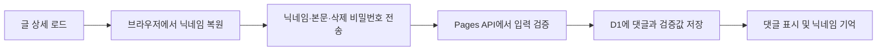
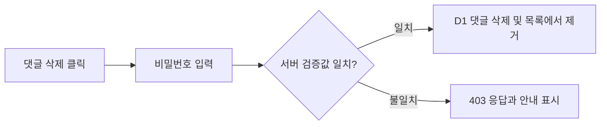
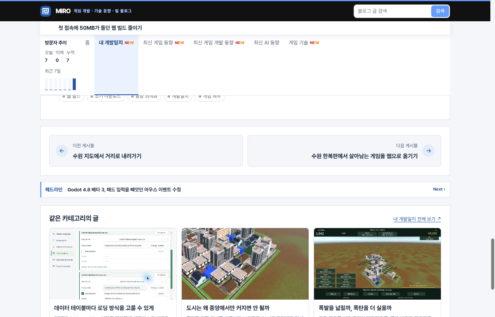
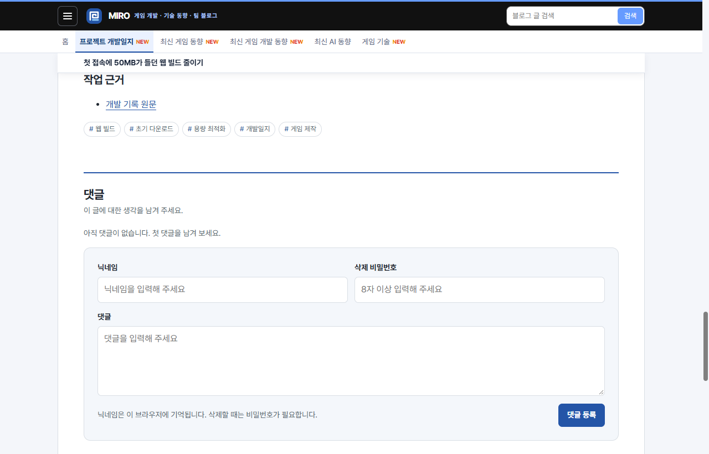
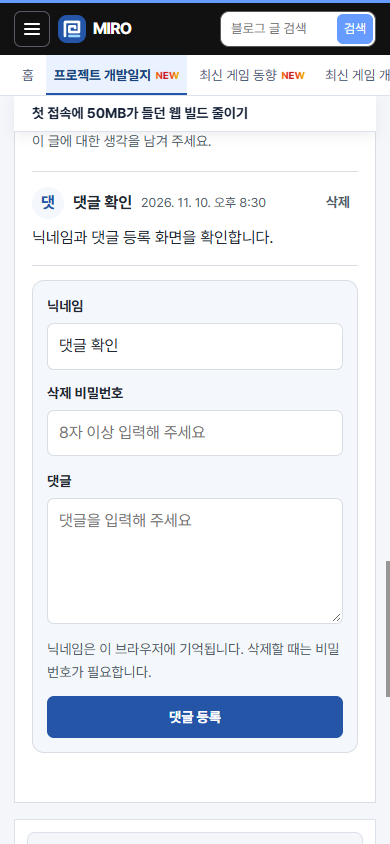
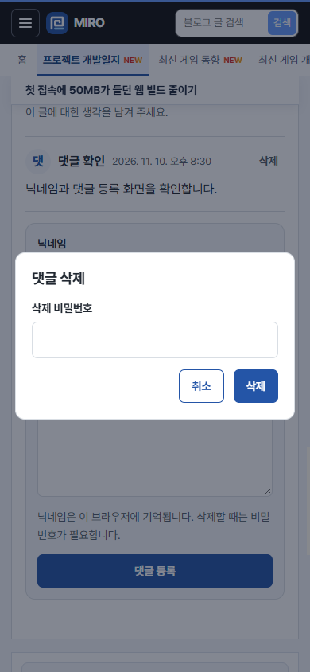

## 작업 결과

[운영 게시글](https://miro-game.pages.dev/posts/story-suwon-web-budget/#comments-title)에 댓글을 배포했습니다. 공개 브라우저에서 댓글 등록, 닉네임 복원, 잘못된 비밀번호 거부와 정상 삭제를 확인했습니다.

## 변경 내용

### 적용 내용

- [PR #1](https://github.com/MDJ0126/github-blog/pull/1)을 병합했습니다. 첫 실행에서 `verify.mjs`의 스크립트 허용 목록 검사가 새 댓글 스크립트를 거부했습니다. `verify.mjs`의 HTML 검사 루프에서 댓글 스크립트를 허용하고 글 상세에만 존재하도록 확인합니다.
- 댓글 작성 폼은 아래 함수로 닉네임을 기억합니다. 비밀번호는 서버가 댓글별 검증값으로 저장합니다.

```js
function rememberNickname(value) {
  try {
    if (value === undefined) return localStorage.getItem(nicknameKey) || '';
    if (value.trim()) localStorage.setItem(nicknameKey, value.trim());
    else localStorage.removeItem(nicknameKey);
  } catch {
    return '';
  }
}
```





### 대화 기록

1. 사용자 (시각 미기록) · “배포 해 확인해보게”
2. AI (20:28 KST) · 승인받은 PR을 병합했습니다.
3. AI (20:29 KST) · 실패한 검사에서 댓글 스크립트 허용 조건을 수정해 푸시했습니다.
4. AI (20:31 KST) · 운영 배포와 공개 동작 확인을 마쳤습니다.

## 검증

- [GitHub Actions](https://github.com/MDJ0126/github-blog/actions/runs/42807927834)에서 사이트 빌드, `verify.mjs`, Cloudflare Pages 배포가 성공했습니다.
- 공개 댓글 API 200, 브라우저 등록과 새로고침 후 닉네임 복원, 틀린 비밀번호 거부, 올바른 비밀번호 삭제를 확인했습니다. 검증용 댓글은 공개 API에서 제거됐습니다.


배포 전 같은 글의 하단입니다.


배포 후 같은 글의 하단입니다.


모바일 너비에서 댓글 작성과 닉네임 복원을 확인했습니다.


삭제 비밀번호를 입력하는 화면입니다.

## 남은 사항

운영 배포와 공개 동작 확인 완료. 브라우저 프로필과 검증용 댓글을 정리했습니다. 전역 및 프로젝트 지침은 기존 규칙을 유지했습니다.

## 작업 시간

- 제안 시간: 3~8분
- 실제로 완료된 시간: 운영 배포 및 공개 동작 확인 3분 2초. 2026-11-10 20:27:59 KST 시작, 20:31:01 KST 완료.
- XERJ: 미사용 — 지정 검색 도구를 사용하지 않았습니다.
