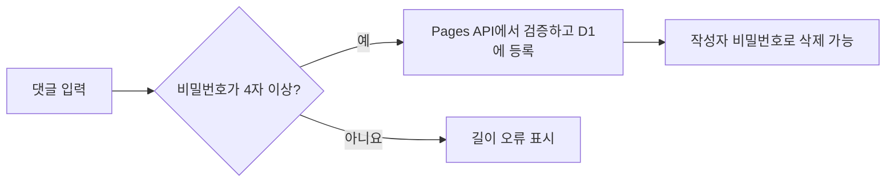
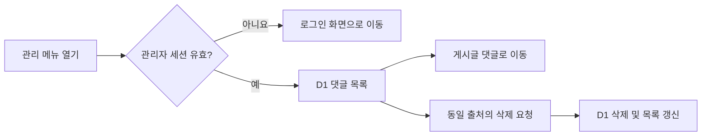
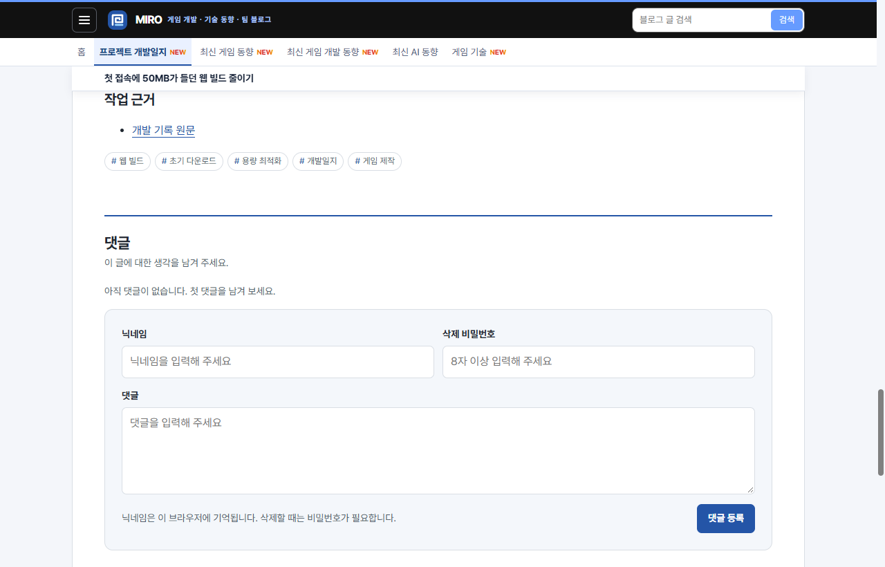
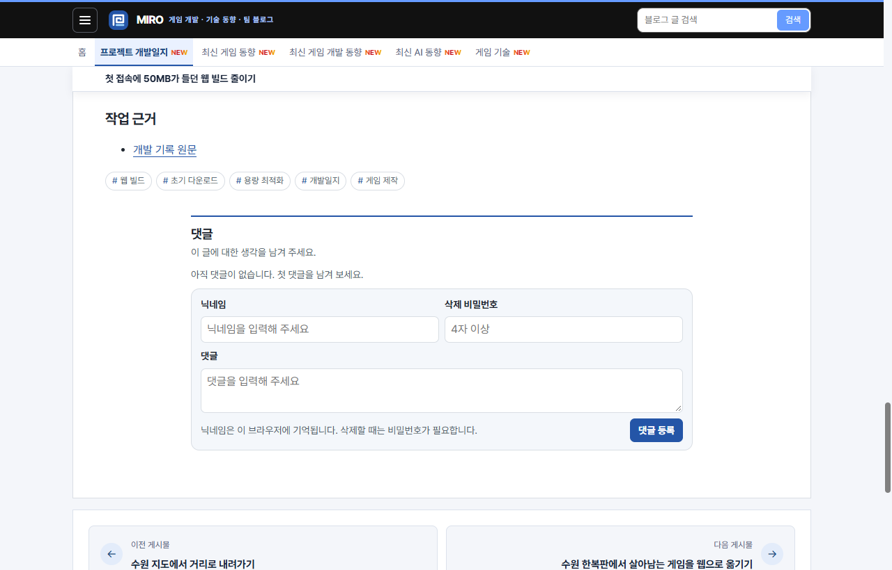
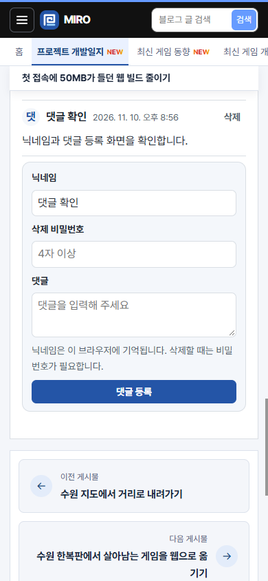
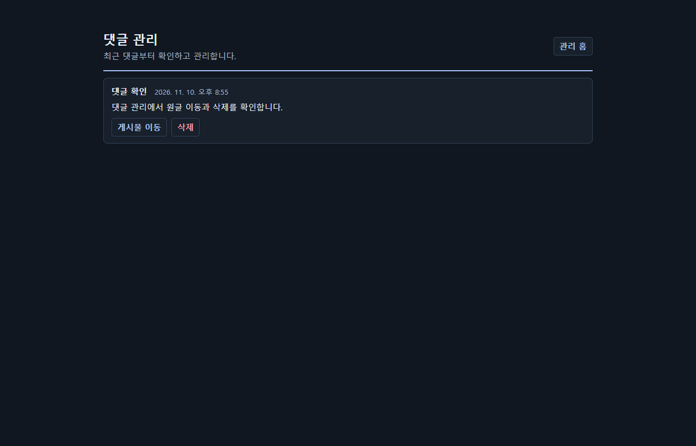
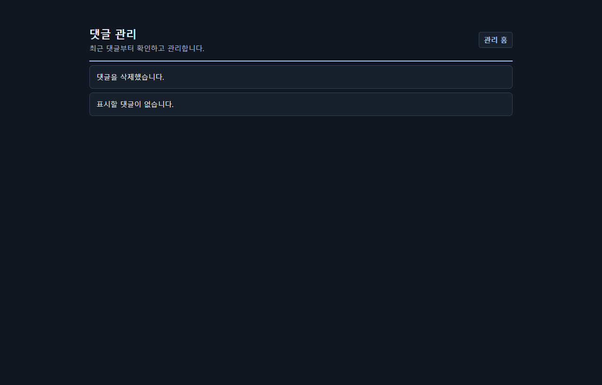

## 작업 결과

[공개 게시글](https://miro-game.pages.dev/posts/story-suwon-web-budget/#comments-title)의 댓글 폼을 줄이고, [관리 페이지](https://miro-blog-admin.ehdwns0126.workers.dev/)에 댓글 관리 메뉴를 추가했습니다. 운영에서 4자 비밀번호로 작성·삭제를 확인했습니다.

## 변경 내용

### 적용 내용

- `comments/style.css`와 `comments/template.mjs`에서 댓글 영역 최대 폭을 720px로 제한하고 폼의 간격, 입력 높이와 본문 행 수를 줄였습니다.
- 폼과 `functions/api/comments.js`의 최소 삭제 비밀번호 길이를 함께 4자로 변경했습니다. 기존 댓글은 작성할 때 정한 비밀번호로 삭제할 수 있습니다.
- `admin/comments.mjs`의 `commentAdministration`에서 기존 관리자 인증을 사용해 최신 댓글부터 30개씩 조회합니다. 각 행에서 게시물로 이동하거나 댓글 비밀번호 없이 삭제합니다.
- 운영 관리자 Worker의 기존 대시보드 소스는 로컬 운영본을 사용했습니다. 배포 전 공개 운영 HTML과 CSS를 대조했고, Git에는 기존 저장소 관리자 템플릿에 적용한 동일 기능만 포함했습니다.

```js
export async function commentAdministration(request, env, blog) {
  const url = new URL(request.url);
  const remove = url.pathname.match(/^\/comments\/([1-9]\d{0,15})\/delete$/);
  if (!configured(env)) return new Response('관리자 로그인 설정을 확인해 주세요.', {status: 503, headers});
  if (!await authorized(request, env)) {
    if (request.method === 'GET') return new Response(null, {status: 303, headers: {...headers, location: '/'}});
    return new Response(null, {status: 401, headers});
  }
  if (!env.COMMENTS_DB) return new Response('댓글 저장소를 확인해 주세요.', {status: 503, headers});
  const before = url.searchParams.get('before');
  if (before !== null && !positiveId(before)) return new Response('잘못된 목록 위치입니다.', {status: 400, headers});

  if (request.method === 'POST' && remove && positiveId(remove[1])) {
    if (request.headers.get('Origin') !== url.origin) return new Response(null, {status: 403, headers});
    const deletion = await env.COMMENTS_DB.prepare('DELETE FROM comments WHERE id = ?').bind(Number(remove[1])).run();
    const query = new URLSearchParams();
    if (before) query.set('before', before);
    if (deletion.meta.changes) query.set('deleted', '1');
    const location = '/comments' + (query.size ? '?' + query : '');
    return new Response(null, {status: 303, headers: {...headers, location}});
  }
  if (url.pathname !== '/comments' || request.method !== 'GET') return new Response(null, {status: 405, headers});

  const {results} = await env.COMMENTS_DB.prepare(
    'SELECT id, post, nickname, body, created_at FROM comments WHERE id < ? ORDER BY id DESC LIMIT ?',
  ).bind(before ? Number(before) : Number.MAX_SAFE_INTEGER, pageSize + 1).all();
  const comments = results.slice(0, pageSize);
  const next = results.length > pageSize ? comments.at(-1).id : null;
  return new Response(renderPage(comments, next, before, url.searchParams.get('deleted') === '1', blog), {headers});
}
```





### 대화 기록

1. 사용자 (시각 미기록) · “디자인을 좀 작게 만들어주고, 비밀번호는 최소 4개로 바꾸고, 관리 페이지에서 댓글들 볼 수 있게 해주고, 그냥 지울 수 있도록 만들어주고, 해당 게시물 이동 버튼도 만들어줘”
2. AI (20:54 KST) · 관리자 Worker 배포와 비로그인 GET 차단을 확인했습니다.
3. AI (20:56 KST) · 공개 글에서 4자 비밀번호 등록·삭제를 확인하고 검증용 댓글을 삭제했습니다.

## 검증

- [블로그 Pages 배포](https://github.com/MDJ0126/github-blog/actions/runs/42811380954) 성공. 4자 비밀번호 등록, 닉네임 복원, 잘못된 비밀번호 거부, 정상 삭제를 공개 브라우저에서 확인했습니다.
- 격리한 관리자 세션에서 목록, 원글 링크, 비밀번호 없는 삭제를 확인했습니다. 운영 관리자 화면은 메뉴 존재 및 비로그인 목록 303, 삭제 401을 확인했습니다.


변경 전 운영 게시글에서 댓글 영역이 글 너비에 맞춰 표시됩니다.


운영 게시글에서 댓글 너비와 입력란 높이를 줄였습니다.


운영 모바일 댓글 폼과 복원된 닉네임입니다.


로컬 관리자 세션에서 원글 이동과 삭제 버튼을 확인했습니다.


로컬 관리자 세션에서 삭제 후 목록이 비고 안내가 표시됩니다. 관리 목록은 신규 화면이라 변경 전 동일 화면이 없습니다.

## 남은 사항

운영 관리자 Google 로그인 상태에서 목록·삭제를 직접 실행하지 않았습니다. 운영 인증 경계와 로컬 로그인 상태의 동작을 별도로 확인했습니다. 전역·프로젝트 지침에 추가할 새 규칙은 없습니다.

## 작업 시간

- 제안 시간: 8~15분
- 실제로 완료된 시간: 운영 반영과 기능 확인 5분 31초 · 2026-11-10 20:51:05 시작, 20:56:36 KST 완료.
- XERJ: 미사용 — 지정 검색 도구를 사용하지 않았습니다.
