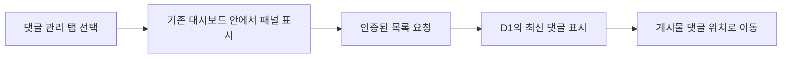
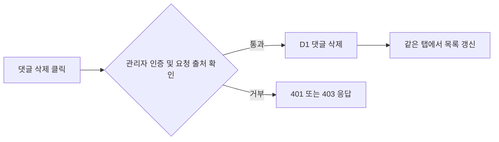
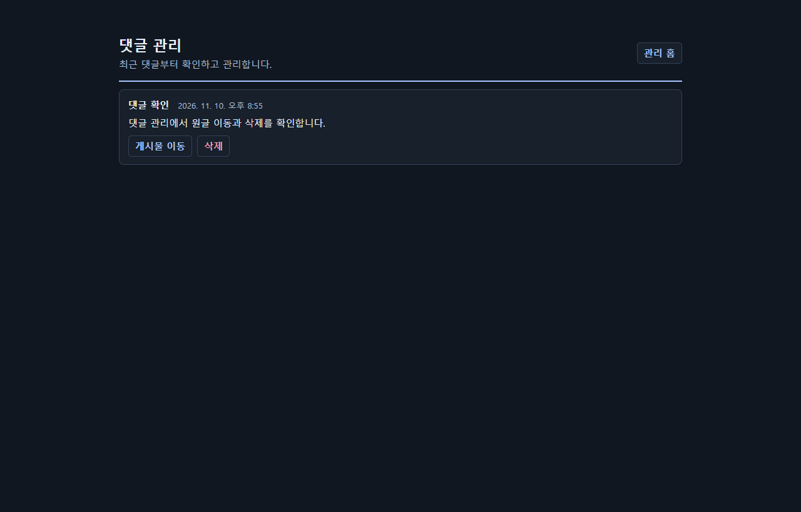
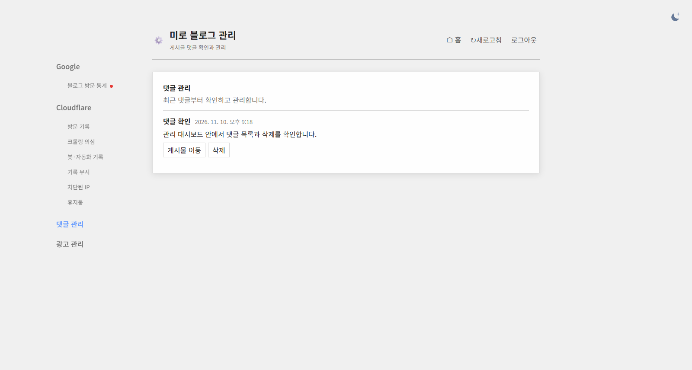
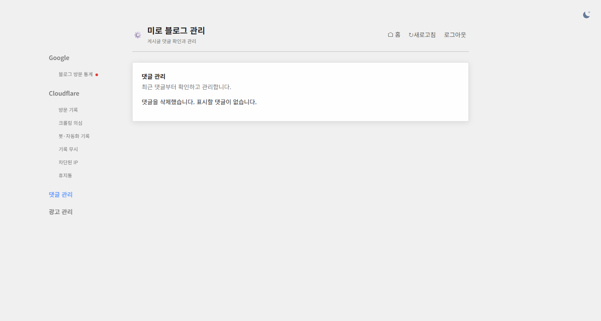
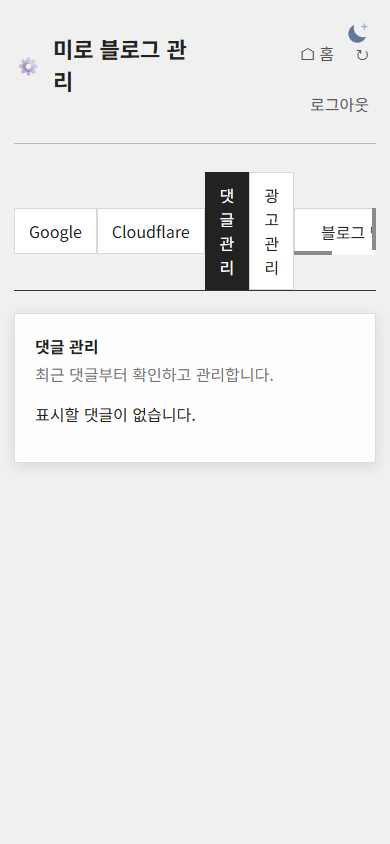

## 작업 결과

[관리 대시보드](https://miro-blog-admin.ehdwns0126.workers.dev/#comments)에 댓글 탭을 배포했습니다. 메뉴를 클릭하면 같은 페이지에서 댓글 목록과 관리 버튼이 표시됩니다.

## 변경 내용

### 적용 내용

- `admin/portfolio.mjs`의 탭 전환이 댓글 패널을 표시하고 목록 조회를 요청합니다. 패널과 버튼은 기존 대시보드의 배경·텍스트·테두리·강조색을 따릅니다.
- `admin/comments-panel.html`이 목록, 원글 이동, 삭제를 표시합니다. 삭제 후 현재 목록을 다시 읽습니다.
- `admin/comments.mjs`는 인증과 삭제 요청의 출처를 검증한 다음 D1을 조회하거나 수정합니다. 기존 주소는 같은 관리자 대시보드의 댓글 탭으로 연결됩니다.
- 운영 Worker는 기존 대시보드 소스를 유지했고, 저장소에는 기존 관리자 템플릿에도 댓글 패널을 통합했습니다.

```js
export async function commentAdministration(request, env, blog) {
  const url = new URL(request.url);
  if (!configured(env)) return reply({error: '관리자 로그인 설정을 확인해 주세요.'}, 503);
  if (!await authorized(request, env)) return reply({error: '관리자 로그인이 필요합니다.'}, 401);
  if (!env.COMMENTS_DB) return reply({error: '댓글 저장소를 확인해 주세요.'}, 503);

  const remove = url.pathname.match(/^\/api\/admin\/comments\/([1-9]\d{0,15})$/);
  if (request.method === 'DELETE' && remove && positiveId(remove[1])) {
    if (request.headers.get('Origin') !== url.origin) return reply({error: '요청 출처를 확인해 주세요.'}, 403);
    await env.COMMENTS_DB.prepare('DELETE FROM comments WHERE id = ?').bind(Number(remove[1])).run();
    return new Response(null, {status: 204, headers});
  }
  if (url.pathname !== '/api/admin/comments' || request.method !== 'GET') return reply({error: '지원하지 않는 요청입니다.'}, 405);

  const before = url.searchParams.get('before');
  if (before !== null && !positiveId(before)) return reply({error: '잘못된 목록 위치입니다.'}, 400);
  const {results} = await env.COMMENTS_DB.prepare(
    'SELECT id, post, nickname, body, created_at FROM comments WHERE id < ? ORDER BY id DESC LIMIT ?',
  ).bind(before ? Number(before) : Number.MAX_SAFE_INTEGER, pageSize + 1).all();
  const comments = results.slice(0, pageSize).map(({post, ...comment}) => ({
    ...comment, postUrl: blog + '/posts/' + encodeURIComponent(post) + '/#comments-title',
  }));
  return reply({comments, next: results.length > pageSize ? comments.at(-1).id : null});
}
```





### 대화 기록

1. 사용자 (시각 미기록) · “따로 페이지 만들지 말고 한 페이지에서 해”
2. 사용자 (시각 미기록) · “디자인 톤도 맞춰주고”
3. AI (21:18 KST) · 기존 메뉴와 패널의 스타일을 사용하고, 탭 전환과 삭제를 확인해 배포했습니다.

## 검증

- 인증된 로컬 브라우저에서 댓글 탭 선택 후 주소·헤더 유지, 원글 URL, 삭제 후 목록 갱신, 통계 탭 복귀 및 모바일 표시를 확인했습니다.
- 운영에서 패널과 메뉴를 확인했고, 기존 주소는 303으로 같은 대시보드 탭에 연결되며 미로그인 목록 API는 401을 반환했습니다.


변경 전 로컬 관리자 세션의 별도 댓글 관리 화면입니다.


변경 후 로컬 관리자 세션에서 기존 메뉴와 톤을 유지한 댓글 탭입니다.


삭제 후 같은 주소에서 목록과 안내가 갱신됐습니다.


모바일에서도 기존 메뉴 안에서 댓글 패널이 열립니다.

## 남은 사항

운영 Google 로그인 후 목록과 삭제는 미확인입니다. 운영 라우팅과 인증 경계, 로컬 로그인 상태의 기능을 각각 확인했습니다. 전역 및 프로젝트 전용 지침은 기존 규칙을 유지했습니다.

## 작업 시간

- 제안 시간: 5~9분
- 실제로 완료된 시간: 기능 배포와 확인 3분 8초. 2026-11-10 21:15:43 시작, 21:18:51 KST 완료.
- XERJ: 미사용 — 지정 검색 도구 미사용.
