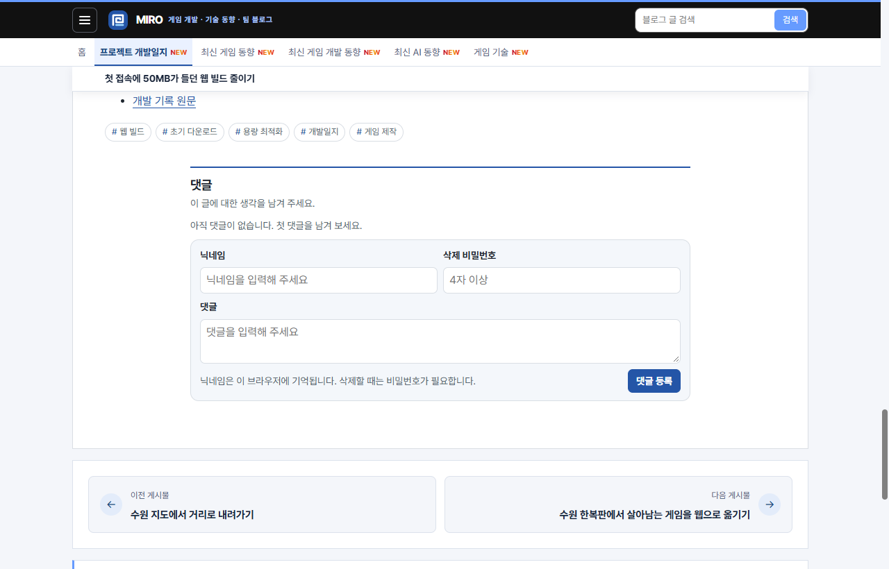
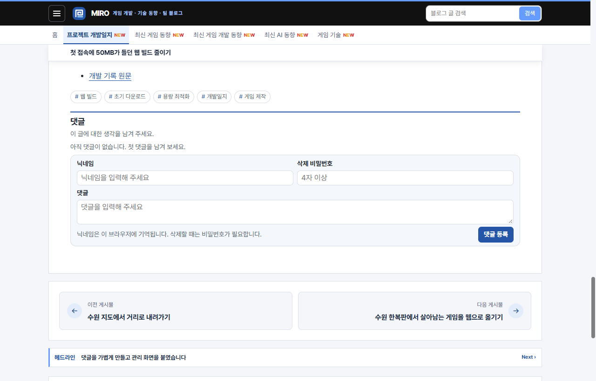

## 작업 결과

[공개 게시글](https://miro-game.pages.dev/posts/story-suwon-web-budget/#comments-title)에서 댓글 폭이 본문과 일치하고, 폼의 높이가 데스크톱에서 약 37px, 모바일에서 약 45px 줄었습니다.

## 변경 내용

### 적용 내용

- `comments/style.css`에서 720px 최대 폭과 가운데 정렬을 제거해 댓글이 본문 안쪽 폭을 채우도록 했습니다.
- 상하 여백, 폼 내부 간격, 입력 높이를 줄였습니다. 모바일 입력 배치는 기존 한 열을 사용합니다.

```css
.comments {
  --comment-tint: color-mix(in srgb, var(--accent) 5%, var(--panel));
  margin-block: 18px 12px;
  padding-block-start: 8px;
  border-top: 2px solid var(--accent);
}
.comments-form :is(input, textarea) { padding-block: 4px; line-height: 1.35; }
```

### 대화 기록

1. 사용자 (시각 미기록) · “이걸 좁혀달라는게 아니라 사이즈를 줄여달라는거지 가로를 줄이면 어캄”
2. AI (21:24 KST) · 본문 폭을 복원하고 입력칸 높이와 세로 여백을 줄이기로 했습니다.
3. AI (21:26 KST) · 공개 페이지에서 가로 정렬과 높이 감소를 확인했습니다.

## 검증

- 데스크톱 1280px 화면에서 댓글 폭 720→966px, 본문 폭 966px. 폼 높이 234→197px.
- 모바일 390px 화면에서 본문과 댓글 폭 모두 326px. 폼 높이 363→317px. 두 화면 모두 가로 스크롤이 생기지 않았습니다.


가운데로 좁아진 변경 전 댓글 영역입니다.


본문과 좌우가 일치하고 높이가 줄었습니다.


기존 모바일 댓글 폼입니다.


같은 폭에서 폼의 세로 높이를 줄였습니다.

## 남은 사항

레이아웃 변경 작업은 완료됐습니다. 전역·전용 지침에 추가할 새 규칙은 없었습니다.

## 작업 시간

- 제안 시간: 3~6분
- 실제로 완료된 시간: 운영 배포·검증 약 2분 1초. 2026-11-10 21:24:20 시작, 21:26:21 KST 완료.
- XERJ: 미사용 — 지정 검색 도구 미사용.
