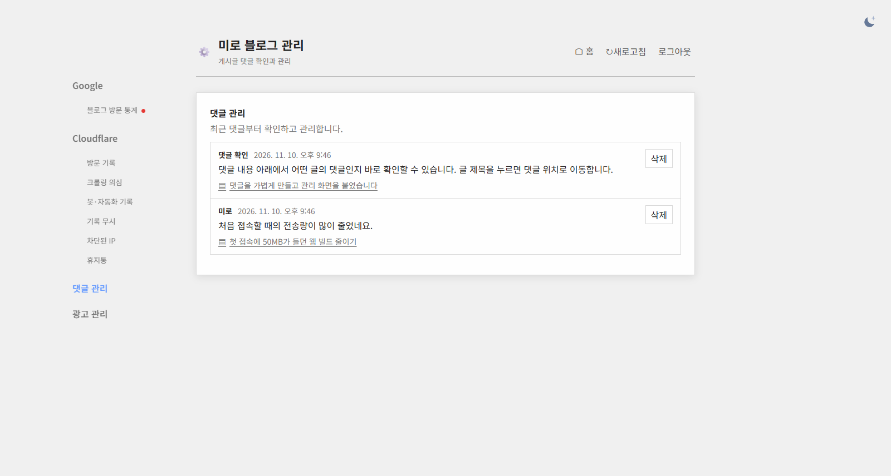
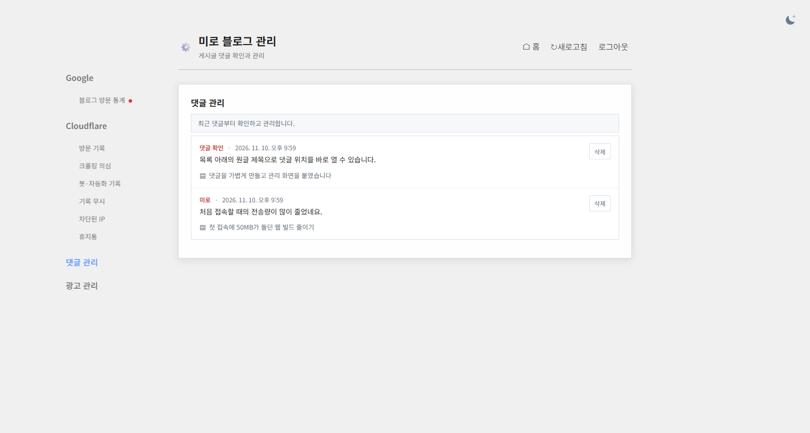
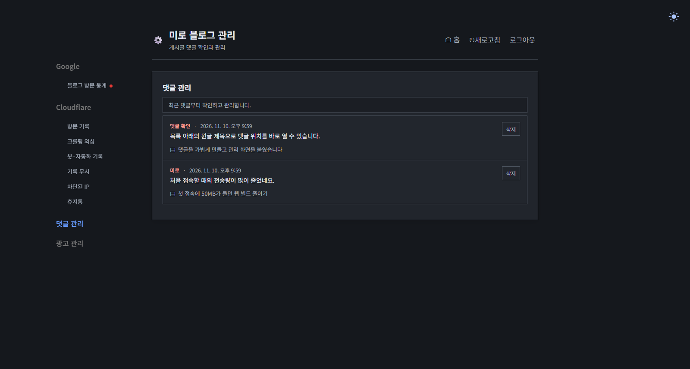
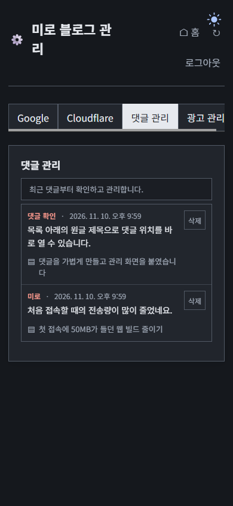

## 작업 결과

[관리자 댓글 탭](https://miro-blog-admin.ehdwns0126.workers.dev/#comments)의 행 배치를 유지하고 티스토리 참고 화면과 비슷한 시각적 계층으로 다듬었습니다.

## 변경 내용

### 적용 내용

- `admin/comments-panel.html`의 CSS에서 작성자에 붉은 강조색을 사용하고, 날짜·원글 제목·삭제 버튼에는 차분한 보조색을 적용했습니다.
- 목록 안내 배경과 행 구분선을 옅게 조정했습니다. 어두운 테마는 기존 대시보드 테마의 배경과 테두리 값을 사용합니다.
- 모바일에서 댓글·광고 메뉴의 글자가 세로로 접히지 않도록 하고, 선택된 댓글 메뉴의 대비를 높였습니다.

```css
.admin-comments .comment-meta strong{color:var(--comment-author);font-weight:600}
.admin-comments li+li{border-top:1px solid var(--comment-divider)}
.admin-comments .comment-post{display:inline-flex;align-items:baseline;gap:6px;max-width:100%;color:var(--comment-secondary);font-size:.8rem;text-decoration:none;text-underline-offset:3px}
```

### 대화 기록

1. 사용자 (시각 미기록) · “레이아웃 좋은데.. 음.. 디자인 좀 해줘 티스토리랑 비슷하게”
2. AI (21:59 KST) · 기존 행 순서는 유지하고 목록의 색, 구분선, 모바일 메뉴를 다듬었습니다.
3. AI (22:00 KST) · 밝은·어두운·모바일을 확인하고 운영 Worker에 최종 스타일을 배포했습니다.

## 검증

- 같은 대시보드 렌더러에 샘플 댓글을 넣어 밝은 테마, 어두운 테마, 390px 모바일을 확인했습니다. 운영 Worker에서 최종 CSS와 미로그인 목록 응답 401을 확인했습니다.


기존 목록입니다.


작성자 강조색과 옅은 행 구분선이 표시됩니다.


대시보드의 어두운 색에 맞춘 결과입니다.


모바일에서 댓글 관리 메뉴가 한 줄로 표시됩니다.

## 남은 사항

운영 Google 계정 로그인 상태의 화면은 미확인입니다. 운영 CSS와 로컬 렌더링을 구분해 확인했습니다. 전역 및 프로젝트 전용 지침 변경 사항은 없습니다.

## 작업 시간

- 제안 시간: 4~7분
- 실제로 완료된 시간: 기능 배포·확인 2분 22초. 2026-11-10 21:57:55 시작, 22:00:17 KST 완료.
- XERJ: 미사용 — 지정 검색 도구 미사용.
