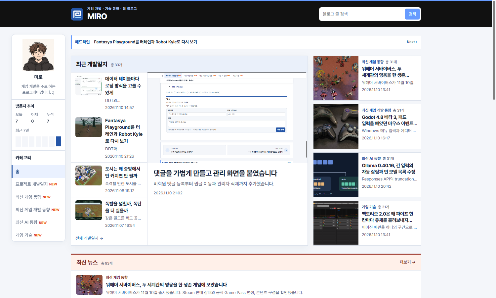
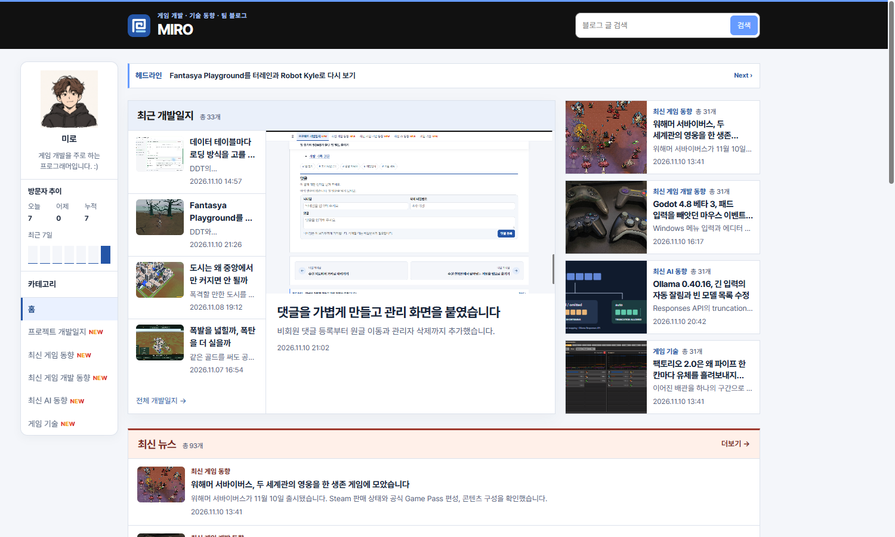

## 작업 결과

긴 제목을 두 줄로 표시해 가운데 대표 글과 오른쪽 카드가 함께 커지는 문제를 줄였습니다.

## 변경 내용

### 적용 내용

사용자는 홈의 왼쪽 요소가 커지면서 옆 레이아웃도 늘어난다고 보고하고 아래쪽 항목 크기를 기준으로 고정해 달라고 요청했습니다. 데스크톱에서만 적용합니다.

```css
.press-devlog .press-brief li { block-size: 105px; overflow: hidden; }
.press-devlog .press-brief .digest-copy strong {
  display: -webkit-box;
  -webkit-box-orient: vertical;
  -webkit-line-clamp: 2;
  overflow: hidden;
}
```

## 검증

운영 홈에서 변경 전 항목 높이는 약 125px, 146px, 105px, 105px였습니다. 변경 전후는 같은 1500px 브라우저 뷰포트에서 촬영했습니다.





## 남은 사항

전역·프로젝트 지침 변경 없음.

## 작업 시간

- 제안 시간: 2~4분
- 실제로 완료된 시간: 22:07:20 KST 시작. 22:09:17 KST에 화면 비교 기록.
- XERJ: 미사용 — 코드 검색 근거가 제공되지 않았습니다.
