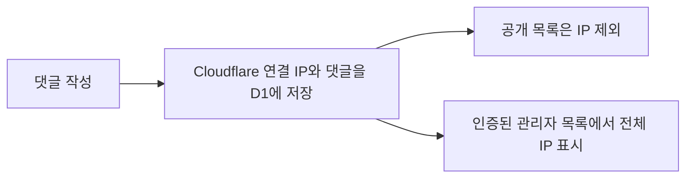
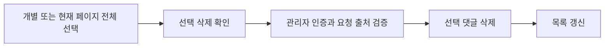
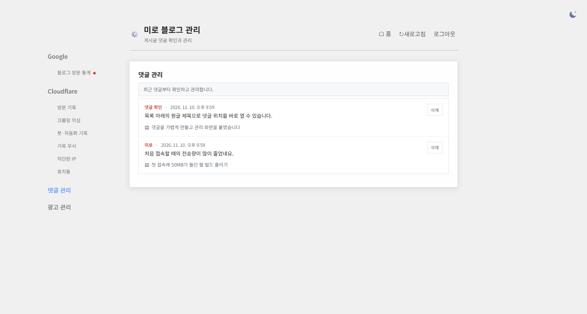
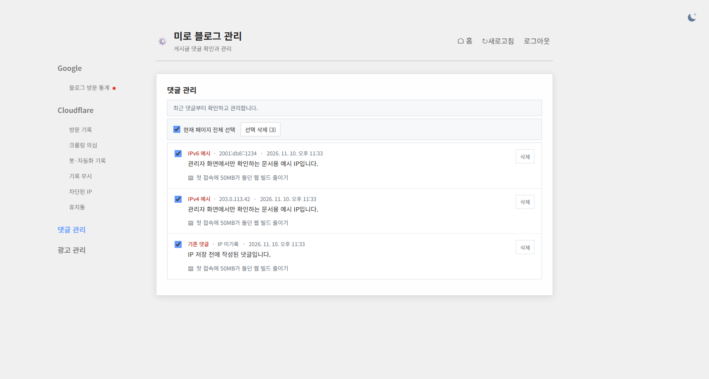
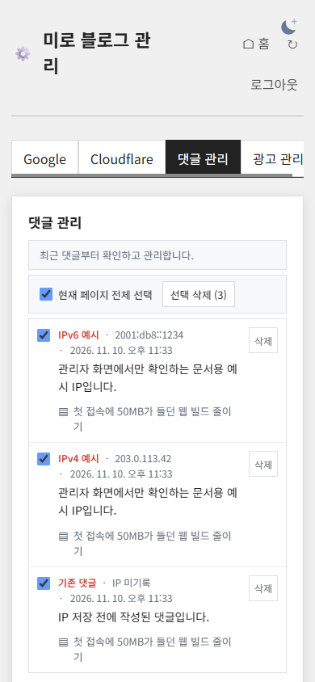

## 작업 결과

[관리자 댓글 탭](https://miro-blog-admin.ehdwns0126.workers.dev/#comments)에서 댓글을 개별 또는 현재 페이지 전체 선택해 삭제할 수 있습니다. 새 댓글의 전체 IP는 로그인한 관리자에게 표시됩니다.

## 변경 내용

### 적용 내용

- `admin/comments-panel.html`은 체크 상태와 선택 건수를 갱신하고, 확인 후 선택 댓글을 삭제합니다. 현재 페이지 단위로 선택합니다.
- `admin/comments.mjs`는 관리자 인증과 같은 출처를 확인하고 한 쿼리로 선택 댓글을 삭제합니다. 관리자 목록만 IP를 반환합니다.
- `functions/api/comments.js`와 D1 마이그레이션은 신규 댓글에 Cloudflare가 전달한 IP를 저장합니다. 이전 댓글은 IP 미기록으로 표시하며, 공개 등록·조회 응답에는 IP가 없습니다.

```js
function updateSelection() {
    const boxes = [...list.querySelectorAll('input[type=checkbox]')];
    const selected = boxes.filter(box => box.checked);
    selectAll.checked = boxes.length > 0 && selected.length === boxes.length;
    selectAll.indeterminate = selected.length > 0 && !selectAll.checked;
    selectAll.disabled = busy || deleting || !boxes.length;
    deleteSelected.disabled = busy || deleting || !selected.length;
    deleteSelected.textContent = selected.length ? '선택 삭제 (' + selected.length + ')' : '선택 삭제';
  }

export async function commentAdministration(request, env, blog) {
  const url = new URL(request.url);
  if (!configured(env)) return reply({error: '관리자 로그인 설정을 확인해 주세요.'}, 503);
  if (!await authorized(request, env)) return reply({error: '관리자 로그인이 필요합니다.'}, 401);
  if (!env.COMMENTS_DB) return reply({error: '댓글 저장소를 확인해 주세요.'}, 503);

  const remove = url.pathname.match(/^\/api\/admin\/comments\/([1-9]\d{0,15})$/);
  if (request.method === 'DELETE' && (remove || url.pathname === '/api/admin/comments')) {
    if (request.headers.get('Origin') !== url.origin) return reply({error: '요청 출처를 확인해 주세요.'}, 403);
    const input = remove?.[1] ?? url.searchParams.get('ids') ?? '';
    if (input.length > pageSize * 17) return reply({error: '삭제할 댓글을 확인해 주세요.'}, 400);
    const ids = [...new Set(input.split(','))];
    if (ids.length > pageSize || !ids.every(positiveId)) return reply({error: '삭제할 댓글을 확인해 주세요.'}, 400);
    const placeholders = ids.map(() => '?').join(',');
    await env.COMMENTS_DB.prepare('DELETE FROM comments WHERE id IN (' + placeholders + ')').bind(...ids.map(Number)).run();
    return new Response(null, {status: 204, headers});
  }
  if (url.pathname !== '/api/admin/comments' || request.method !== 'GET') return reply({error: '지원하지 않는 요청입니다.'}, 405);

  const before = url.searchParams.get('before');
  if (before !== null && !positiveId(before)) return reply({error: '잘못된 목록 위치입니다.'}, 400);
  const {results} = await env.COMMENTS_DB.prepare(
    'SELECT id, post, nickname, body, created_at, author_ip FROM comments WHERE id < ? ORDER BY id DESC LIMIT ?',
  ).bind(before ? Number(before) : Number.MAX_SAFE_INTEGER, pageSize + 1).all();
  const titles = results.length ? await postTitles(blog) : new Map();
  const comments = results.slice(0, pageSize).map(({post, ...comment}) => {
    const path = '/posts/' + encodeURIComponent(post) + '/';
    return {...comment, postTitle: titles.get(path) || post, postUrl: blog + path + '#comments-title'};
  });
  return reply({comments, next: results.length > pageSize ? comments.at(-1).id : null});
}
```





### 대화 기록

1. 사용자 (시각 미기록) · “선택 박스도 없네 아이피도 그렇고 아이피 다 보여줘”
2. AI (23:33 KST) · 기존 댓글에 IP 저장 열이 없음을 확인하고 새 댓글부터 저장하기로 했습니다.
3. AI (23:35 KST) · 운영에서 IP 저장 여부와 공개 응답 비노출을 확인했습니다.

## 검증

- 로컬 관리자 세션에서 문서용 IPv4·IPv6, 기존 댓글의 IP 미기록, 개별·전체 선택, 3개 일괄 삭제를 확인했습니다.
- 운영 D1에 새 댓글의 IP가 저장되는 것과 공개 GET·POST 응답에 IP가 없는 것을 확인했습니다. 값 자체는 출력하지 않았고 임시 댓글을 지웠습니다. 관리자 목록 비로그인 요청은 401을 반환했습니다.


기존 관리자 댓글 목록입니다.


선택 상태와 문서용 예시 IP만 포함한 로컬 화면입니다.


390px 화면에서 동일한 기능을 확인했습니다.

## 남은 사항

운영 계정으로 로그인한 실제 댓글 IP는 미확인입니다. 기존 댓글은 IP 미기록입니다. 전역 및 프로젝트 전용 지침에 추가할 규칙은 없습니다.

## 작업 시간

- 제안 시간: 6~10분
- 실제로 완료된 시간: 기능 배포·검증 4분 21초. 2026-11-10 23:31:15 시작, 23:35:36 KST 완료.
- XERJ: 미사용 — 지정 검색 도구 미사용.
