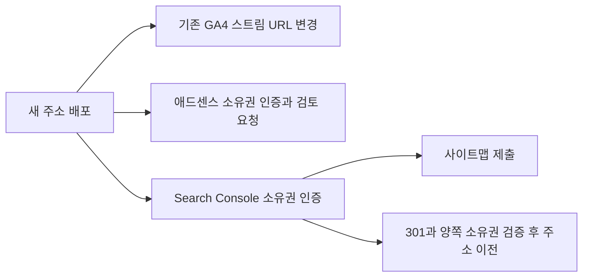
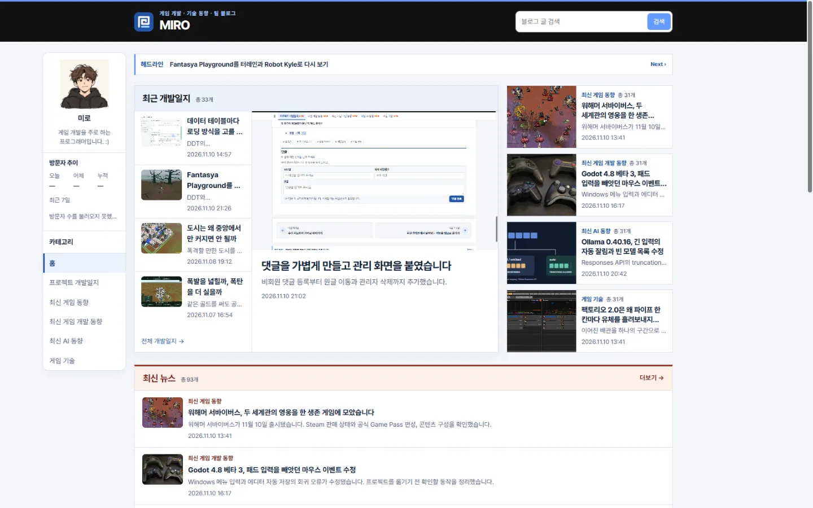

## 작업 결과

[새 운영 블로그](https://miro-lab.pages.dev/)를 배포했습니다. 기존 게시물 링크와 댓글 기록을 유지했습니다. Google 서비스 등록은 접수됐으며 광고 심사와 사이트맵 보고서 갱신은 대기 중입니다.

## 변경 내용

### 적용 내용

### 운영 주소와 기존 링크

기본 주소, 자동 배포 대상, canonical, robots.txt와 사이트맵을 새 주소로 맞췄습니다. 기존 주소는 경로와 쿼리를 보존해 301로 전달합니다. 기존 댓글 삭제 비밀번호가 계속 검증되도록 댓글 API는 기존 Pages 프로젝트에 두고 새 주소의 요청을 허용했습니다.


### 댓글 API

functions/api/comments.js의 publicPost는 이전 호스트에서 새 운영 글을 확인합니다. onRequest는 기존 API에서 새 주소의 사전 요청과 CORS 응답을 처리합니다.

```javascript
async function publicPost(env, url, post) {
  const path = '/posts/' + encodeURIComponent(post) + '/';
  const page = url.origin === legacyOrigin
    ? await fetch(new URL(path, productionOrigin), {redirect: 'error'})
    : await env.ASSETS.fetch(new Request(new URL(path, url)));
  await page.body?.cancel();
  return page.ok && page.headers.get('Content-Type')?.startsWith('text/html');
}

export async function onRequest({request, env}) {
  const isLegacyHost = new URL(request.url).origin === legacyOrigin;
  const fromProduction = isLegacyHost && request.headers.get('Origin') === productionOrigin;
  if (fromProduction && request.method === 'OPTIONS') {
    return new Response(null, {
      status: 204,
      headers: {
        'Access-Control-Allow-Origin': productionOrigin,
        'Access-Control-Allow-Methods': 'GET, POST, DELETE',
        'Access-Control-Allow-Headers': 'Content-Type',
        'Vary': 'Origin',
      },
    });
  }

  let response;
  try {
    response = await handle(request, env);
  } catch (error) {
    console.error('Comment request failed', {name: error.name});
    response = reply({error: '댓글을 처리하지 못했습니다. 잠시 후 다시 시도해 주세요.'}, 503);
  }
  if (isLegacyHost) response.headers.append('Vary', 'Origin');
  if (fromProduction) response.headers.set('Access-Control-Allow-Origin', productionOrigin);
  return response;
}
```

### Google 등록과 운영 관리

기존 GA4 측정 ID를 유지하고 URL을 변경했습니다. 동일한 애드센스 계정에서 새 사이트 검토를 요청하고 이전 사이트 등록을 제거했습니다. Search Console URL 접두어 속성을 인증하고 사이트맵과 주소 이전 요청을 제출했습니다. 관리 Worker는 운영 코드의 URL 4개만 교체했고 방문 집계 Worker는 새 Origin을 허용합니다.



### 대화 기록 요약

사용자는 주소와 Google 서비스 재등록을 요청한 뒤 첫 시도를 중단했습니다. 이름을 비교한 다음 “ㅇㅇ 그렇게하자”로 miro-lab을 확정했습니다. 진행 중 하이픈이 필수인지 물어 형식상 필수가 아니며 miro-lab 배포가 진행 중이라고 답했습니다.

## 검증

- 운영 소스 커밋 f7fe7b5를 main에 푸시했고, Cloudflare 운영 배포에 같은 커밋이 표시됐습니다.

- 새 홈페이지, 대표 글, 사이트맵, ads.txt와 GA4 자바스크립트는 HTTPS 200입니다. 기존 대표 글은 쿼리를 유지한 301입니다.

- 기존 댓글 API 조회 200과 새 Origin의 사전 요청 204, 방문자 집계 조회 200을 확인했습니다. 관리 Worker는 새 Origin의 요청을 받아 유효하지 않은 입력을 400으로 거부했습니다.

- Search Console에서 소유권과 주소 이전 접수를 확인했습니다. 실제 URL 테스트에서 사이트맵 가져오기가 성공했고 공개 XML에 새 주소 180개가 들어 있습니다.



이전 전 · 기존 운영의 고정 배포 주소를 같은 크기로 다시 열었습니다.


이전 후 · 새 공개 주소의 블로그 본문과 카드 배치를 확인했습니다.

## 남은 사항

- 애드센스는 검토 중입니다. Search Console 사이트맵 목록에는 초기 가져오기 실패가 표시되며 Google 실시간 테스트는 성공했습니다. 검색 색인과 GA4 집계 반영은 미확인입니다.
- 댓글 쓰기·삭제를 이번 이전 과정에서 다시 실행하지 않았습니다. 기존 댓글 조회와 사전 요청을 확인했습니다.
- 관리 Worker의 운영 v2 설정과 저장소 설정의 차이를 확인했습니다. 이번에는 코드 전용 API로 갱신해 운영 바인딩을 유지했습니다. 지침 변경은 없습니다.

## 작업 시간

- 제안 시간: 15~25분. Google 심사 별도.
- 실제로 완료된 시간: 2026-11-11 00:14:59 KST 시작. 00:29 KST까지 운영 전환과 Google 실시간 검증을 확인했습니다. 약 14분.
- XERJ: 미사용 — Git, Wrangler, HTTPS 응답과 각 서비스의 운영 화면을 사용했습니다.
