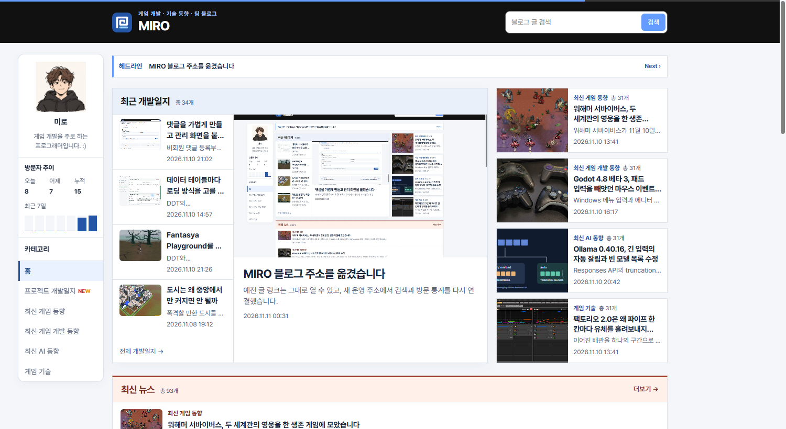

## 작업 결과

한국시간 자정을 지나도 발행 후 24시간 이내라면 NEW가 표시됩니다.

## 변경 내용

### 적용 내용

사용자는 발행 후 24시간 기준에 동의했습니다. 페이지 생성 시 카테고리별 최근 발행 시각을 넣고, 브라우저에서 경과 시간을 확인합니다.

```js
const newWindowMs = 24 * 60 * 60 * 1000;
const badges = document.querySelectorAll('.category-new');

for (const badge of badges) {
  const publishedAt = Date.parse(badge.dataset.publicationTime);
  const age = Date.now() - publishedAt;
  badge.hidden = !(age >= 0 && age < newWindowMs);
  if (!badge.hidden) {
    setTimeout(() => { badge.hidden = true; }, newWindowMs - age);
  }
}
```

## 검증

같은 운영 홈에서 변경 전후를 비교했습니다. 한국시간 전날 발행된 글도 24시간 이내면 카테고리에 NEW가 표시되는 것을 확인했습니다.




## 남은 사항

발행 시각을 확인할 수 없는 글은 24시간 계산에서 제외했습니다. 지침 추가 사항 없음.

## 작업 시간

- 제안 시간: 2~4분
- 실제로 완료된 시간: 07:53:04 KST 시작. 07:55:27 KST에 화면 비교 기록.
- XERJ: 미사용 — 코드 검색 근거가 제공되지 않았습니다.
