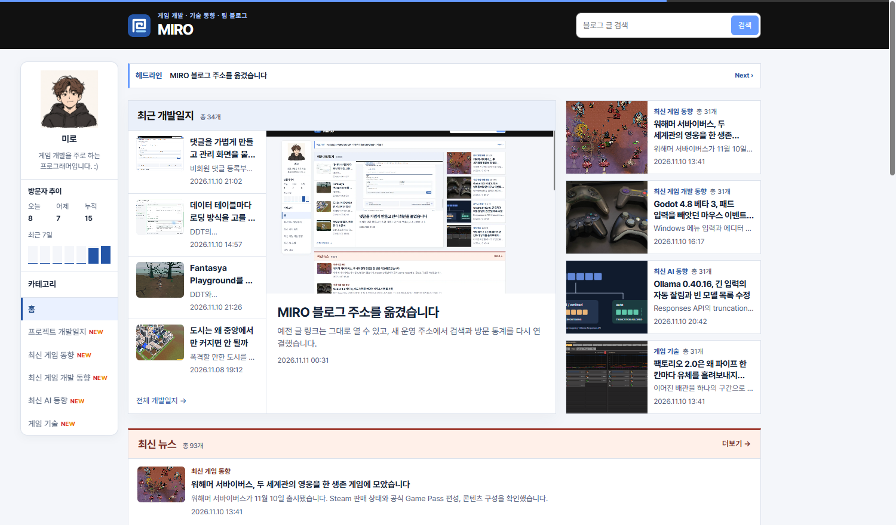

## 작업 결과

정확한 발행 시각을 카드의 시간 텍스트에 마우스를 올려 확인할 수 있습니다.

## 변경 내용

### 적용 내용

사용자는 “홈 페이지에서 게시물들 몇 시간 / 몇 일 전으로 표시 해줘”라고 요청했습니다. 홈 카드가 화면에 나타날 때 기존 발행 시각으로 경과 시간을 계산합니다.

```js
const hourMs = 60 * 60 * 1000;
const dayMs = 24 * hourMs;
const relativeTime = new Intl.RelativeTimeFormat('ko', { numeric: 'always' });

function updatePublicationTime(time, now) {
  const stamp = time.dateTime;
  const age = now - Date.parse(stamp);
  if (!Number.isFinite(age)) return;

  let label;
  if (stamp.length === 10) {
    const seoulDay = Math.floor((now + 9 * hourMs) / dayMs);
    const days = seoulDay - Date.parse(stamp) / dayMs;
    if (days < 0) return;
    label = days === 0 ? '오늘' : relativeTime.format(-days, 'day');
  } else {
    if (age < 0) return;
    if (age >= dayMs) label = relativeTime.format(-Math.floor(age / dayMs), 'day');
    else if (age >= hourMs) label = relativeTime.format(-Math.floor(age / hourMs), 'hour');
    else if (age >= 60000) label = relativeTime.format(-Math.floor(age / 60000), 'minute');
    else label = '방금 전';
  }

  time.title = time.textContent;
  time.textContent = label;
}
```

## 검증

운영 홈에서 변경 전후 날짜를 비교했습니다.




## 남은 사항

발행 날짜만 있는 글은 한국시간 날짜 차이로 표시합니다. 지침 추가 사항 없음.

## 작업 시간

- 제안 시간: 2~4분
- 실제로 완료된 시간: 08:01:42 KST 시작. 08:03:38 KST에 화면 비교 기록.
- XERJ: 미사용 — 코드 검색 근거가 제공되지 않았습니다.
