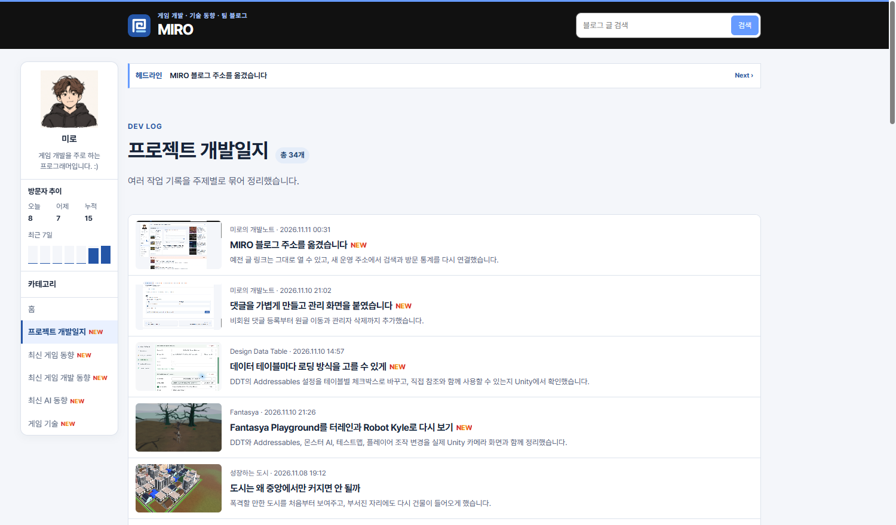

## 작업 결과

스크롤 후 나타나는 카드에도 기존 카테고리와 같은 경과 시간 규칙을 적용합니다.

## 변경 내용

### 적용 내용

사용자는 “각 게시판으로 갔을 때도 하루 이내 있던 게시물들에 NEW 표시 넣어줘”라고 요청했습니다. 게시판 카드가 나타날 때 아래 함수를 호출합니다.

```js
const newWindowMs = 24 * 60 * 60 * 1000;

export function updateNewBadges(root) {
  const now = Date.now();
  for (const badge of root.querySelectorAll('.category-new')) {
    const publishedAt = Date.parse(badge.dataset.publicationTime);
    const age = now - publishedAt;
    badge.hidden = !(age >= 0 && age < newWindowMs);
    if (!badge.hidden) {
      setTimeout(() => { badge.hidden = true; }, newWindowMs - age);
    }
  }
}

updateNewBadges(document);
```

## 검증

운영 게시판의 변경 전후를 브라우저에서 비교했습니다.




## 남은 사항

발행 시각을 확인할 수 없는 글은 표시 대상에서 제외했습니다. 지침 추가 사항 없음.

## 작업 시간

- 제안 시간: 2~4분
- 실제로 완료된 시간: 08:06:15 KST 시작. 08:09:08 KST에 화면 비교 기록.
- XERJ: 미사용 — 코드 검색 근거가 제공되지 않았습니다.
