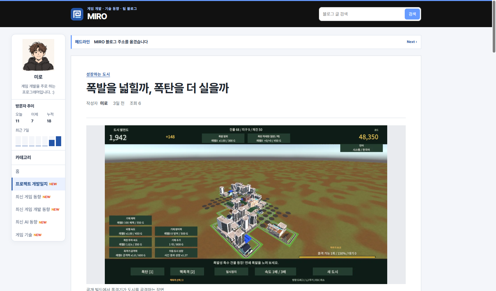
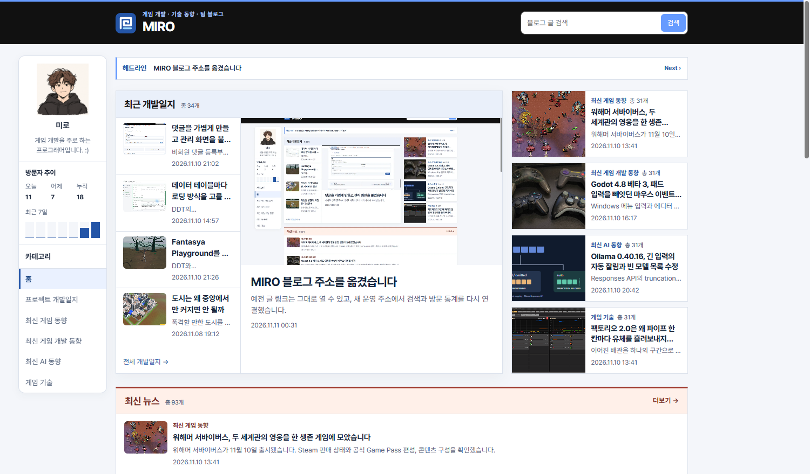

## 작업 결과

1년이 지난 글에는 각 화면의 발행 날짜가 표시됩니다. 게시판 목록은 날짜 표기를 사용합니다.

## 변경 내용

### 적용 내용

사용자는 홈과 게시물에 상대 시간을 적용하되 1년 이상 지난 글은 날짜로 표시하고 게시판을 유지해 달라고 요청했습니다.

```js
const hourMs = 60 * 60 * 1000;
const dayMs = 24 * hourMs;
const relativeTime = new Intl.RelativeTimeFormat('ko', { numeric: 'always' });

export function updatePublicationTime(time, now) {
  const stamp = time.dateTime;
  const publishedAt = Date.parse(stamp);
  const age = now - publishedAt;
  if (!Number.isFinite(age) || age < 0) return;

  const seoulOffset = 9 * hourMs;
  const dateOnly = stamp.length === 10;
  const anniversary = new Date(publishedAt + (dateOnly ? 0 : seoulOffset));
  anniversary.setUTCFullYear(anniversary.getUTCFullYear() + 1);
  if (now + seoulOffset >= anniversary.getTime()) return;

  let label;
  if (dateOnly) {
    const seoulDay = Math.floor((now + seoulOffset) / dayMs);
    const days = seoulDay - publishedAt / dayMs;
    if (days < 0) return;
    label = days === 0 ? '오늘' : relativeTime.format(-days, 'day');
  } else {
    if (age >= dayMs) label = relativeTime.format(-Math.floor(age / dayMs), 'day');
    else if (age >= hourMs) label = relativeTime.format(-Math.floor(age / hourMs), 'hour');
    else if (age >= 60000) label = relativeTime.format(-Math.floor(age / 60000), 'minute');
    else label = '방금 전';
  }

  time.title = time.textContent;
  time.textContent = label;
}
```

## 검증

운영 홈과 게시물 상세에서 상대 시간을 확인했습니다. 브라우저에서 기준 시각을 2027년 12월 1일로 지정해 1년 이후에 날짜가 표시되는 것을 확인했습니다. 운영 게시판은 날짜를 표시했습니다.







## 남은 사항

전역·프로젝트 지침 추가 사항 없음.

## 작업 시간

- 제안 시간: 3~5분
- 실제로 완료된 시간: 08:43:04 KST 시작. 08:45:26 KST에 화면 비교 기록.
- XERJ: 미사용 — 코드 검색 근거가 제공되지 않았습니다.
