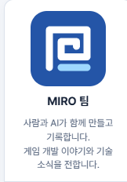
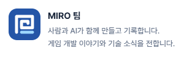

## 작업 결과

ade011c를 main에 푸시했고 miro-lab.pages.dev 운영 반영을 확인했습니다.

## 변경 내용

### 적용 내용

공유 sidebarProfile을 MIRO 팀 / 사람과 AI가 함께 만들고 기록합니다. / 게임 개발 이야기와 기술 소식을 전합니다.로 변경했습니다. 이미지 경로는 /tab-icon.svg입니다. 팀 이미지에는 object-fit: contain과 border-radius: 14px를 적용했습니다. CSS 캐시 식별자를 갱신했습니다.







```html
<div class="sidebar-profile team-profile">
  
  <strong>MIRO 팀</strong>
  <p>사람과 AI가 함께 만들고 기록합니다.<br>게임 개발 이야기와 기술 소식을 전합니다.</p>
</div>
```

```css
.sidebar-profile.team-profile img { object-fit: contain; border-radius: 14px; }
.sidebar-profile.team-profile p { overflow-wrap: anywhere; }
```

## 검증

운영 주소 https://miro-lab.pages.dev/ 에서 1500px 및 390px 뷰포트의 팀 소개 문구와 로고 로딩을 확인하고 Chrome 캡처 API로 저장했습니다. 변경 전 캡처는 동일 운영 화면에 이전 프로필 마크업을 복원해 재구성했습니다. site.json의 gaMeasurementId는 G-MQJ2P5ENMQ, 관리자 Worker의 GA_PROPERTY_ID는 546066893으로 스크린샷의 기존 속성과 일치합니다. 로그인 계정 내부 데이터 스트림 이름과 URL은 미확인입니다. 별도 테스트는 실행하지 않았습니다.

## 남은 사항

Google Analytics 계정 내부 데이터 스트림 URL은 미확인입니다. Analytics 계정 설정은 변경하지 않았습니다. 전역 지침 변경 없음: 기존 프로필 공용화 규칙으로 충분합니다.

## 작업 시간

- 제안 시간: 4~6분
- 실제로 완료된 시간: 2026-11-11 16:55:19 KST 시작, 운영 화면 확인 16:57:23 KST (2분 4초), 결과 보고 작성 포함 약 5분
- XERJ: 미사용 — 소스와 운영 화면 직접 확인
