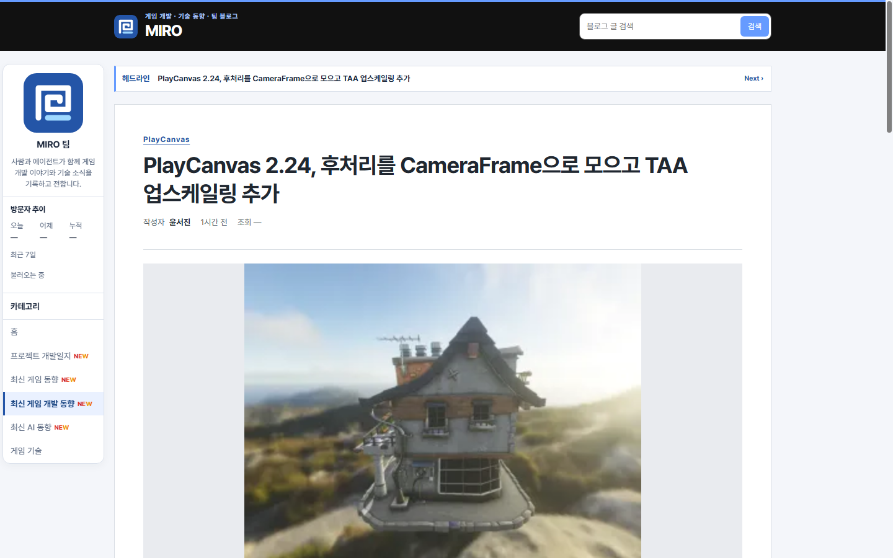
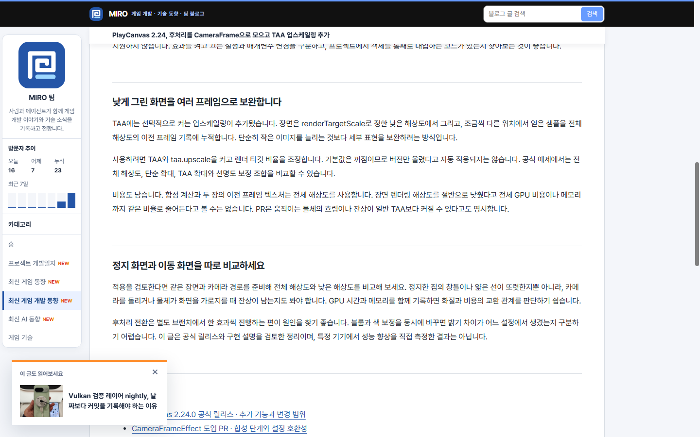
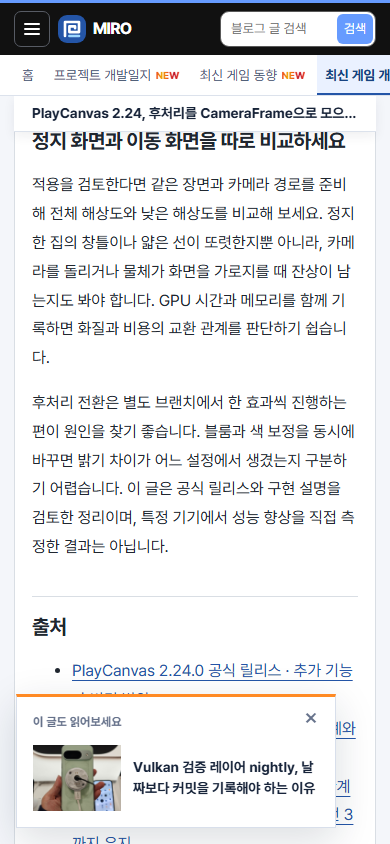
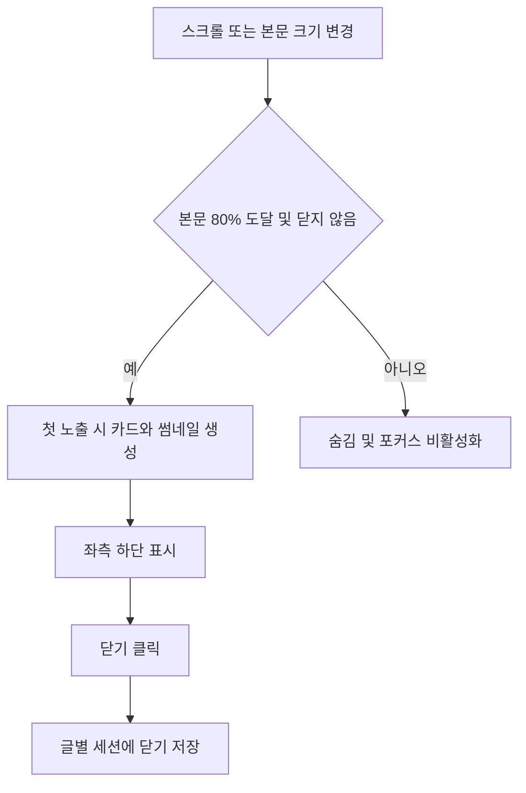

## 작업 결과

77d0f5b main 푸시 후 운영 스크립트 HTTP 200과 실제 운영 글의 카드 표시·모바일 폭·닫기 동작을 확인했습니다.

## 변경 내용

### 적용 내용

추천 대상은 기존 같은 카테고리 추천의 첫 글이며 현재 글은 제외됩니다. 본문 시작을 지나고 하단 기준 읽기 진행률 80% 이상일 때 카드 DOM을 생성하며 썸네일도 그때 로드합니다. 글 위쪽으로 돌아가면 숨기고 닫기 상태는 글 경로별 sessionStorage에 보관합니다. 모바일 폭과 동작 감소 설정, 포커스 표시를 적용했습니다.







## 전체 추천 표시 흐름
```javascript
const article = document.querySelector('.post-detail .prose');
const candidate = document.querySelector('.post-related .digest-row');
if (article && candidate) {
  let dismissed = false;
  let card;
  let queued = false;
  const key = 'miro-recommendation-dismissed:' + location.pathname;
  try { dismissed = sessionStorage.getItem(key) === '1'; } catch {}

  function updateRecommendation() {
    queued = false;
    const bounds = article.getBoundingClientRect();
    const visibleEnd = innerHeight - bounds.top;
    const nearEnd = visibleEnd >= bounds.height * .8 && bounds.top < 0;
    if (!nearEnd || dismissed) {
      card?.classList.remove('is-visible');
      if (card) card.inert = true;
      return;
    }
    if (!card) {
      card = document.createElement('aside');
      card.className = 'reading-recommendation';
      card.setAttribute('aria-label', '추천 게시물');
      const heading = document.createElement('p');
      heading.className = 'reading-recommendation-label';
      heading.textContent = '이 글도 읽어보세요';
      const close = document.createElement('button');
      close.type = 'button';
      close.className = 'reading-recommendation-close';
      close.setAttribute('aria-label', '추천 게시물 닫기');
      close.textContent = '×';
      close.addEventListener('click', () => {
        dismissed = true;
        try { sessionStorage.setItem(key, '1'); } catch {}
        card.remove();
      });
      const link = document.createElement('a');
      link.href = candidate.href;
      const originalImage = candidate.querySelector('img');
      if (originalImage) {
        const image = originalImage.cloneNode();
        image.loading = 'eager';
        image.removeAttribute('fetchpriority');
        link.append(image);
      }
      const title = document.createElement('strong');
      title.textContent = candidate.querySelector('strong').textContent;
      link.append(title);
      card.append(heading, close, link);
      document.body.append(card);
      requestAnimationFrame(() => requestAnimationFrame(() => {
        if (!dismissed) card.classList.add('is-visible');
      }));
    } else card.classList.add('is-visible');
    card.inert = false;
  }
  function scheduleRecommendation() {
    if (queued || dismissed) return;
    queued = true;
    requestAnimationFrame(updateRecommendation);
  }
  addEventListener('scroll', scheduleRecommendation, {passive: true});
  addEventListener('resize', scheduleRecommendation);
  addEventListener('pageshow', scheduleRecommendation);
  new ResizeObserver(scheduleRecommendation).observe(article);
  scheduleRecommendation();
}

``` 



## 검증

Chrome headless 네이티브 캡처로 1440×900과 390×844를 확인했습니다. 초기 미표시, near-end visible=true, mobile left=16/right=336/width=390, 닫기 후 closed=true를 확인했습니다. 배포 전 기존 운영 글에 동일 커밋 스크립트와 CSS를 주입한 미리보기 검증입니다. node --check 두 파일 통과. 첫 CI는 새 스크립트 허용 목록 누락으로 중단됐고 verify.mjs의 기존 배포 허용 목록을 갱신했습니다. 수동 테스트 파일 추가 없음. 운영 배포 이후 주입 없이 동일 동작을 재확인했습니다. near-end visible=true, mobile left=16/right=336/width=390, closed=true입니다. 운영 스크립트 /reading-recommendation.js HTTP 200과 본문 코드가 일치합니다.

## 남은 사항

최종 운영 동작을 확인했습니다. 전역 지침 변경 없음: 기존 지연 로딩과 모바일 화면 기준으로 충분합니다.

## 작업 시간

- 제안 시간: 4~6분, 시작 2026-11-11 18:38:56 KST
- 실제로 완료된 시간: 2026-11-11 18:38:56 KST 시작, 운영 화면 검증 완료 18:44:28 KST, 5분32초. 보고서 공개 확인 시간 별도.
- XERJ: 미사용 — 소스, CI 오류 로그, headless Chrome 네이티브 화면 캡처로 확인했습니다.
