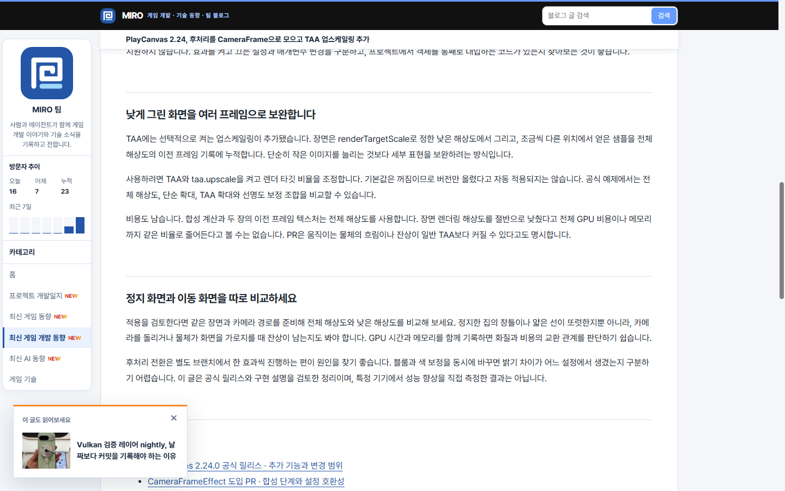
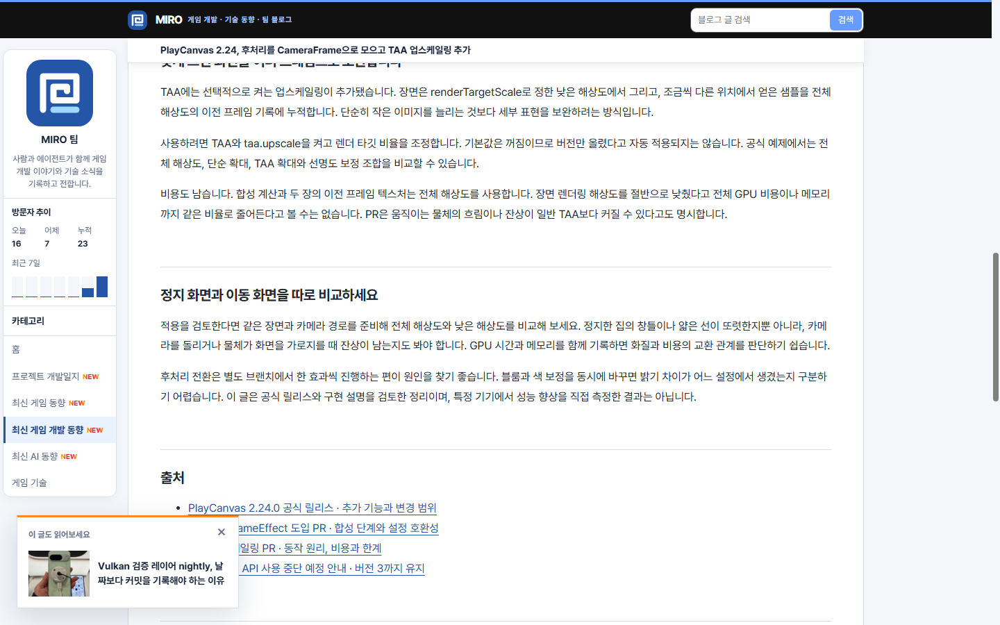
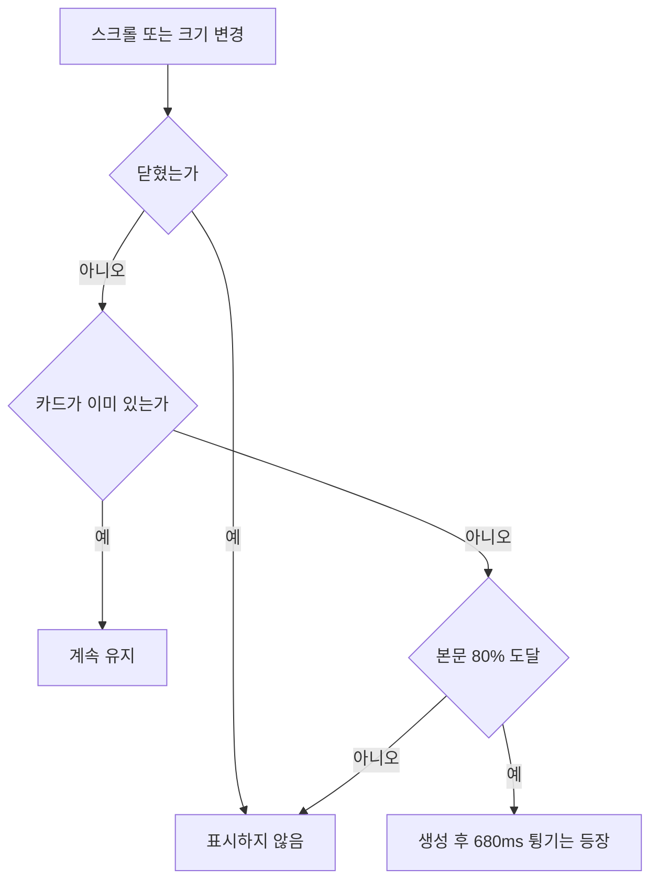

## 작업 결과

6e4c16d main 푸시와 Actions 성공, 실제 운영 화면의 애니메이션·위로 스크롤 후 유지·닫기를 확인했습니다.

## 변경 내용

### 적용 내용

기존 220ms 전환 대신 680ms 키프레임으로 화면 아래에서 출발해 -14px, +6px, -3px를 지나 정착합니다. 사용자가 요청한 효과를 위해 이 카드의 동작 감소 비활성화 조건을 제거했습니다. 최초 생성 이후 nearEnd 조건이 false가 되어도 유지하며 닫기 상태는 그대로 보관합니다. 추천 기준은 같은 카테고리에서 현재 글과 이전·다음 글을 제외한 최신 글입니다. 스크립트와 스타일 URL의 캐시 식별자를 갱신했습니다.





## 전체 카드 갱신 코드
```javascript
const article = document.querySelector('.post-detail .prose');
const candidate = document.querySelector('.post-related .digest-row');
if (article && candidate) {
  let dismissed = false;
  let card;
  let queued = false;
  const key = 'miro-recommendation-dismissed:' + location.pathname;
  try { dismissed = sessionStorage.getItem(key) === '1'; } catch {}

  function updateRecommendation() {
    queued = false;
    const bounds = article.getBoundingClientRect();
    const visibleEnd = innerHeight - bounds.top;
    const nearEnd = visibleEnd >= bounds.height * .8 && bounds.top < 0;
    if (dismissed || (!nearEnd && !card)) return;
    if (!card) {
      card = document.createElement('aside');
      card.className = 'reading-recommendation';
      card.setAttribute('aria-label', '추천 게시물');
      const heading = document.createElement('p');
      heading.className = 'reading-recommendation-label';
      heading.textContent = '이 글도 읽어보세요';
      const close = document.createElement('button');
      close.type = 'button';
      close.className = 'reading-recommendation-close';
      close.setAttribute('aria-label', '추천 게시물 닫기');
      close.textContent = '×';
      close.addEventListener('click', () => {
        dismissed = true;
        try { sessionStorage.setItem(key, '1'); } catch {}
        card.remove();
      });
      const link = document.createElement('a');
      link.href = candidate.href;
      const originalImage = candidate.querySelector('img');
      if (originalImage) {
        const image = originalImage.cloneNode();
        image.loading = 'eager';
        image.removeAttribute('fetchpriority');
        link.append(image);
      }
      const title = document.createElement('strong');
      title.textContent = candidate.querySelector('strong').textContent;
      link.append(title);
      card.append(heading, close, link);
      document.body.append(card);
      requestAnimationFrame(() => requestAnimationFrame(() => {
        if (!dismissed) card.classList.add('is-visible');
      }));
    } else card.classList.add('is-visible');
    card.inert = false;
  }
  function scheduleRecommendation() {
    if (queued || dismissed) return;
    queued = true;
    requestAnimationFrame(updateRecommendation);
  }
  addEventListener('scroll', scheduleRecommendation, {passive: true});
  addEventListener('resize', scheduleRecommendation);
  addEventListener('pageshow', scheduleRecommendation);
  new ResizeObserver(scheduleRecommendation).observe(article);
  scheduleRecommendation();
}

```



## 검증

Actions가 최종 커밋 6e4c16d에 대해 success입니다. 운영 글을 실제 headless Chrome에서 열어 prefers-reduced-motion: reduce 상태로 확인했습니다. animationName=recommendation-bounce-in, duration=0.68s, 실행 중 animation 수=1과 translateY=173.797을 확인했습니다. 상단으로 돌아간 뒤 visible=true/inert=false, 닫기 후 DOM 없음=true입니다. 별도 테스트 파일은 작성하지 않았습니다. 운영 코드와 source syntax를 확인했습니다.

## 남은 사항

전역 지침 변경 없음: 이번 동작은 사용자가 지정한 개별 UI 요구이며 공통 동작 감소 정책으로 확대하지 않습니다.

## 작업 시간

- 제안 시간: 2~4분, 시작 2026-11-11 18:49:23 KST
- 실제로 완료된 시간: 운영 확인 18:51:44 KST, 2분21초. 보고서 공개 확인 별도.
- XERJ: 미사용 — 소스와 실제 브라우저 애니메이션 상태 및 Actions 결과를 확인했습니다.
