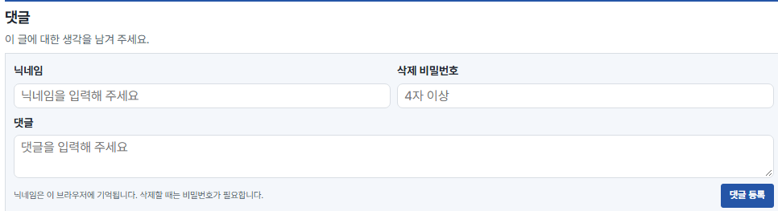
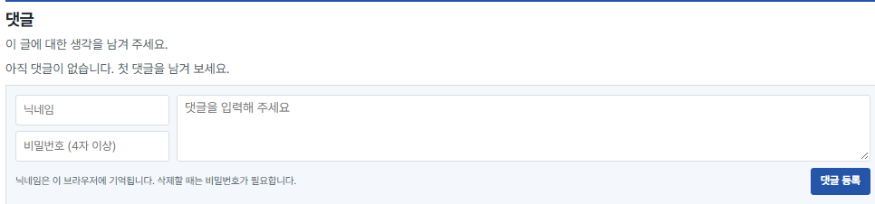
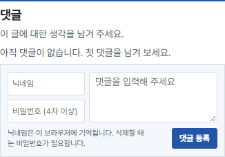

## 작업 결과

e290a2b를 main에 푸시했고 운영 글에서 새 입력란과 이전·다음 버튼 제거를 확인했습니다.

## 변경 내용

### 적용 내용

articleFooter의 이전·다음 버튼 생성과 반환을 제거했습니다. 댓글은 comments-compose 공통 그리드에 닉네임·삭제 비밀번호를 왼쪽 170px, 댓글칸을 나머지 폭으로 배치했습니다. 입력칸 34px 두 개와 간격 6px에 맞춰 댓글칸은 74px입니다. 모바일 왼쪽 폭은 112px이며 동일한 두 열을 유지합니다. 접근성 레이블은 보존하되 화면에서는 placeholder로 구분합니다. 등록 버튼과 보조 안내는 아래 한 줄에 압축했습니다. 기존 댓글 등록과 삭제 로직은 수정하지 않았습니다.







## 댓글 렌더 함수 전체
```javascript
export function renderComments(post) {
  return `<section class="comments" aria-labelledby="comments-title" data-comments data-post="${post}">
  <link rel="stylesheet" href="/comments.css?v=compact-compose">
  <script type="module" src="/comments.js"></script>
  <header class="comments-heading">
    <h2 id="comments-title">댓글</h2>
    <p>이 글에 대한 생각을 남겨 주세요.</p>
  </header>
  <noscript><p>댓글을 이용하려면 JavaScript를 켜 주세요.</p></noscript>
  <p class="comments-status" data-load-status role="status"></p>
  <ol class="comments-list" aria-label="댓글 목록" hidden></ol>
  <button class="comments-secondary" type="button" data-more hidden>댓글 더 보기</button>
  <button class="comments-secondary" type="button" data-retry hidden>댓글 다시 불러오기</button>
  <form class="comments-form" autocomplete="off" hidden>
    <div class="comments-compose">
      <div class="comments-fields">
        <label><span class="comments-field-label">닉네임</span><input name="nickname" required maxlength="24" placeholder="닉네임"></label>
        <label><span class="comments-field-label">삭제 비밀번호</span><input name="password" type="password" autocomplete="new-password" required minlength="4" maxlength="128" placeholder="비밀번호 (4자 이상)"></label>
      </div>
      <label class="comments-message"><span class="comments-field-label">댓글</span><textarea name="body" required maxlength="2000" rows="2" placeholder="댓글을 입력해 주세요"></textarea></label>
    </div>
    <div class="comments-actions">
      <p>닉네임은 이 브라우저에 기억됩니다. 삭제할 때는 비밀번호가 필요합니다.</p>
      <button class="comments-primary" type="submit">댓글 등록</button>
    </div>
  </form>
  <p class="comments-status" data-action-status role="status"></p>
  <dialog class="comments-dialog" aria-labelledby="comment-delete-title">
    <form autocomplete="off">
      <h3 id="comment-delete-title">댓글 삭제</h3>
      <label>삭제 비밀번호<input name="password" type="password" autocomplete="off" required minlength="4" maxlength="128"></label>
      <p class="comments-status" role="status"></p>
      <div class="comments-actions">
        <button class="comments-secondary" type="button" data-cancel>취소</button>
        <button class="comments-primary" type="submit">삭제</button>
      </div>
    </form>
  </dialog>
</section>`;
}

```

## 검증

운영 글을 headless Chrome으로 열어 production-new=true를 확인했습니다. 1440px에서 입력칸 170×34 두 개, 댓글칸 766×74, 모바일390px에서 입력칸112×34, 댓글칸186×74를 확인했습니다. 두 화면 모두 overflow=false, pagination=false입니다. 캡처는 Chrome 자체 캡처 API를 사용했습니다. 변경 전 화면은 이전 커밋의 템플릿과 CSS로 동일 글에서 재구성했습니다. build.mjs와 template.mjs의 node --check 통과. 댓글을 실제 등록하거나 삭제하지 않았습니다. 테스트 파일 추가 없음.

## 남은 사항

글 등록·삭제 API는 변경하지 않아 실제 데이터 쓰기는 수행하지 않았습니다. 지침 변경 없음: 기존 공통 폭과 모바일 확인 기준으로 충분합니다.

## 작업 시간

- 제안 시간: 3~5분, 시작 2026-11-11 19:15:04 KST
- 실제로 완료된 시간: 운영 화면 확인 19:17 KST, 약 2분. 보고서 공개 확인 별도.
- XERJ: 미사용 — 소스, 실제 운영 DOM 위치·크기와 Chrome 캡처로 확인했습니다.
