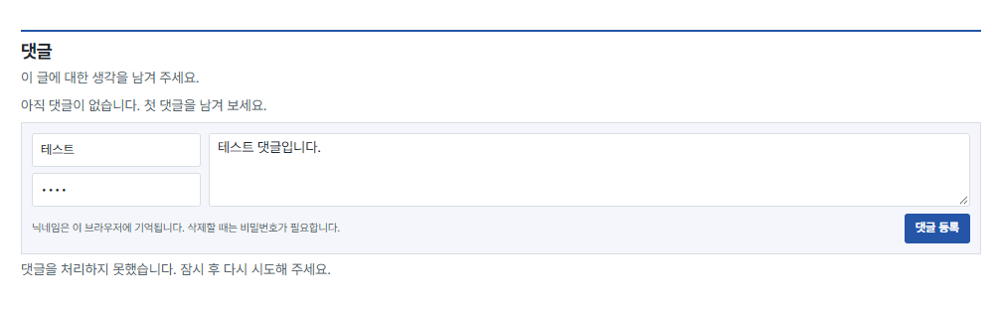
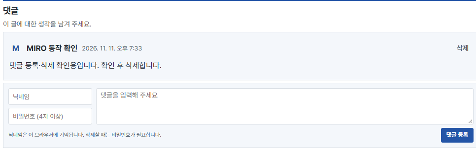
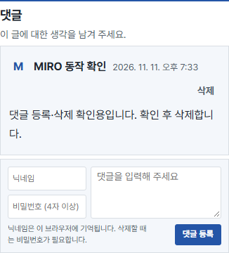
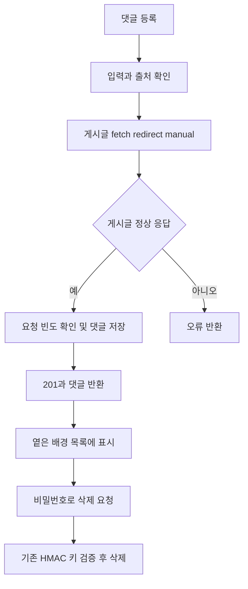

## 작업 결과

24aa400 main 푸시와 운영 사이트 반영을 완료했습니다. 기존 댓글 저장소와 검증 키를 보존해 확인용 댓글 등록201·화면 조회·비밀번호 삭제 성공을 확인했습니다.

## 변경 내용

### 적용 내용

댓글 등록 전 공개 게시글을 확인하는 fetch의 redirect 옵션을 error에서 manual로 변경했습니다. redirect 응답은 기존 page.ok 검사로 거절합니다. 서버 내부 로그에 오류 메시지를 추가했습니다. 댓글 목록과 비어 있는 목록 안내에 공통 옅은 배경과 테두리를 넣었습니다. CSS 쿼리를 갱신했습니다. 기존 댓글이 있어 기존 백엔드와 HMAC 검증 키를 유지했습니다.







## 전체 댓글 처리 코드
```javascript
async function publicPost(env, url, post) {
  const path = '/posts/' + encodeURIComponent(post) + '/';
  const page = url.origin === legacyOrigin
    ? await fetch(new URL(path, productionOrigin), {redirect: 'manual'})
    : await env.ASSETS.fetch(new Request(new URL(path, url)));
  await page.body?.cancel();
  return page.ok && page.headers.get('Content-Type')?.startsWith('text/html');
}


export async function onRequest({request, env}) {
  const isLegacyHost = new URL(request.url).origin === legacyOrigin;
  const fromProduction = isLegacyHost && request.headers.get('Origin') === productionOrigin;
  if (fromProduction && request.method === 'OPTIONS') {
    return new Response(null, {
      status: 204,
      headers: {
        'Access-Control-Allow-Origin': productionOrigin,
        'Access-Control-Allow-Methods': 'GET, POST, DELETE',
        'Access-Control-Allow-Headers': 'Content-Type',
        'Vary': 'Origin',
      },
    });
  }

  let response;
  try {
    response = await handle(request, env);
  } catch (error) {
    console.error('Comment request failed', {name: error.name, message: error.message});
    response = reply({error: '댓글을 처리하지 못했습니다. 잠시 후 다시 시도해 주세요.'}, 503);
  }
  if (isLegacyHost) response.headers.append('Vary', 'Origin');
  if (fromProduction) response.headers.set('Access-Control-Allow-Origin', productionOrigin);
  return response;
}

```



## 검증

실제 POST 실패를 재현하고 Wrangler tail에서 Invalid redirect value, must be one of follow or manual을 확인했습니다. DB 테이블 스키마와 기존 댓글1건을 확인했습니다. 수정 후 운영 POST 201로 확인용 댓글 ID6 생성, Chrome 데스크톱1440px과 모바일390px에서 목록 로딩1건 및 가로 넘침false, 배경 color(srgb 0.957059 0.966667 0.982745)을 확인했습니다. UI 비밀번호 삭제 후 deleted=true와 댓글을 삭제했습니다 상태를 확인했습니다. 확인용 댓글은 남기지 않았습니다. 기존 댓글은 수정·삭제하지 않았습니다. 노출한 비밀번호나 비밀키 없음. functions/api/comments.js 구문 확인 통과. 최소 정적 산출물만 이전 프로젝트에 배포하는 시도는 자동 승인 검토가 전체 사이트 삭제 위험으로 차단하여 실행되지 않았습니다. 대신 전체 소스에서 185 HTML과 5165 자산을 빌드해 보존 배포했습니다. 로그 확인용 배포 후 최종 수정 배포 https://8409bad6.miro-game.pages.dev 를 완료했습니다.

## 남은 사항

새 사이트에서 댓글은 기존 저장소와 키를 유지하는 이전 주소 API를 사용합니다. 전체 서비스 이전은 이번 수정 범위에 포함하지 않았습니다. 실제 등록·삭제 검증을 마쳤습니다.

## 작업 시간

- 제안 시간: 4~7분, 시작 2026-11-11 19:26:07 KST
- 실제로 완료된 시간: 실제 등록·조회·삭제 및 배경 확인 완료19:34:20 KST, 8분13초. 보고서 공개 확인 별도.
- XERJ: 미사용 — Cloudflare 실제 로그·DB 스키마·운영 API 응답·실제 브라우저 화면으로 확인했습니다.
